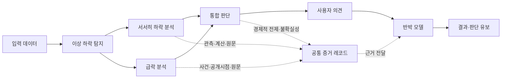

# FDS 프로젝트 전체 인계서 — Claude용

작성: 2026-10-22 / 개인 노트북에서 교육용 노트북 변경 pull 및 서버 재시작 후.

이 문서 하나만 전달해도 개발 경과와 안전 경계를 파악하도록 정리했다. 뒤쪽 부록에는 기존 개발·검증·금융 의사결정 문서의 전체 스냅샷을 포함한다. 부록의 과거 승인 대기 문구·포트·커밋 상태는 당시 기록이며, 현재 상태는 아래 본문을 우선한다. 이 인계서에 원본 CSV/XML·인증정보는 첨부하지 않았다.

## A. 현재 상태를 먼저 읽기

- 프로젝트명: **기업가치 훼손위험 탐지 및 검증 시스템**.
- 저장소: https://github.com/jayjoo21/fds_dashboard / main.
- 개인 노트북 실제 저장소 루트: `C:\code\fds_dashboard\fds_dashboard`. 바깥 `C:\code\fds_dashboard`와 혼동하지 않는다.
- 인계 작성 기준 HEAD: `f7ecc1c63e059dafb2d5eb4b23934dddee121f67`.
- 교육용 노트북에서 추가한 커밋 `f7ecc1c`를 개인 노트북에 fast-forward로 반영했다. 코드 충돌·stash·강제 push 없음.
- 현재 서버는 최신 코드로 **8770 포트에서 재시작 완료**. 기존 이 저장소의 8770 서버만 종료했고 다른 포트의 서버는 종료하지 않았다.
- 신규 인계서 작성 자체는 별도 작업이다. `f7ecc1c`에 이 파일이 포함되어 있다는 뜻이 아니며, 이번 요청에서는 이 문서의 추가 commit/push를 수행하지 않았다.
- 개요/DuPont은 전체 UI를 위한 **디자인 기준 v1 승인**. 금융 데이터 검증 완료나 모든 모형의 정의 승인과 다르다.
- 기업 분석·계보·가격 연결 완료. 교육용 노트북에서 데이터 처리/품질 화면과 Ohlson/F-Score 작업면 추가.
- 가장 최근 금융 조사 결론은 **팀 정의 결정 대기**. F-Score 총점·총LTD·F7 판정·Ohlson 기업가치·w·통합 위험점수를 확정하지 않는다.

## B. 사용자 의도와 개발 원칙

기존 GitHub 코드를 이어서 개발하는 프로젝트다. 새 프로젝트 생성이나 기존 UI/데이터 일괄 교체를 요구한 것이 아니다. 금융 원천·계산·공시 추적을 보존하며 UI를 개선해 왔다.

1. 실제 연구 데이터를 사용한다. 가짜 금융값을 실제 기업값처럼 만들지 않는다.
2. 출처는 CSV 컬럼 → 계산 입력 → fact_id → 원천 계정 → DART 보고서로 추적한다.
3. 공시일, 이용 가능일, 회계기간, 거래일을 구별한다. 미래 정정을 과거에 소급하지 않는다.
4. 식 일치, 금액 일치, 원문 검색 일치, 회계 의미 승인, 모형 정의 승인은 별개다.
5. 미확인·REVIEW·MISSING·오류 영향·비적용을 0이나 PASS로 바꾸지 않는다.
6. Drive 원본은 읽기 전용. 전체 다운로드·복사·미러링·자동 동기화·원본 변환 금지.
7. OAuth·PostgreSQL 이전·AWS 배포는 시작하지 않는다.
8. 같은 오류가 두 번 반복되거나 회계 의미 판단·정의 변경·인증·원본 수정·큰 구조 변경이 필요하면 PAUSE하고 근거와 대안을 보고한다.
9. 이미 확인한 경로와 작업 기록을 재사용한다. 전체 저장소·Drive를 매번 다시 탐색하지 않는다.
10. 연관된 두 화면씩 개발·검증하고 사용자 확인을 받는 방식이다. 다음 기능을 자동으로 전부 구현하지 않는다.

## C. 디자인 요구와 승인 이력

Toss의 화이트 배경·명료한 타이포그래피·절제된 블루·부드러운 조작, The Pudding의 대형 데이터 시각화·직접 조작·스크롤 설명을 결합한다. 일반 관리자 대시보드, 반복 숫자 카드/탭, 큰 제목 뒤 빈 공간, 작은 설명문 반복을 피한다.

처음에는 기존 운영 화면의 개요와 DuPont을 여러 차례 개선했으나 사용자는 색상/여백/CSS 반복 수정만으로 정보 구조가 달라지지 않는다고 반려했다. 이에 코드를 멈추고 `UI_REDESIGN_PLAN.md`를 작성했다. 전체 방향의 원칙 승인 후 기존 화면을 덮어쓰지 않는 `/design-preview`를 만들었다.

새 기준은 개요의 자료 변환 중심 연구 작업면과 DuPont의 PM×ATO 수익성 평면이다. 이후 선택/스크롤 충돌, 근거 버튼 가림, 큰 모달의 계층과 모바일 시트를 수정했다. 사용자는 이를 디자인 기준 v1으로 승인하고 다른 화면을 두 개씩 확장하도록 지시했다. DuPont의 작은 CSS 수정을 계속 반복하지 말라는 지시도 유지한다.

## D. 개발 타임라인

| 단계 | 한 일 | 결과/주의 |
|---|---|---|
| 기존 저장소 조사 | 구조·기술·기존 API·금융 계산·UI·데이터 누락 확인 | 과거 노트북 대화를 알고 있다고 가정하지 않음 |
| Drive 접근 | Windows 샌드박스 일반 조회 거부 후 정식 승인 읽기 조회 | 폴더 없음이 아니라 실행 환경 권한 차이였음 |
| 초기 개요/DuPont 개선 | 분기·수식·스크롤·출처 연결 개선 | 디자인 반복으로 반려; 역사적 버전 보존 |
| 전체 설계안 | PT·감사·실제 컬럼을 근거로 13개 화면 설계 | 구현과 설계를 구분 |
| 독립 프리뷰 | 개요 연구 작업면, DuPont 수익성 평면 | 기존 운영 화면 유지 |
| 선택 충돌 수정 | 직접 선택/스크롤 장면/관측/패널 상태 분리 | 자동 스크롤이 PM을 바꾸는 문제 해결 |
| 계산·근거 UX | 버튼 가림, 단계적 계산 전개, 보고서 강조, 모바일 전체 시트 | 기준 v1 승인 |
| 첫 묶음 | 실제 기업 분석 + 데이터 계보/공시 근거 | REVIEW 참고 표시, 선택 왕복 보존 |
| 가격 점검 | 기존 기본 파일 없음 확인, 실제 Drive CSV 발견 | 조정 여부 불명확하여 PAUSE |
| 제한적 가격 승인 | 미확인 조정 종가로 읽기 전용 연결 | CSV/API/UI 대조 및 7개 테스트 |
| Git 인계 | 코드·문서·캡처 push, 제외 규칙·실행 안내 추가 | e0502a5까지 개인 노트북 작업 |
| 교육용 둘째 묶음 | 데이터 처리 + 품질 검증 작업면 | 12개 테스트 기록; 사용자 결과 승인 기록 |
| 교육용 셋째 묶음 | Ohlson + F-Score 작업면 | 19개 테스트 기록; 금융 확정값 아님 |
| 추가 원천 조사 | F-Score 14입력, F5 LTD, F7 발행사건, 정의 차이 분석 | 코드/원본/기존 REVIEW 변경 없이 의사결정 문서 작성 |
| 이번 동기화 | f7ecc1c pull, 8770 재시작, 응답 확인 | 상세 브라우저/19개 테스트를 이번에 새로 실행한 것은 아님 |

## E. 코드 구조와 기술 스택

```text
server.py                     Python 표준 라이브러리 HTTP 서버/Store/API/정적 경로
lineage.py                    기존 금융 계산·명시적 fact_id·TTM 및 계보
provenance.py                 파일/컬럼/보고서/감사/원문 메타데이터
data_workbench.py             둘째 묶음: 변환 과정·감사 상세 읽기 전용 조회
model_workbench.py            셋째 묶음: Ohlson/F-Score 입력·시나리오·판정 게이트
start.ps1                     환경별 데이터 경로 주입 및 실행
test_dashboard.py             기존 회귀/가격 테스트
test_data_workbench.py         신규 데이터 작업면 테스트
test_model_workbench.py        신규 모형 작업면 테스트
web/index.html                기존 운영 UI 진입
web/dupont.js, dupont.css      기존 운영 화면의 DuPont/개요 개선 코드
web/design-preview/*          승인된 개요/DuPont 독립 디자인 기준
web/research/*                실제 기업 분석/계보
web/data-workbench/*          데이터 처리/품질
web/model-lab/*               Ohlson/F-Score
client/flow.jsx               기존 React Flow 번들 소스
client/package*.json          번들 의존성/잠금파일
derived/*                     기존 파생 메타데이터; 금융 원본 대체 아님
docs/*                        설계·검증·캡처·연구 결정 기록
```

서버 Python 3.10 이상. 프런트는 기본 JS/CSS/SVG와 기존 로컬 번들을 사용한다. 전체 앱이 React/Vite/Next.js 프로젝트인 것은 아니다. React Flow/Motion 번들은 기존에 포함되어 있으며 일반 실행에 npm 설치는 필요 없다. XML 일부 검색에 선택 의존성 lxml이 쓰일 수 있다. 잠금파일은 현재 추적되어 있다. README의 과거 dashboard/ 경로와 잠금파일 없음 문구는 현재 루트 구조와 차이가 있어 그대로 실행하지 않는다.

## F. 현재 페이지 주소와 완료 수준

기준 URL: `http://127.0.0.1:8770`

| 경로 | 용도 | 현재 수준 |
|---|---|---|
| `/` | 기존 운영 화면 | 보존; 새 디자인 전체 적용 아님 |
| `/design-preview/overview` | 프로젝트 개요 | 디자인 기준 v1 |
| `/design-preview/dupont` | 수정 DuPont | 기준 v1, 평면/근거 탐색 |
| `/research/company` | 실제 기업 분석 | 가격/재무/공시 시점 계층 |
| `/research/lineage` | 데이터 계보·공시 근거 | 계산→원천→보고서 |
| `/research/pipeline` | 데이터 수집·처리 | 둘째 묶음 구현 |
| `/research/quality` | 데이터 품질·검증 | 둘째 묶음 구현 |
| `/research/ohlson` | Ohlson 입력 탐색 | 입력·가정 RI 산술; 가치평가 미완 |
| `/research/fscore` | F-Score 9조건 탐색 | 미판정 게이트; 확정 총점 없음 |

서서히 하락, 급락, 반박, 개발 현황은 새 기준 전체 구현 완료가 아니다. 기존 설명/기획/기초 코드를 새 모형의 실증 완료로 오인하지 않는다.

## G. 데이터 위치와 외부 경로

개인 노트북에서 확인한 경로다. 다른 PC의 드라이브 문자/계정 경로는 다를 수 있다. 코드는 G:를 필수값으로 고정하지 않는다.

```text
자료 루트
G:\내 드라이브\skku_fds_main

재무 최종 CSV (DataDir)
G:\내 드라이브\skku_fds_main\데이터\Open Dart\OpenDART_TTM_팀원전달_최종본(지해)\csv버전

독립 감사 (AuditDir)
G:\내 드라이브\skku_fds_main\데이터\Open Dart\OpenDART_전수재검증_검토용(나현)

귀속/원본 계정 (OwnerAccounts)
G:\내 드라이브\skku_fds_main\데이터\Open Dart\OpenDART_보완통합본\04_전체원본계정_통합.csv

가격 (PriceCsv)
G:\내 드라이브\skku_fds_main\데이터\KRX\1_개별종목가격.csv

기획
G:\내 드라이브\skku_fds_main\기획PT\기획PT_261015.pdf
G:\내 드라이브\skku_fds_main\기획PT\기업가치_훼손위험_3대모형_요약.pptx
```

XML 일부는 DataDir 아래 `검증·보완자료\공시원문`에 있다. 교육용 노트북의 직접 검증은 `C:\Users\SD1-06\Documents\Codex\2026-10-19\open-dart-zip-txt\outputs\OpenDART_보완자료\공시원문\20190401003890_20190401003890.xml` 보존 사본을 사용했다. 이 C: 경로가 개인 노트북에도 있다고 가정하지 않는다. 교육용의 업무보고서는 `C:\Users\SD1-06\Downloads\업무보고서 (개발_데이터 팀).pdf`; 이 파일도 Git에는 없다.

증자감자/주식수 추가 원본은 같은 OpenDART_보완통합본의 `08_증자감자현황_API원본.csv`, `08_발행주식수현황_API원본.csv`다. 파일이 존재한다는 사실과 사건/PIT/모형 입력 인증은 별개다. DB dump/backup은 자료 폴더에 존재하나 복원하지 않았다.

## H. 재무 CSV 구조와 식별자

주요 파일: 01 공시버전/이용일, 02 원문기간별 금액, 03 분기변환, 08 핵심지표, 25 공시시점별 NOA/DuPont/Ohlson 입력, 26 일별 입력, 기업_종목_매핑표.csv 및 검증·보완자료.

- stock_code: 6자리 문자열, 앞자리 0 유지. corp_code와 다른 코드다.
- fs_div: CFS 연결/OFS 별도. 서로 조용히 대체하지 않는다.
- rcept_no/source_receipt/trigger_receipt: 각각 선택 공시·원천 공시·이벤트 유발 공시 문맥을 확인한다.
- fact_id: 명시적 원천 행 ID. 이름·금액만 비슷한 후보를 확정 fact 연결로 만들지 않는다.
- publication_date: 공시일. available_from: 프로젝트 이용 가능일. trade_date: 실제 거래일.
- fiscal_year/quarter/period_kind: 회계기간과 stock/ytd/단독분기 구별.
- amount_krw: 원 단위 원천 금액. UI 억원/퍼센트 표시와 혼동 금지.
- TTM은 한 보고서가 아니라 연간+현재누적−전년동기누적 등 여러 fact·보고서의 구성이다.

## I. 금융 데이터 표시 정책

기본적으로 미승인 재무값을 공식 결과처럼 표시하지 않는다. 사용자가 REVIEW 참고값 보기를 켤 때 실제 연결된 CSV 기록과 검사 범위를 함께 보인다. 산식/합산 대조 통과만으로 원천 의미 PASS를 주지 않는다. 상위 오류 영향·산식 불일치·합산 미확정이면 관련 참고 금액도 차단한다. 결측은 `—` 또는 미연결/미판정 사유를 표시한다.

대표 오류: 우전앤한단 `052270`, OFS, 선택 공시 `20180515000925`(2018Q1)의 매출 원천 및 파생 PM/ATO/OpROA 영향. 원천 오류 사실은 해당 감사 키에 연결하며 다른 기업에 전파하지 않는다. 원본 금액을 대체값으로 수정하지 않았다.

감사의 금액 PASS/의미 REVIEW 구별은 필수다. 교육용 조사에서 `원천계정_금액대조.csv` 37,603행은 PASS/REVIEW 37,600행, FAIL/FAIL 3행이었다는 기록이 있다. 이것은 이번 개인 노트북에서 다시 전수 실행한 결과가 아니다. 의미 PASS가 없는 상태에서 F-Score 게이트를 해제하지 않는다.

## J. 프로젝트 개요 구현

단순 가로 8단계가 아니라 입력→탐지→서서히/급락 분기→통합→사용자 의견→반박→결과를 자료 변환 작업면으로 표현한다. 자료 종이 묶음, 기간/관측, 증거 레코드 등 단계별 표현이 다르다. 클릭/스크롤에 따라 선택 단계와 실제 공시 메타데이터가 바뀐다. 의견은 임시 UI 입력이지 DB 저장/자동 논증 검증 완료가 아니다. 모바일은 작업면과 단계 탐색을 재배치한다.

## K. DuPont 구현과 고정 정의

```text
NOA_t = assets_t - current_liabilities_t
avg_noa = (NOA_t + NOA_t_4q) / 2
PM = operating_profit_ttm / sales_ttm
ATO = sales_ttm / avg_noa
OpROA = PM * ATO
```

평균은 당기/전년 동분기 NOA이며 직전분기나 평균총자산으로 변경하지 않는다. x축 ATO, y축 PM, 실제 공시 관측을 연결한다. 동일 OpROA 관계선은 수학 관계이며 위험 경계/적정값이 아니다. REVIEW 보기 off면 가짜 좌표를 채우지 않는다. 결측/감사 오류 영향점 제외. 켐트로닉스 예시 21공시 중 결측 제외 18개 REVIEW 평면 관측을 과거 브라우저에서 확인했다.

PM/ATO/OpROA 직접 선택 시 관련 축·분수·계산 경로와 원천이 바뀐다. PM은 영업이익TTM/매출TTM, ATO는 매출TTM/평균NOA→당기/전년NOA→총자산/유동부채로 내려간다. 전체 설계안의 두 시점 기여 분해·모든 시계열 구성 등은 해당 코드 확인 없이 전부 구현 완료라고 단정하지 않는다.

## L. 해결한 선택 충돌·근거 UI 오류

처음 오류는 자동 스크롤이 IntersectionObserver를 작동시켜 사용자 PM 선택을 ATO/OpROA로 바꾼 것이었다. 상태를 아래처럼 분리했다.

- selectedMetric: 사용자의 직접 변수 선택.
- activeStoryScene: 스크롤 설명 장면. Observer는 이 상태만 변경.
- selectedObservation: 기업/제표/기간/공시 맥락.
- evidencePanelState: 열림/키/관측 상태.

기업/기간 변경 시 관측과 근거를 비우고 새 범위의 관측을 선택한다. 변수는 유지 정책. 요청 세대 ID로 이전 비동기 응답 차단. 패널 자동 스크롤/열기/닫기는 변수나 공시를 바꾸지 않는다.

sticky 설명이 근거 버튼을 가리던 문제는 정상 문서 흐름으로 분리하여 마우스 클릭까지 확인했다. 큰 모달은 선택 변수→식→입력/검증상태→접힌 구성항 순으로 바꿨다. 입력을 펼쳐 TTM/fact를 보고 선택하면 관련 보고서를 우선 강조한다. 모바일은 전체 화면 dialog 시트, 배경 스크롤 차단·내부 스크롤·고정 닫기·Escape·Tab/Shift+Tab·호출 버튼 포커스 복귀를 지원한다.

## M. 실제 기업 분석과 계보

기업 화면은 실제 거래일 가격층, 공시 이용일 재무층, 공시 이벤트층을 공통 시간축으로 표시한다. 수익성/영업 규모/공시 시점 질문과 두 끝점 브러시가 있다. 재무는 공시 관측점이며 일별 보간하지 않는다.

계보 화면은 결과 컬럼→계산 입력→원천 fact→보고서 그래프와 문서 검사기를 연결한다. Hover/focus 경로 강조, 클릭 원천 변경, DART 링크, 표/열/단위/계정/기간 정보와 미확보 상태를 표시한다. 실제 XML 없으면 인용을 생성하지 않는다.

URL 맥락에는 stock/fs/from/asof/receipt/metric/review/question/brushFrom/brushTo/input/fact_id/report 및 price_date가 쓰인다. 화면 왕복·새로고침에서 유효한 선택을 복원한다. 가격 선택은 재무 공시 선택과 독립이다.

## N. 가격 연결의 원인·승인·검증

원래 서버 기본은 저장소 상위 `KRX_20종목_2015-2025_확보자료/01_종목가격_2015-2025_수정주가미확인.csv`였고 개인 노트북에 없어서 빈 배열을 반환했다. 실제 Drive 가격은 존재했다. 수정주가 여부가 없어 처음 PAUSE했고, 사용자 승인 후 **조정 여부 미확인 종가**로 제한 연결했다.

`DART_PRICE_CSV` / `start.ps1 -PriceCsv` 주입, 기존 기본값 유지, 원본 읽기 전용. 컬럼 stock_code/trade_date/close/daily_change_pct. 거래량 없음. close 원값 그대로, 기존 숫자 파싱이 원문 십진값과 동일함을 전 행 비교했다. daily_change_pct는 원본 행에만 보존하고 분석 결과로 반환/표시/재계산하지 않는다.

| 검증 | 결과 |
|---|---|
| 전체 행/종목 | 50,317 / 20 |
| 켐트로닉스 전체 | 2,700, 2015-01-02~2025-12-30 |
| 2015~2019 선택 | CSV/API/UI 각 1,227 |
| 코드 매핑/앞자리0 | 일치/보존 |
| 중복 종목+날짜/역순/필수결측/잘못된 날짜/비양수·비유한 종가 | 발견0 |
| 2015-01-02 | CSV/API/UI 9,650원 |
| 2017-06-28 | CSV/API/UI 6,540원 |
| 2019-12-30 | CSV/API/UI 18,050원 |
| 2019-12-29 | 가격 관측 없음 |
| 2010 구간 | API/UI 0건 |

가격 원본 SHA256: `fbdfa5eaddf5dde2855301c89876e96919eff0498d8f316c6a22aff702dd4755` (당시 읽기 전후 동일).

API points의 date/close 계약은 유지하고 출처·단위·관측수·unverified/not_provided/not_fully_validated 상태를 추가했다. UI 종가(원), 실제 거래일, 거래량 미제공, 전체 품질 미검증 표시. 비관측일을 만들지 않으며 가격 날짜 선택/이전·다음 실제 관측/키보드 지원. 연속 달력일 사이가 아니면 경로를 끊어 빈 날짜를 보간하지 않는다. 모바일 입력 draft가 재렌더링에 사라지던 문제는 priceDraft를 분리해 수정했다.

미검증: 조정 여부, 분할/기업행동, 공식 거래소 가격 대조, 휴장/거래정지 캘린더, 극단값 신뢰성. 데이터 날짜 합집합 대조를 공식 거래일 검증이라고 부르지 않는다. 수익률·CUSUM·AR/CAR·급락/가치훼손 경보 없음.

## O. 둘째 묶음: 데이터 처리와 품질

교육용 커밋에서 data_workbench.py와 web/data-workbench를 추가했다. pipeline-detail은 실제 저장된 원천/분기/TTM/이벤트/일별 연결을 보여주고, audit-detail은 정확한 기업/제표/원천키/저장금액이 대응하는 감사만 붙인다. 비슷한 금액이나 다른 키의 PASS를 상속하지 않는다. REVIEW/미연결/오류 영향을 구분한다. 상세 API는 **단일 receipt가 필수**다.

사용자는 두 화면 구현 결과를 승인한 기록이 있으나 금융 의미 승인은 아니다. 당시 기존7+신규5=12개 테스트, 원천14파일 해시 보존, 데스크톱/모바일/상태 전환 검증 기록이 있다.

## P. 셋째 묶음: Ohlson

현재 구현은 owner 자본/owner NI TTM/전년 동분기 자본과 출처를 탐색하고, 명시적으로 동의한 경우 `RI = NI_owner_TTM - r_e × prior_parent_equity` 가정 산술을 보인다. 초기 8.5%는 시장 확정 추정치가 아니라 프로토타입 가정. 시나리오 범위는0~30%. OFS/결측을 다른 값으로 대체하지 않는다.

기록된 켐트로닉스 CFS 2019Q3 값: 현재 자본94,913,084,567원, owner NI TTM25,489,766,525원, 전년 동분기 자본78,197,600,711원. 8.5% 산술18,842,970,464.57원은 REVIEW 참고 계산이다. 기업가치·미래 RI·clean surplus·ω/Q·시장 내재w는 미완이다. 숫자 재현을 의미 승인으로 확대하지 않는다. 귀속 입력에는 확정 fact_id 없는 후보 연결 한계가 남아 있다.

## Q. 셋째 묶음: F-Score

연간 t/t-1 비교이며 전기 ROA에 t-2 자산이 필요하다. F9는 총자산 회전율이고 DuPont NOA ATO가 아니다. 엄격한 >/< 비교를 사용하며 개선과 동률을 혼합하지 않는다.

| 조건 | 현재 코드 식 |
|---|---|
| F1 | NI_t/A_(t-1)>0 |
| F2 | CFO_t/A_(t-1)>0 |
| F3 | NI_t/A_(t-1)>NI_(t-1)/A_(t-2) |
| F4 | (NI_t-CFO_t)/A_(t-1)<0 |
| F5 | LTD_t/avg(A_t,A_(t-1)) < LTD_(t-1)/avg(A_(t-1),A_(t-2)) |
| F6 | CA_t/CL_t > CA_(t-1)/CL_(t-1) |
| F7 | 해당 연도 보통주 신규발행 없음 |
| F8 | GP_t/REV_t > GP_(t-1)/REV_(t-1) |
| F9 | REV_t/avg(A_t,A_(t-1)) > REV_(t-1)/avg(A_(t-1),A_(t-2)) |

필수 입력의 정확한 의미 PASS가 있어야 1/0을 판정한다. REVIEW/MISSING/비정상 분모는 None(미판정), 0점 아님. 최신 기록 사례는 2019-12-31 기준 2018 연간/20190401003890, 14직접입력 REVIEW, LTD0/LTD1/ISSUE0 MISSING, judged0/unjudged9/score=null. 2019-04-01에는 이용일2019-04-02인 2018보고서를 쓰지 않고 2017로 제한했다.

현재 annual_input은 quarter4를 보지만 사업보고서 코드11011을 무조건 강제하지 않아 분·반기보고서의 연간 비교열도 후보가 될 수 있다. 팀 문서의 사업보고서 전용 원칙과 차이가 있어 D02 결정 전 임의 변경하지 않는다.

## R. 교육용 노트북의 원천 검증 3건

### R1. F-Score 14입력 파일럿

대상은 켐트로닉스 CFS 2018 사업보고서20190401003890 안의 2018/2017/2016 비교열이다. 14입력의 원문 제표·계정·기간·단위·부호·셀과02/04 대응을 확인했다. 다른 기업/원사업보고서/과거 시점으로 확대 인증하지 않는다. 비교열은2019-04-02에 알 수 있는 값이며2016/2017 당시 이용 가능한 값으로 소급하지 않는다. 의미 REVIEW를 변경하거나 F점수를 계산하지 않았다.

보존XML SHA256 `e92e94700b6c3d6e1ca216da468c5bcfb05939c84d6ad60effe7134456c9300d`. XML 선언UTF-8과 실제CP949 해석 차이를 기록했고 원본 바이트를 변경하지 않았다. API account_id는 XML 본문에 직접 태그되어 있다는 뜻이 아니라 키·기간·금액 대조로 연결한 후보/관계다.

### R2. F5 총장기부채

장기차입금·전환증권 유동/비유동 구성과 상위합계 중복 관계를 일부 확인했다. 유동성차입금120억원의 단기차입금 대체가 있으나 포함/제외를 확정하지 않았다. 2017 비유동 전환사채 공란/대시도0으로 만들지 않았다. 총LTD 합계/F5비율/점수 미산출.

### R3. F7 발행사건

2018-01-26 제7회 전환사채 전환권행사로 보통주198,019주가 기록된 사실을 확인했다. 최초 공시·정정·철회·납입/상장일 연결 및 F7포함 범위는 미확정. 증자감자 API는 발행법인 단위이고 fs_div가 없어 임의 CFS 사건으로 분류하지 않았다. 행 없음은 미발행 증거가 아니며 F7 0/1은 미산출.

## S. 반드시 팀 결정을 받아야 하는 10항목

`FINANCIAL_MODEL_DECISIONS_REQUIRED.md`의 D01~D10은 **모두 미결정**인 양식이다. 코드의 임시 동작도 최종 금융 정의가 아니다.

1. D01 F-Score NI: 전체순이익 vs owner 귀속순이익.
2. D02 사업보고서/비교열/정정 원천 선택 및 PIT 버전.
3. D03 총LTD 비중복 범위와120억원 대체분 포함 여부.
4. D04 2017전환사채 공란·대시·주석 차이의 수치화 근거.
5. D05 F7 유상증자만인지 전환권행사 등도 포함인지.
6. D06 사건 귀속일·정정/철회·발행 없음 증거 기준.
7. D07 Ohlson w의 괄호/정확한 식, 시장Prem/v/r 가정.
8. D08 DuPont 평균NOA판과 새 업무보고서 평균총자산판의 공식 구분.
9. D09 당시KSIC개정·비교집단·산업중위수 정의.
10. D10 매수/현재 변화량→위험점수 규칙과 검증.

특히 새 업무보고서의 w 인쇄식은 괄호 범위가 불명확하고 PT 후보식과 다르다. 임의 해석하여 구현하지 않는다. 산업ETF는 KSIC집단이 아니며 손실표본20사를 산업대표로 쓰지 않는다. 가격CSV에 시가총액/일별 상장주식수가 없으므로 Ohlson 시장Prem을 close만으로 만들 수 없다.

## T. API 지도

기존 API: `/api/data-status`, `/api/catalog`, `/api/project`, `/api/series`, `/api/lineage`, `/api/evidence`, `/api/schema`, `/api/files`, `/api/file-profile`, `/api/column`, `/api/pipeline-quality`, `/api/quarter-compare`, `/api/reports`, `/api/source-fact`, `/api/reviews`, `/api/xml`, `/api/prices`.

신규: `/api/pipeline-detail`, `/api/audit-detail`, `/api/model-inputs?model=ohlson|fscore`.

공통 stock/fs/asof와 API별 from/receipt/metric/fact_id 등을 확인한다. 가격은 from/asof 필터, 모형은 model/from/asof와 rate(.085 등) 인자를 사용한다. pipeline/audit 상세는 receipt가 필수다. 기존 Store/PIT/계보를 재사용한다. 로컬 Host만 허용하며 인증을 갖춘 운영 공개 서버는 아니다. 데이터가 없으면 data-status로 확인하고 금융 API 503을 가짜값으로 덮지 않는다.

## U. 실행·재시작 방법

```powershell
Set-Location C:\code\fds_dashboard\fds_dashboard
git status --short
git switch main
git pull --ff-only origin main

$financeDir = 'G:\내 드라이브\skku_fds_main\데이터\Open Dart\OpenDART_TTM_팀원전달_최종본(지해)\csv버전'
$auditDir = 'G:\내 드라이브\skku_fds_main\데이터\Open Dart\OpenDART_전수재검증_검토용(나현)'
$ownerCsv = 'G:\내 드라이브\skku_fds_main\데이터\Open Dart\OpenDART_보완통합본\04_전체원본계정_통합.csv'
$priceCsv = 'G:\내 드라이브\skku_fds_main\데이터\KRX\1_개별종목가격.csv'
.\start.ps1 -Port 8770 -DataDir $financeDir -AuditDir $auditDir -OwnerAccounts $ownerCsv -PriceCsv $priceCsv
```

환경변수는 `DART_DATA_DIR`, `DART_AUDIT_DIR`, `DART_OWNER_ACCOUNTS`, `DART_PRICE_CSV`다. start.ps1이 프로세스 환경으로 전달한다. 인자가 없으면 기존 기본값을 사용한다. 기본 ROOT는 server.py의 상위 폴더이므로 데이터 위치를 저장소 내부로 오인하지 않는다. 직접 python 실행이나 테스트는 위 환경변수를 별도로 설정해야 한다. 런처는 사용자 Codex Python이 없으면 PATH의 python을 사용한다.

다른 노트북에서는 먼저 같은 자료가 읽히는지 확인하고 실제 경로만 바꾼다. 포트 충돌 때는 해당 프로세스의 실행 경로/명령행을 확인하고 이 FDS 서버만 종료한다. 화면만 새로고침해서 이미 실행 중인 Python 코드가 바뀌었다고 가정하지 않는다.

## V. 테스트와 실제 검증의 범위

개인 노트북 가격 연결 때 7개, 교육용 둘째 묶음 12개, 셋째 묶음 19개 **선별 테스트** 통과 기록이 있다. test_dashboard의 모든 테스트가 현재 데이터에서 통과했다는 뜻이 아니다. 일부 과거 테스트는 51 XML/이전 경로/고정 자료 전제를 가진다.

대표 7개는 다음과 같다.

- identifiers_and_counts
- formulas_without_replacing_csv
- asof_and_unknown_receipt_fail_closed
- independent_confirmed_errors_are_flagged_not_silently_replaced
- fact_links_and_ttm_multiple_receipts
- price_path_and_raw_source_preservation
- real_price_csv_match_and_period_cutoff

교육용 신규 5개는 감사 범위 일치/오류 영향/일별 저장행/PASS 오상속 차단/실제 TTM 구성, 신규 7개는 연간 선택/PIT/전년 동분기/OFS·결측/REVIEW 미판정/시나리오 범위/엄격 판정 검사다. 정확한 이름과 실행 기록은 부록 batch2/batch3-tests에 있다.

```powershell
# 위 데이터 경로를 환경변수로 지정한 같은 셸에서
$env:DART_DATA_DIR = $financeDir
$env:DART_AUDIT_DIR = $auditDir
$env:DART_OWNER_ACCOUNTS = $ownerCsv
$env:DART_PRICE_CSV = $priceCsv
python -m unittest test_dashboard.DashboardTests.test_identifiers_and_counts test_dashboard.DashboardTests.test_formulas_without_replacing_csv test_dashboard.DashboardTests.test_asof_and_unknown_receipt_fail_closed test_dashboard.DashboardTests.test_independent_confirmed_errors_are_flagged_not_silently_replaced test_dashboard.DashboardTests.test_fact_links_and_ttm_multiple_receipts test_dashboard.DashboardTests.test_price_path_and_raw_source_preservation test_dashboard.DashboardTests.test_real_price_csv_match_and_period_cutoff test_data_workbench test_model_workbench -v
node --check web/design-preview/app.js
node --check web/research/app.js
node --check web/data-workbench/app.js
node --check web/model-lab/app.js
```

과거 브라우저 검증은 1440×1000/390×844, Hover/Click/Scroll/키보드/포커스/모바일/동작 감소를 포함한다. OS reduced-motion 설정 변경이나 모든 기업/접근성 도구/인위적 지연 전수 검증은 아니다. 캡처와 옛 JSON을 현재 실행 PASS로 재사용하지 않는다.

**이번 재시작 후 새로 확인한 것:** data-status와 8개 주요 화면 HTTP 200, 가격 1,227건(첫 9,650원/마지막 18,050원), Ohlson/F-Score 입력 API 각각 200, receipt=20191113000024 지정 pipeline/audit 상세 API 각각 200. 처음 상세 API에서 receipt를 누락한 요청은 단일 공시 필수 오류로 거부되었고, 필수값을 추가하여 확인했다. 누락 요청 때 PowerShell의 이전 응답 변수가 재사용되어 출력된 상태는 성공 증거에서 제외했다. 이번에 19개 테스트나 새 브라우저 상호작용 전수 검증을 실행하지 않았다.

## W. Git 이력·제외 규칙

| 커밋 | 내용 |
|---|---|
| 46b976b | 개인 노트북 작업 시작 기존 기반 |
| 4d0ebd4 | 가격 연결 원인/PAUSE 문서 |
| 7cab801 | 기존 미커밋 UI 보존, 기업/계보, 가격 연결 코드 및 검증 |
| 8898800 | 남은 디자인 캡처/검증 스냅샷 |
| e0502a5 | .gitignore·교육용 인계 안내 |
| f7ecc1c | 교육용 데이터/모형 작업면 및 금융 원천 검증 22파일 |

e0502a5 때 실제 원격 해시 일치를 확인했다. 이후 교육용 추가 f7ecc1c를 fetch해 로컬 0/원격 1커밋 차이를 확인한 뒤 ff-only로 반영했다. 금융 원본은 커밋하지 않았다.

.gitignore는 .env류/인증 JSON/키·인증서/DB·dump·backup/CSV·XML/node_modules/pyc·venv·log를 제외한다. 단 이미 추적되던 client/node_modules와 __pycache__는 삭제하거나 추적 해제하지 않아 ignore가 소급 적용되지 않는다. 이는 정리 후보일 뿐 이번에 임의 삭제하지 않았다. 추적된 캡처는 유지한다. 과거 민감정보 패턴 조회에서 발견되지 않았으나 완전한 보안 감사라는 뜻은 아니다.

## X. 문서·캡처를 읽는 순서와 함정

1. 이 통합 인계 본문: 최신 상태.
2. FINANCIAL_MODEL_DECISIONS_REQUIRED.md: 현재 막힌 팀 판단.
3. MODEL_DEFINITION_GAP_ANALYSIS.md: 코드/PT/업무보고서 차이.
4. FSCORE_SOURCE_VERIFICATION_PILOT.md, F5/F7 문서: 제한된 원천 검증.
5. WORK_STATUS.md: 시간순 추가 로그. 맨 위의 오래된 현재 Phase/중간 미연결/미커밋 문구보다 뒤쪽 최신 기록과 커밋 상태를 우선한다.
6. UI_REDESIGN_PLAN.md: 전체 13화면 설계. 작성 당시 승인 전 문구는 현재 v1 승인 이력과 구분한다.
7. price-*.json, batch2/3-tests, batch3-browser-check/preservation: 당시 증거.

가격 최신 캡처는 docs/price-connected-desktop.jpg, price-connected-mobile.jpg다. 기준 프리뷰 관련 evidence-ux-after-*.jpg, preview-fix-pm-*.jpg와 batch1-*.jpg도 추적 중이다.

교육용 batch3 화면 PNG는 `C:/Users/SD1-06/.codex/visualizations/2026/10/22/01a16224-7102-7c71-a6f9-91d1a7a67daf`에 기록되어 있다. 현재 개인 PC에 동일 파일이 있거나 Git으로 이전되었다고 가정하지 않는다. 아래 부록에 해당 이미지 자체는 포함하지 않았다. 이미지가 없어도 글만으로 개발 맥락을 전달하도록 본문과 원문 기록을 통합했다.

## Y. 남은 일과 추천 다음 순서

1. 새 대화에서 git status/HEAD를 확인하고 이 인계와 현재 결정 문서부터 읽는다.
2. 서버/실제 데이터 경로 접근을 제한적으로 확인한다. 없으면 정확한 누락/권한을 보고한다.
3. 사용자가 원하는 다음 작업이 정의 회의인지, 원천 조사인지, 새 UI인지 범위를 정한다. 현재 D01~D10을 자의적으로 채택하지 않는다.
4. 팀 결정 시 선택/범위/근거/승인자/일자/규칙 버전을 기록한다. 정의 승인과 개별 원천 PASS 및 구현 착수 승인을 분리한다.
5. 코드 변경을 승인받으면 기존 NOA판·PIT·REVIEW 게이트를 보존하고 대상 모형에 한정해 구현한다.
6. 두 화면씩 실제 API/CSV/브라우저/모바일/키보드/Reduced motion 검증 후 멈춘다.

아직 하지 않은 것:

- 수정주가/거래량 생성, 새로운 수익률 분석.
- CUSUM/AR/CAR 실증, 급락/가치훼손 경보.
- 완전 F-Score 점수, F5 총LTD 및 F7 확정 판정.
- Ohlson 기업가치/w/시장Prem.
- 산업 중위수/상대지표, 두 시점 위험점수 매핑.
- 반박 자동 판정.
- OAuth/자동 동기화, DB 복원/이전, AWS 배포.

기존 설명 UI나 원재료 존재를 완료로 세지 않는다. 신규 금융 정의나 원본 수정은 이 인계 요청의 승인 범위가 아니다.

## Z. Claude에게 바로 전달할 시작 지시

> 기존 FDS 저장소 main의 f7ecc1c 이후 상태를 이어받아라. 이 통합 인계와 부록을 먼저 읽고 실제 git status/HEAD를 확인하라. 새 프로젝트를 만들거나 기준 v1 DuPont을 반복 CSS 수정하지 마라. 금융 원본은 읽기 전용이며 NOA 정의/PIT/REVIEW/미판정 게이트를 보존하라. 교육용에서 추가한 Ohlson/F-Score와 데이터 처리/품질 화면은 구현됐지만 모형 전체 검증은 아니다. D01~D10은 미결정이며 F5 총LTD/F7 점수/전체 F점수/w/기업가치/위험점수를 임의 확정하지 마라. 새 작업 범위를 사용자와 정하고 해당 범위만 구현·검증하라. 오래된 WORK_STATUS 헤더/포트/승인 전 문구보다 최신 커밋·결정 기록을 우선하라. 같은 오류 반복/정의 판단/인증/원본 수정 필요 시 멈추고 근거와 대안을 보고하라.

---

# 부록 — 기존 근거 문서 전체 스냅샷

아래는 인계 작성 시 저장소 문서를 그대로 붙인 것이다. 역사적 표현과 현재 상태를 구별한다. 표·실제 금액·식별자·경로·테스트 결과의 세부 근거는 여기서 확인할 수 있다. 원본 금융 파일 자체는 포함하지 않는다.


---

## 부록 1. docs/WORK_STATUS.md

# FDS 작업 상태 — 2026-10-22 / Phase 3 가독성·표시 정책 보완

## 현재 Phase

두 기준 화면의 기존 분기·수식·스크롤·계보를 유지한 보완 구현 및 브라우저 검증 수행. 사용자 최종 디자인 확인 대기. 다른 화면 확장·OAuth·동기화·DB·AWS는 수행하지 않음.

## 이번 변경

- `web/dupont.js`: 개요의 선택 단계 설명을 핵심 입력/계산·처리/산출물/검증 범위로 정리. DuPont 입력에 분자·분모 및 PM/ATO 경로 표시. 직접 선택과 스크롤에 따른 분해 상태 유지. 같은 시점 비교·선택 변수 근거 링크를 수식 바로 아래에 연결.
- `web/dupont.css`: 선택 노드의 실색·굵은 경로·명확한 비선택 대비. 본문·보조 글자 크기와 대비 강화. 지도 높이/장면 간격을 줄이고 기존 큰 수식 유지. 모바일에서는 긴 내부 변수명 대신 계정 설명을 우선 노출(원래 키는 접근성 이름과 계보에 유지).
- `docs/WORK_STATUS.md`와 `docs/*-v3-*.jpg`: 현재 기록·비교 캡처.
- 이번에는 서버·계산·공시 추적 코드와 Drive 원본을 변경하지 않음. 원본 복사·다운로드·수정·삭제·인증정보 변경 없음.

## 감사 자료를 확인한 표시 정책

읽은 자료: 기존 경로의 `전체_데이터_재검증_종합보고서.md`, `스키마_키_판정기준.md`, 최종본 `검증·보완자료/데이터품질_재검증_요약.json`.

보고서 §8은 기업코드·공식 날짜·PIT·산식 차원의 검사 결과를 사용할 수 있다고 하며, 원천 의미 전체 PASS를 금지함. §4는 우전 비정상 원천과 파생 지표 제외, 대체금액 미확정을 명시함. 이 구분을 화면에 반영함:

1. 기본 화면에서 금융값의 최종 결과는 미표시. 사용자가 `검토 중 CSV 참고값 보기`를 켜면 별도 참고 영역만 열림.
2. 기존 API의 formula_matches / traces.matches_csv가 확인된 경우 `연결·산식 대조 확인 / 원천 의미 REVIEW`로 표시. 자동 의미 인증은 아님.
3. 값과 연결은 있으나 그 검사 확인이 없는 경우 `CSV 원값 기록 / 원천 의미·계산 범위 추가 검토`. 원천 fact도 회계 의미 완료로 분류하지 않음.
4. 선택 노드와 모든 상위 입력의 audit_issues, 산식 불일치 또는 합산 미확정이 있으면 선택 계산의 참고 금액을 차단. 결측·미연결은 `—`. 알려진 오류를 대체금액으로 고치지 않음.
5. 참고 영역에 기업·CFS/OFS·기간·이용 가능일, API가 CSV에서 연결한 수치와 단위를 함께 표시. 큰 표시값은 기존 nodeValue의 표시 단위/반올림이며 아래 수치가 함께 표시됨. 승인된 공식 결과가 아님을 명시함.
6. 시점 변경 시 이전 참고값을 즉시 비우고 새 계보 응답만 반영. 금액 시계열을 생성하거나 기본 결과를 검증 완료로 승격하지 않음.

이는 관측된 CSV 수치와 검사 범위를 구분하는 표시 정책임. 회계적 정상 금액 채택이나 원인 판정·대체금액 산정은 수행하지 않음. 감사의 모든 REVIEW 목록을 새로 전수 원문 검증했다는 뜻이 아님.

## 이번 실제 검증

- `node --check web/dupont.js`, `git diff --check`: 통과. 기존 README 줄바꿈 경고만 있음.
- 기존 테스트 4개 재실행 통과(11.322초): identifiers_and_counts, formulas_without_replacing_csv, asof_and_unknown_receipt_fail_closed, independent_confirmed_errors_are_flagged_not_silently_replaced. 원본은 읽기 전용. 전체 테스트/회계 의미 전수 검증을 완료한 것은 아님.
- 켐트로닉스 CFS 2019 Q3: 참고 영역에서 PM과 영업이익/매출 TTM의 실제 연결 수치·산식 확인 범위·REVIEW 표시 확인.
- 우전 052270 OFS, 접수번호 20180515000925: PM 선택 + 참고값 보기를 켜도 감사 오류 영향으로 선택 계산의 3개 금액 행 모두 차단됨을 확인.
- 켐트로닉스 CFS 2015 Q1: OpROA·ATO 결측은 `—`, 연결된 PM은 REVIEW 참고값으로 분리됨을 확인.
- PM 선택 시 분자/분모·계정/설명·선택 경로 변경 및 기본 펼침 깊이 1 확인. 개요 선택 단계의 핵심 입력·계산·산출물·검증 범위 변경 확인.
- 실제 PageDown 후 개요의 선택 단계가 바뀌는 것을 확인. 기존 스크롤 연동을 제거하지 않음. Hover와 키보드 focus는 기존 공유 강조 핸들러 유지. 이번에 독립 pointer-dwell Hover를 별도 자동화하지 않음.
- 1440×1000: 페이지 폭 1425. 390×844: 페이지 폭 375, 큰 수식 335. 가로 넘침 없음. 모바일 계정 설명의 긴 내부 키 줄바꿈을 한 번 수정 후 캡처 재확인.
- 브라우저 error/warn 로그 빈 목록. 캡처 도중 단축키 자동화 실패와 스크롤 중 클릭 실패가 각각 1회 있었으며, 화면 상태를 새로 읽은 뒤 접근성 클릭으로 정상 이동함. 같은 실패 명령을 반복하거나 원인 미확정 코드 수정을 하지 않음.

## 캡처와 비교

- 이전: `docs/overview-v2-desktop.jpg`, `docs/dupont-v2-desktop.jpg` 보존.
- 변경 후: `docs/overview-v3-desktop.jpg`, `docs/dupont-v3-desktop.jpg`.
- 모바일: `docs/overview-v3-mobile.jpg`, `docs/dupont-v3-mobile.jpg`.
- 참고 정책: `docs/dupont-v3-reference.jpg`, `docs/dupont-v3-error-policy.jpg`.

## 실행과 남은 제한

- 기존 읽기 전용 서버: http://127.0.0.1:8767/ . 실행 시 `start.ps1 -DataDir <최종 CSV 폴더> -AuditDir <감사 폴더> -Port 8767` 사용. G:를 코드의 필수 기본값으로 고정하지 않음.
- 재무금액의 의미 검증과 금액 시계열은 미완료. 실제 공시 이벤트 비교와 참고 수치 확인을 제공하며 공식 확정 분석 결과는 아님.
- 일부 로컬 XML의 이전 절대경로와 원문 회계기간은 여전히 미확인. 실제 접수번호의 공식 DART 링크 제공. 숫자·기간을 추정하여 채우지 않음.
- 사용자 확인 전 다른 화면 확장 또는 표시 정책의 검증 완료 승격을 진행하지 않음.

## 접근 확인

- 환경: Windows x64. 일반 샌드박스 조회는 권한 거부였으나 `require_escalated` 승인 절차를 통한 읽기 전용 조회 성공.
- 프로젝트 자료: `G:\내 드라이브\skku_fds_main`.
- 최종 CSV: `G:\내 드라이브\skku_fds_main\데이터\Open Dart\OpenDART_TTM_팀원전달_최종본(지해)\csv버전`.
- XML: 위 CSV 폴더의 `검증·보완자료\공시원문`. XML 이름 3개를 조회하여 파일 존재 확인. 원문 내용과 회계 의미를 전수 검증한 것은 아님.
- 검증 CSV: 위 CSV 폴더의 `검증·보완자료`.
- 별도 감사: `G:\내 드라이브\skku_fds_main\데이터\Open Dart\OpenDART_전수재검증_검토용(나현)`. `데이터품질_최종요약.json`, `전체_데이터_재검증_종합보고서.md`, `확인오류_영향범위.csv` 등의 존재 확인. 이번에는 내용·판정을 재검증하지 않음.
- API 원천: `G:\내 드라이브\skku_fds_main\데이터\Open Dart\OpenDART_보완통합본\04_전체원본계정_통합.csv`.
- 기획 PT: `G:\내 드라이브\skku_fds_main\기획PT\기획PT_261015.pdf` 및 같은 폴더의 `기업가치_훼손위험_3대모형_요약.pptx`.
- DB 폴더에는 `f1_database_v1.dump`, `fds.backup`이 있음. DB 연결이나 복원은 수행하지 않음.
- 폴더·파일 이름과 메타데이터만 조회함. 전체 다운로드·복사·원본 수정·삭제·인증정보 조회·변경 없음. 영구적인 권한 설정을 변경한 것이 아니라 각 조회 명령을 승인 절차로 실행함.


# 2026-10-22 · 독립 디자인 프리뷰 제작 / PAUSE

## 범위와 실행

- 기존 화면과 분리한 `/design-preview/overview`, `/design-preview/dupont` 추가.
- 별도 읽기 전용 서버: http://127.0.0.1:8768/design-preview/overview 및 http://127.0.0.1:8768/design-preview/dupont .
- 앞서 확인한 최종 CSV·감사 폴더를 start.ps1의 DataDir/AuditDir 인자로 재사용. 폴더 재검색·전체 다운로드·복사 없음.
- 기존 web/index.html, web/dupont.js, web/dupont.css 및 금융 계산·데이터 처리·출처 API는 이번 작업에서 수정하지 않음. server.py에는 프리뷰 HTML/CSS/JS 정적 경로 허용만 추가.

## 현재 구현

- 개요: 공시 종이 자료, 탐지 관문, 재무/사건의 두 작업 분기, 통합→사용자 의견→반박→결과를 U자 작업면으로 연결. 단계 클릭·관련 상위 경로 강조·실제 공시 메타데이터·임시 의견 입력. 증거 단계에서는 기간 항 대신 실제 fact_id/계정을 표시.
- DuPont: ATO x축 / PM y축, 실제 CSV 공시 순서 연결, 선택 관측의 동일 OpROA 수학적 관계선, PM/ATO 축 강조, 공시 선택, 계산 입력·CSV·원천 계정·보고서 하단 시트.
- 검토용 관측은 기본 꺼짐. 명시적으로 열면 실제 REVIEW 기록만 표시. 결측 및 확인된 오류의 영향 관측 제외. 수학적 관계선은 관측이나 적정 경계가 아님을 표시. 의미 검증 완료로 승격하지 않음.
- 모바일: 개요는 선택 단계의 작업면+단계 탐색, DuPont은 평면/계산/근거 보기로 분리. 데스크톱 축소판 방식과 구분.

## 실제 확인과 중단 사유

- 독립 서버 및 두 경로를 실제 브라우저에서 열었음.
- 켐트로닉스 CFS 기준 21개 공시 시점, 결측 제외 18개 실제 REVIEW 관측 표시 확인.
- PM 클릭 직후 분자 operating_profit_ttm, 분모 sales_ttm과 두 원천 보고서 표시 확인.
- Hover 전용 SVG 문구에 포인터를 옮기는 브라우저 클릭으로 mouseenter 설명 표시 확인. 이 대상에는 클릭 상태 변경 핸들러가 없음. 실제 CSV/의미 검증 미완료/오류 제외 설명 표시.
- 원천 시트에서 실제 접수번호, 보고서 종류, 공시일, 이용 가능일, DART 링크 표시 확인. 미확인 원문 회계기간은 미확인으로 표시.
- node --check 통과. 브라우저 첫 확인 error/warn 없음.
- **동일 오류 두 번 발생: PM 선택 뒤 계산 경로 버튼으로 이동할 때 브라우저의 자동 스크롤이 IntersectionObserver 설명 구간을 활성화해 선택 변수를 바꿈.** 첫 시도 ATO 시트, 설명을 순차 배치한 수정 후 OpROA 시트로 바뀌어 재현. PM 클릭 직후 상태 자체는 올바르지만 시트 열기까지 선택을 유지하지 못함.
- 사용자 중단 규칙에 따라 추가 구현/자동 수정 중단. 이 상태를 완성·통과로 보고하지 않음.
- 대안: 사용자 스크롤 서술 상태와 직접 선택한 분석 변수 상태를 분리하고, 설명 구간 진입이 직접 선택 상태를 덮어쓰지 않도록 우선순위를 정한 뒤 재검증. 이번 중단 뒤에는 적용하지 않음.
- 수동 Scroll 전 구간, 모바일 탭 전환, 모든 공시/기업, 오류 영향 기업, 키보드·Reduced motion의 종합 동작 검증 및 기존 회귀 테스트 재실행은 미완료. 지원 코드는 있으나 통과했다고 주장하지 않음.

## 캡처와 비교

- `docs/design-preview-overview-desktop.jpg`: 1440px 데스크톱 작업면, 마지막 기간 표기 수정 전 캡처.
- `docs/design-preview-dupont-desktop.jpg`: 1440px 실제 REVIEW 평면, 최종 스크롤 구조 수정 전 캡처.
- `docs/design-preview-overview-mobile.jpg`: 390px 현재 개요 작업면.
- `docs/design-preview-dupont-mobile-current.jpg`: 390px 중단 시점의 원천 시트(평면 모바일 전체 검증을 대체하지 않음).
- `docs/design-preview-hover.jpg`: 실제 mouseenter 설명 상태.
- `docs/design-preview-evidence.jpg`: 자동 스크롤에 의해 잘못 OpROA로 변경된 시트 상태. 오류 재현 근거이며 정상 PM 결과 캡처가 아님.
- 비교 대상 기존 `docs/overview-v3-desktop.jpg`, `docs/dupont-v3-desktop.jpg` 보존. 개요는 동일한 원형 노드 나열 대신 서로 다른 자료/분기 작업면, DuPont은 대형 글자·설명 패널 대신 수익성 좌표 평면으로 정보 구조를 변경.

## 이번 변경 파일

- web/design-preview/index.html (신규)
- web/design-preview/app.js (신규)
- web/design-preview/style.css (신규)
- server.py (프리뷰 정적 경로만 추가)
- docs/WORK_STATUS.md 및 위 캡처

사용자 확인까지 PAUSE. 다른 페이지 확장·원본 금융 자료 수정·OAuth·DB 이전·AWS 배포 없음.

# 2026-10-22 · 프리뷰 선택 상태 충돌 수정 완료

## 원인과 변경

- 이전 IntersectionObserver가 S.metric을 직접 변경하고 작업면 전체를 다시 그려, 버튼으로 이동하는 자동 스크롤도 직접 선택을 덮어썼음.
- selectedMetric: 직접 PM/ATO/OpROA를 선택할 때만 변경. 기업·기간·공시·스토리·패널 변경은 변수 선택을 유지.
- activeStoryScene: IntersectionObserver는 이 설명 상태를 갱신하고 현재 설명 장면 표시만 변경. DuPont 작업면 재생성이나 변수 변경 없음. 개요의 기존 장면 흐름은 유지.
- selectedObservation: stock/fs/asof/from/receipt를 묶어 선택 범위를 명시. 기업·기간 적용 시 기존 관측과 패널을 비우고 새 범위 최신 공시 선택. 공시 변경 시 기존 계보를 즉시 비우고 요청 세대를 증가시켜 이전 비동기 응답 차단.
- evidencePanelState: open/key/observation을 분리. 시트 열기는 선택 변수나 공시를 바꾸지 않음. 변수·관측·기업·기간 변경 시 열린 패널 닫고 비움. 계보 조회 완료 시 열려 있는 패널을 해당 키로 갱신. 닫기/Escape와 포커스 복귀 처리, 패널 포커스는 preventScroll 적용.

## 실제 브라우저 결과

- 1440×1000: PM → 계산 경로 시트 제목 영업이익률 및 CSV 컬럼 PM, 공시 20191113000024 유지.
- ATO → 근거 시트 제목 순영업자산 회전율 및 CSV 컬럼 ATO, 같은 공시 유지. 데스크톱 근거 버튼은 아래 겹침 문제로 Enter로 열어 확인.
- OpROA 직접 선택 → 실제 스크롤로 activeStoryScene=2(ATO 설명) 진입 → OpROA 및 같은 공시 유지.
- 엠피씨 050540 OFS / 기준일 2018-12-31 적용: PM 유지, 관측은 새 범위 최신 2018Q3/20181114001110으로 초기화. 기존 켐트로닉스 근거 제거.
- 공시 슬라이더 Home(키보드) → 2015Q1/20150515002200: 시트의 계정·공시·이용 가능일도 해당 시점으로 변경. 결측 ATO는 계산 불가·REVIEW 표시, 이전 관측 좌표를 남기지 않음.
- 390×844: PM 계산 탭 → 시트 PM 유지; ATO 근거 탭 → 시트 ATO 유지; OpROA 선택 후 실제 스크롤 장면 2에서도 OpROA 유지.
- 모바일 기업·제표·시작일/기준일 변경 후 켐트로닉스 CFS / 2018-01-01~2019-12-31 9개 공시 확인. 슬라이더 Home/End 연속 변경 뒤 PM 시트는 최종 2019Q3/20191113000024와 일치.
- 키보드 Enter로 변수·패널 선택, Escape로 닫기, range Home/End 정상. 동작 줄이기 Enter 활성화 후 computed transitionDuration=0s 및 선택 보존 확인. OS 설정 자체 변경·에뮬레이션은 수행하지 않음(기존 prefers-reduced-motion 규칙 유지).
- 원천 계보 CSV 컬럼·계정·DART 링크·공시일·이용 가능일과 원천 의미 REVIEW 유지. 미확인 회계기간을 채우지 않음.
- 브라우저 error/warn 빈 목록. 종료된 이전 브라우저 탭 핸들 1회 실패 후 새 검증 탭 사용. 근거 버튼 위 설명 겹침으로 클릭이 열리지 않은 상태를 확인한 뒤 키보드로 검증; 같은 실패 반복하지 않음.
- 기존 회귀 테스트 4개 통과: identifiers_and_counts, formulas_without_replacing_csv, asof_and_unknown_receipt_fail_closed, independent_confirmed_errors_are_flagged_not_silently_replaced (6.868s).
- node --check 통과. 작업 전 SHA-256 대비 server.py/lineage.py/provenance.py/web/index.html/web/dupont.js/web/dupont.css/프리뷰 style.css 7개 모두 동일.

## 남은 오류와 범위

- 이번 선택 충돌은 검증한 데스크톱·모바일 시나리오에서 재현되지 않음.
- **기존 레이아웃 문제:** 데스크톱에서 스토리 설명이 sticky 작업면의 우측 하단 근거 버튼을 가려 포인터 클릭이 열리지 않는 구간이 있음. Enter는 정상. 선택 상태 충돌과 별개이며 이번 UI 변경 범위를 넘기지 않기 위해 CSS·레이아웃 수정하지 않음.
- 전체 금융데이터의 의미 검증 완료를 뜻하지 않음. OS reduced-motion 실제 설정 변경 검증과 전체 기업 전수 브라우저 검증은 수행하지 않음.

## 이번 변경 파일과 캡처

- web/design-preview/app.js (선택/설명/관측/패널 상태 분리만)
- docs/WORK_STATUS.md
- docs/preview-fix-baseline.json (보존 확인용 SHA-256)
- docs/preview-fix-pm-desktop.jpg, docs/preview-fix-pm-mobile.jpg (PM 유지 실제 캡처)

주소: http://127.0.0.1:8768/design-preview/overview / http://127.0.0.1:8768/design-preview/dupont . 기존 운영 화면·금융 계산·CSV·출처 API·디자인 CSS 변경 없음. 디자인 최종 승인 대기, 다른 페이지 확장 없음.

# 2026-10-22 · Phase 3 계산·근거 탐색 UX 수정 완료

## 이번 변경

- DuPont 작업면의 sticky 겹침을 제거하고 설명 구간과 정상 문서 흐름으로 분리. 수익성 평면 좌표·계산·데이터는 유지. 스크롤한 설명 구간에서 근거 버튼으로 돌아와 마우스로 여는 동작 확인.
- 첫 화면은 선택 변수 → 실제 계산식 → 기록값/입력값 → 검증 상태 → 접힌 입력 항목 순서. 기본적으로 보고서 나열을 숨기고 입력을 펼칠 때 TTM 가감 구성·fact_id·원천 계정이 단계적으로 나타남.
- CSV 컬럼 → fact_id → 원천 계정 → 공시 보고서 경로 표시. 입력/원천 fact 선택에 따라 연결 보고서 우선 정렬·강조. 다른 입력 보고서는 구분하여 낮은 대비로 표시. 원문 회계기간·사본 상태는 보고서의 추가 펼침으로 제공.
- 숫자는 기존 value()/blocked()/eligible() 정책과 API 응답을 재사용. 새로운 계산값 생성·원천 금액 보정 없음. 식의 실제 컬럼을 읽기 쉬운 입력명으로 바꾸고 기존 기록값을 대입해 표시(금융 재계산 없음).
- 모바일은 390×844 화면 전체를 사용하는 계산·근거 시트. 상단 닫기 고정, 본문 자체 스크롤, 배경 스크롤 차단, 공시 보고서로 이동 버튼 제공. 접근성은 네이티브 dialog의 배경 비활성화를 사용하되 시각적으로 전체 화면 탐색 UI.
- 패널 열기/닫기가 선택 변수·기업·기간·관측을 바꾸지 않음. 기존 선택/설명 분리 유지. 닫기 후 호출 버튼으로 포커스 복귀. 비동기 계보 갱신 시 최초 호출 포커스를 덮어쓰지 않음. Tab/Shift+Tab 순환은 접힌 details 내부를 제외.

## 실제 검증

- 데스크톱 1440×1000: PM→계산 경로 마우스 열기, PM→원천 근거 마우스 열기, 설명 구간까지 실제 스크롤 후 근거 버튼 마우스 열기 모두 성공. 마지막 패널 PM/20191113000024 유지.
- 첫 화면에서 TTM 구성/보고서 목록을 접고 시작함 확인. 영업이익 TTM 펼치면 실제 2019 Q3 ytd (+), 2018 Q3 ytd (−), 2018 Q4 ytd (+)와 F030167/F030169/F030464 표시.
- F030167 선택: 20191113000024를 연결 보고서로 최상단 강조, 20190401003890은 다른 입력 근거로 분리. 실제 공시일 2019-11-13 / 이용 가능일 2019-11-14 확인. 계정·제표 ID의 미확인은 추정하지 않음.
- 실제 참고값 열기: PM 252.34억 원 ÷ 3,789.84억 원 → 기록값 6.66%, F030167 원천 22,993,384,704원 모두 검토용 CSV 기록/REVIEW로 표시. 기본 참고값 끔에서는 숫자 미표시 유지.
- ATO→평균 NOA→당기 NOA→총자산/유동부채 단계 확장 확인. 확정 프로젝트 NOA 정의 및 평균 정의 유지.
- 오류 영향 정책: 우전앤한단 052270 OFS, 2018Q1/20180515000925. 참고값 켜도 sales_ttm·PM 및 펼친 원천 금액은 차단. 독립 재검증 오류 영향/원본 CSV 유지/REVIEW 상태 유지.
- 모바일 390×844: 전체 화면 시트 높이 844, 가로 넘침 없음. 입력 펼침·보고서 이동 후 내부 스크롤 및 보고서 영역 포커스 확인. 마우스/터치 방식 닫기 후 calculation-open으로 복귀, PM·같은 관측·기업·기간 유지.
- 키보드 Enter 입력 펼침·fact 선택, Escape 닫기, Tab/Shift+Tab 시트 안 순환 확인. 접힌 입력 안의 숨은 버튼은 순환 대상에서 제외. 동작 감소 설정에서 전환 0s 확인. OS 설정 자체는 변경하지 않음.
- 포커스 테스트에서 초기 역방향 Tab이 문서 쪽으로 이동하는 동작을 발견해 명시적 순환 처리 추가. 숨은 details 후손 제외 후 최종 Shift+Tab은 마지막 ATO summary, Tab은 닫기 버튼으로 복귀. 동일 원인 오류를 반복한 자동 수정 없음.
- 브라우저 error/warn 빈 목록. node --check 통과.
- 기존 회귀 테스트 4개 통과(3.987s): identifiers_and_counts, formulas_without_replacing_csv, asof_and_unknown_receipt_fail_closed, independent_confirmed_errors_are_flagged_not_silently_replaced.
- 작업 전 SHA-256 대비 server.py/lineage.py/provenance.py/web/index.html/web/dupont.js/web/dupont.css 6개 동일. 이번 작업은 원천 CSV/XML 수정 및 서버 API 수정 없음.
- 읽기 전용 로컬 API를 셸로 조회하려던 1회는 샌드박스 소켓 WinError 10013으로 차단. 같은 명령 반복하지 않고 기존 lineage.py 구조와 실제 브라우저 UI로 확인. 편집 중 1회 텍스트 읽기 인코딩 실패는 encoding=utf-8을 명시하여 해결. 금융 자료 접근 오류나 인증 변경 없음.

## 변경 전후와 파일

- 변경 전: docs/evidence-ux-before-desktop.jpg (기존 큰 계정·보고서 나열 화면).
- 변경 후 첫 화면: docs/evidence-ux-after-desktop.jpg.
- 입력/fact 선택 후: docs/evidence-ux-after-desktop-expanded.jpg.
- 모바일 전체 화면: docs/evidence-ux-after-mobile.jpg.
- 모바일 보고서 이동: docs/evidence-ux-after-mobile-reports.jpg.
- 오류 영향 정책: docs/evidence-ux-review-policy.jpg.
- 코드 변경: web/design-preview/app.js, web/design-preview/style.css.
- 기록: docs/WORK_STATUS.md, docs/evidence-ux-baseline.json 및 위 캡처.

최신 주소: http://127.0.0.1:8768/design-preview/dupont . 검증한 범위에서 버튼 가림·선택 충돌·닫기 포커스 오류 재현 없음. 원천 의미 검증 미완료와 일부 원문 회계기간 미확인은 기존대로 남음. 전체 기업/보조기기 전수 검증은 아님. 이번 범위를 완료하고 디자인 승인까지 대기. 다른 화면 확장·OAuth·DB 이전·AWS 배포 없음.

# 2026-10-22 · 디자인 기준 v1 확장 / 첫 번째 묶음 완료

## 구현 범위와 경로

- 실제 기업 분석: http://127.0.0.1:8769/research/company
- 데이터 계보·공시 근거: http://127.0.0.1:8769/research/lineage
- 승인된 두 기준 화면을 덮어쓰지 않고 별도 신규 자산으로 구현. /design-preview의 개요·DuPont JS/CSS/HTML은 이번 작업에서 수정하지 않음.
- 기존 start.ps1과 WORK_STATUS에 기록된 DataDir/AuditDir을 재사용하여 8769에 읽기 전용 서버 실행. Drive 재검색·전체 복사·인증·동기화 없음.

## 화면과 실제 데이터 연결

- 기업 분석: 공통 시간 구간의 두 범위 조절기, 수익성/영업 규모/공시 시점 질문 선택. PM·ATO·OpROA 또는 실제 매출·영업이익·NOA를 각각의 단위/축에서 공시 이용 가능일의 점으로 표시. 분기 재무를 일별 값으로 보간하지 않음. 실제 공시 이용일 층과 선택 커서를 공유.
- 가격층: 기존 /api/prices를 사용하되 이번 실행에서는 선택 기업/기간의 points가 0건. 화면에 실제 가격 관측 없음으로 명시. 가격 대체값·수익률·급락/가치훼손 판정 생성 없음. 기존 서버가 기대하는 가격 위치는 프로젝트 상위 ROOT/KRX_20종목_2015-2025_확보자료/01_종목가격_2015-2025_수정주가미확인.csv. 위치 재검색·경로 어댑터·서버 계산 수정은 이번 묶음에서 수행하지 않음.
- 계보: 결과 CSV 컬럼 → 선택 계산 입력 → 저장된 fact_id/TTM 가감 구성 → 다대다 DART 보고서의 독립 경로 그래프. Hover는 관련 경로 강조, 원천 행/보고서 선택은 문서면의 실제 계정·표/열·금액·출처를 변경. 모바일은 그래프를 축소하지 않고 계층별 세로 탐색으로 배치.
- 기존 /api/catalog, /api/series, /api/lineage, /api/prices, /api/source-fact, /api/xml 재사용. 감사 영향 상태도 lineage/series 응답의 audit_issues/source_issues를 사용. API 본문 변경 없음.
- 모든 재무 참고값은 기본 꺼짐. 명시적 REVIEW 선택 후에만 표시하며, 확인된 오류 영향과 결측은 차단. 검색 일치·산식 일치를 회계 의미 검증 완료로 승격하지 않음.
- 기업·재무제표·기간·공시·지표·참고값 보기·질문·시간 구간과 선택 입력/fact/보고서를 두 신규 화면의 URL 맥락으로 전달. 새로고침·화면 왕복에서도 해당 관측에 유효한 선택만 복원. 기업·기간 적용 시 관측은 해당 범위 최신으로 초기화하고, 변수 선택은 유지. 이전 요청은 세대 식별자로 무효화.
- 원문은 /api/xml의 실제 응답만 표시. 검증한 20190401003890은 source_unavailable로 응답하여 공식 DART 링크와 사본 없음 메시지를 표시. 원문 회계기간·행·계정/제표 ID가 없으면 미확인. 실제 텍스트 인용을 만들지 않음.

## 실제 브라우저 검증

- 데스크톱 1440×1000, 모바일 390×844 두 화면 렌더링 확인. 모바일 document.scrollWidth 375 < innerWidth 390, 가로 넘침 없음. 모바일 타임라인은 별도 440 단위 viewBox, 계보는 세로 계층.
- 기업 화면 수익성↔영업 규모 질문 선택에 따라 실제 표시 지표 변경. 구간 시작/끝 키보드 Arrow 이동으로 공통 시간 구간과 관측 개수 변경. 공시 선택 20180814000443 후 재무/출처/시간 커서 동기화 확인.
- 켐트로닉스 CFS 전체 구간은 21개 공시 시점. 선택한 2019Q3/20191113000024의 PM 6.66%는 실제 CSV 참고 관측으로만 표시.
- 계보에서 실제 TTM 원천 F030167/F030169/F030464 확인. F030464 선택 시 20190401003890 사업보고서가 우선 강조되고, 문서면은 원천 9,397,971,114원/표47/열1과 공시일2019-04-01/이용가능일2019-04-02로 변경. 의미는 REVIEW.
- CSV 파일명 Hover 전용 요소를 실제 포인터 클릭으로 진입시켜 mouseenter 툴팁 확인(해당 요소에는 선택 클릭 동작 없음). 관련 노드6개/경로8개 강조 확인. 재무 점의 키보드 focus/Enter에서도 실제 날짜·지표·값·REVIEW 툴팁 확인.
- 모바일에서 2018Q2/20180814000443, 구간2015-08-18~2019-08-14 맥락이 계보로 전달됨 확인. F030758 선택은 새로고침과 기업 화면 왕복 뒤에도 복원. 반복 렌더링 후 키보드 포커스가 선택 원천에 남도록 처리.
- 스크롤 설명은 두 신규 화면에서 scene=1로 전환되고 선택 공시/REVIEW 설명 및 강조가 바뀜. 선택 지표·공시는 스크롤이 변경하지 않음. 동시에 진입한 설명은 뒤 장면을 우선하여 빠른 스크롤에도 일관되게 처리.
- 동작 줄이기에서 새 노드 transitionDuration=0s 확인. OS 설정 자체 변경 없음. 기본 CSS의 prefers-reduced-motion도 유지.
- 우전 052270 OFS / 2018Q1/20180515000925: 참고값을 켜도 PM 결과와 원천 금액/원문 셀 차단 확인. 기업 화면의 해당 오류 영향 재무 좌표 개수0 확인. 원본 CSV 값은 수정하지 않음.
- 참고값 끄면 그래프·원천 금액·원문 셀이 모두 숨겨지고 숫자 인용 검색도 비활성화됨.
- 최종 브라우저 error/warn 빈 목록. 포커스를 받지 않는 h2에 키를 보내려던 자동화 1회 실패 후 현재 스크롤 위치를 읽고 페이지 키로 확인. 같은 실패 명령 반복 없음. 데이터 권한·인증 오류 없음.

## 테스트와 보존

- node --check web/research/app.js 통과.
- 기존 회귀 테스트 5개 통과(10.840s): identifiers_and_counts, formulas_without_replacing_csv, asof_and_unknown_receipt_fail_closed, independent_confirmed_errors_are_flagged_not_silently_replaced, fact_links_and_ttm_multiple_receipts.
- 작업 전 SHA-256 대비 기존 금융·원천 코드 및 UI 8개 파일 동일. server.py는 신규 정적 경로4개만 추가. API 처리부 SHA-256은 이전 기록과 동일한 5638e3581c9530ca7f6eec2f6758168c83fd7d63c573bcc972436ee10f762aaf.
- 원본 CSV/XML/감사 자료 변경·복사 없음. 금융 계산식/서버 API/기존 화면 수정 없음. 전체 금융 검증 완료나 전체 기업 전수 브라우저 검증을 뜻하지 않음.

## 변경 파일과 캡처

- 신규 web/research/index.html
- 신규 web/research/app.js
- 신규 web/research/style.css
- server.py: /research/company, /research/lineage, /research/app.js, /research/style.css 정적 허용 경로만 추가
- docs/WORK_STATUS.md, docs/batch1-baseline.json
- docs/batch1-company-desktop.jpg / docs/batch1-company-mobile.jpg
- docs/batch1-lineage-desktop.jpg / docs/batch1-lineage-mobile.jpg
- docs/batch1-lineage-source-desktop.jpg / docs/batch1-review-blocked.jpg

가격 관측과 일부 XML은 현 API에서 미연결이므로 실제 값/인용을 채우지 않았으며 화면에 상태를 남겼음. 신규 두 화면끼리의 선택 전달을 검증했으며 기존 독립 DuPont 진입 동작은 변경하지 않음. 첫 번째 묶음 구현과 검증을 마치고 사용자 확인 대기. 나머지 화면·OAuth·자동 동기화·DB 이전·AWS 배포는 시작하지 않음.

## 2026-10-22 가격 데이터 제한적 연결 완료

- 직접 원인: /api/prices가 현재 PC에 없는 기존 로컬 기본 CSV를 참조. DART_PRICE_CSV 환경변수 / start.ps1 -PriceCsv 인자로 읽기 전용 경로를 주입하도록 추가. 기존 기본 경로 유지, 코드에 Drive 절대 경로 하드코딩 없음.
- 승인 원본: G:\내 드라이브\skku_fds_main\데이터\KRX\1_개별종목가격.csv. 원본 수정·변환·복사 없음.
- 원본 50,317행 / 20종목. 종목 매핑 일치, 코드 앞자리 0 보존. 필수 결측·중복 종목/날짜·역순·잘못된 날짜·비양수/비유한 종가 0건. 전체 종가의 기존 숫자 파싱 결과와 원문 십진값 정확히 일치.
- 켐트로닉스 089010 전체 2,700건, 2015-01-02~2025-12-30. 2015~2019 선택 구간 CSV/API/화면 각 1,227건.
- CSV/API/UI 대조: 2015-01-02=9,650원; 2017-06-28=6,540원; 2019-12-30=18,050원. 2019-12-29는 가격 관측 없음, 2010년 구간은 API/화면 0건. 비관측일을 생성하거나 연결 보간하지 않음.
- API의 기존 date/close points 계약 유지. 출처 파일명, observation_count/source_row_count, adjustment_status=unverified, volume_status=not_provided, quality_status=not_fully_validated를 추가. daily_change_pct는 읽은 원본 행에만 보존하고 API 포인트/화면 분석값으로 사용하지 않음.
- UI 종가(원)/실제 거래일, 조정 여부 미확인 종가, 거래량 미제공, 전체 가격 품질 미검증 명시. 가격 선택은 재무 receipt와 분리. 공시일/이용가능일은 기존 날짜 유지.
- 브라우저 데스크톱 1440×1000 / 모바일 390×844 검증. 모바일 scrollWidth375로 넘침 없음. Hover/Click/기간 브러시 키보드/날짜 조회/결측 표시 확인. 입력 중 날짜가 비동기 재렌더링으로 초기화되는 문제 1회 발견 후 draft 상태 분리; 재렌더링을 유발한 뒤 날짜 확인 및 6,540원 표시 정상. 같은 오류 재발 없음.
- 계보 왕복 시 price_date=2017-06-28, receipt=20191113000024 유지. PM→operating_profit_ttm→F030167→DART 20191113000024, 공시2019-11-13/이용2019-11-14 및 REVIEW 상태 유지. 브라우저 error/warn 0건.
- 회귀/가격 연결 테스트 7개 통과(11.941초), node --check 통과. 결과 price-readonly-audit.json / price-api-check.json / price-ui-check.json, 실제 캡처 price-connected-desktop.jpg / price-connected-mobile.jpg.
- 읽기 전후 원본 SHA256 동일: fbdfa5eaddf5dde2855301c89876e96919eff0498d8f316c6a22aff702dd4755.
- 미검증: 수정주가 여부, 기업행동/분할, 공식 거래소 가격 대조, 거래소 휴장·정지 캘린더, 극단 가격 신뢰성 및 전체 가격 품질. 날짜 합집합 비교는 공식 거래일 캘린더 검증이 아님. 거래량은 원본에 미제공. 금융 계산식과 금융 원천 파일 변경 없음.
- 실행: 기존 DataDir/AuditDir 인자에 -PriceCsv '<승인 CSV 절대 경로>'를 추가하거나 DART_PRICE_CSV를 프로세스 환경변수로 지정. 최신 로컬 확인 http://127.0.0.1:8770/research/company . 사용자 확인까지 다른 화면 확장 중단.


## 2026-10-22 두 번째 묶음 승인 및 세 번째 묶음 사전 확인

- 사용자 승인: 데이터 수집·처리 및 데이터 품질·검증 화면의 구현 결과 승인. 금융 데이터의 회계 의미 검증 완료를 승인한 것은 아님.
- 구현: /research/pipeline, /research/quality 및 기존 계산을 재사용하는 pipeline-detail/audit-detail 읽기 전용 조회. 원천 ID·저장 금액과 감사 키가 맞는 행만 연결하며 REVIEW·미연결·오류 영향을 분리.
- 검증: 기존 회귀 7개 + 신규 5개 = 12개 통과. 저장 기록 docs/batch2-tests.txt(18.287초); 직전 재검증 18.426초. 새 브라우저에서 선택 변경 중 이전 데이터 노출은 재현되지 않음. 저장 JS/서버 응답 SHA-256 일치, no-store 확인.
- 데스크톱 1440×1000 / 모바일 390×844, 실제 TTM·감사·우전 오류 영향·Hover·Click·Scroll·키보드·동작 감소 확인. 원천 14개는 검증 전후 해시 동일. 캡처 및 재검증 JSON은 현재 대화의 visualizations 폴더에 보존.
- Git: main/e0502a5 기반 두 번째 묶음 미커밋 변경 보존. stash 복원·pull·원본 변경 없음. 사전 파일 해시는 batch3-start-baseline.json에 기록.
- 세 번째 묶음 승인 범위: Ohlson 및 Piotroski F-Score만. 구현 전 기획·팀 정의·실제 컬럼·연간 비교기간 확인. 불명확한 정의나 원천 의미를 임의로 확정하지 않음.

## 2026-10-22 세 번째 묶음 구현·검증 완료 / 사용자 확인 대기

- 화면: http://127.0.0.1:8772/research/ohlson 및 /research/fscore. 기존 start.ps1로 별도 포트 실행, 기존 서버 종료 없음. 기존 DataDir/AuditDir/PriceCsv와 -OwnerAccounts를 재사용. 귀속 원천 경로는 `G:\내 드라이브\skku_fds_main\데이터\Open Dart\OpenDART_보완통합본\04_전체원본계정_통합.csv`. 원본은 읽기 전용.
- 정의 확인: Drive의 기획PT_261015.pdf 6~7쪽 및 기업가치_훼손위험_3대모형_요약.pptx 3·7·9·11~13쪽. RI는 NI_owner_TTM - r_e × 1년 전 동일 분기 지배기업 자본. F-Score는 연간 t/t-1, 전기 ROA에는 t-2 자산, 평균자산은 당기·전기 단순평균. F9는 총자산 기준으로 NOA ATO를 대입하지 않음.
- Ohlson: 자본·TTM 순이익·전년 동분기 자본의 계산 구조, 자기자본비용 슬라이더, 명시적인 REVIEW 입력 공개 및 가정 산술 별도 동의. 8.5%는 프로토타입 초기 가정. OFS·원천 결측은 대체하지 않음. 기업가치·지속성·ω·Q 산출 없음, clean surplus 및 미래 RI·할인 구조 미확정 표시.
- 실제 사례: 켐트로닉스 089010/CFS/2019Q3/20191113000024, 공시 2019-11-13·이용 2019-11-14. 현재 자본 94,913,084,567원, NI_TTM 25,489,766,525원, 전년 동분기 자본 78,197,600,711원. 8.5% 가정 산술 18,842,970,464.57원은 REVIEW 참고 계산이며 검증된 RI·기업가치가 아님. 귀속 원천 계정 후보·원문 금액·접수번호를 보이되 명확하지 않은 fact_id 연결은 만들지 않음.
- F-Score: 9조건을 수익성·안정성·효율성으로 구분한 연간 매트릭스, 모바일은 그룹 탭·조건 목록·입력 검사기로 별도 구성. 1/0/미판정 구분, 모든 필수 입력이 검증된 경우에만 판정. 정확히 대응하는 감사 원천의 의미 검증이 없으면 REVIEW를 유지. 장기부채 전체 범위와 보통주 신규발행 근거는 MISSING이며 다른 계정으로 대체하지 않음.
- 실제 사례: 2019-12-31 기준 최신 연간은 2018(접수20190401003890, 이용2019-04-02). NI·CFO·자산·유동계정·매출·매출총이익 원천 후보와 비교 연도/fact_id/원문 계정/DART 보고서/XML 검색을 확인. 현재 사례는 판정 0개·미판정 9개, 완전한 점수는 null. 2019-04-01 기준에는 아직 이용 불가능한 2018 공시를 제외하고 2017 연간 선택. 의미 REVIEW를 PASS로 승격하지 않음.
- 신규 /api/model-inputs는 기존 읽기 전용 Store·계보·감사 조회를 재사용. 기존 금융 계산·CSV·감사·원본 공시 수정 없음. 기존 data_workbench.py와 화면·테스트·기록 7개는 시작 해시와 동일. 원본 14개는 기존 해시와 동일(docs/batch3-preservation.json). 귀속 원천은 이번 실행 전 해시가 없으므로 전후 일치 검증 범위에는 포함하지 않음.
- 검증: 기존 12개 + 신규 7개 = 19개 통과(44.304초, docs/batch3-tests.txt). 전년 동분기 선택, PIT, 결측/OFS, REVIEW 미판정, 엄격한 판정 비교, 시나리오 범위 포함. node --check 및 git diff --check 통과.
- 브라우저: 데스크톱 1440×1000, 모바일 390×844(문서폭375)에서 실제 입력·원천·기업/기간/공시 변경·빠른 연속 선택·Hover/Click/Scroll/Enter/Escape·포커스 복귀·동작 감소 확인. 8.5→8.6% 키보드 변경 시 참고 산술 18,764,772,863.85원. OFS 차단 및 CFS 복귀 확인. 오류/경고 로그 0건. 인위적 네트워크 지연이나 모든 기업·접근성 도구를 전수 검증한 것은 아님.
- 화면 캡처: 현재 대화 visualizations 폴더 `C:\Users\SD1-06\.codex\visualizations\2026\10\22\01a16224-7102-7c71-a6f9-91d1a7a67daf`의 batch3-ohlson-desktop.png / batch3-ohlson-mobile.png / batch3-fscore-desktop.png / batch3-fscore-mobile.png. 브라우저 검증 기록 docs/batch3-browser-check.json.
- 변경: model_workbench.py, web/model-lab 3개, test_model_workbench.py, server.py의 신규 조회·정적 경로, 본 작업 기록·검증 결과. stash 복원·pull·커밋 없음. 기존 두 번째 묶음 변경을 보존. 다른 금융모형·동기화·DB·AWS는 진행하지 않음. 구현 및 검증을 마치고 PAUSE, 사용자 확인 대기.


---

## 부록 2. docs/UI_REDESIGN_PLAN.md

# FDS 전체 UI/UX 재설계안

작성일: 2026-10-22 · 상태: 사용자 검토용 설계 제안 / 구현 승인 전

프로젝트명: **기업가치 훼손위험 탐지 및 검증 시스템**

## 0. 이번 산출물과 경계

이 문서는 A. 전체 사이트 UI/UX 설계안과 B. 프로젝트 개요·DuPont의 구체적인 새 배치를 함께 제시한다. 이번 작업은 문서 작성만 수행한다. 기존 UI·CSS·계산·데이터 처리·출처 추적 코드는 수정하지 않는다. 아래의 신규 화면, 모형 계산, 상호작용, 제안 상태 모델은 구현 완료 기능이 아니다.

기존의 분기 관계, 공시 시점 선택, PIT 제한, 수식·CSV·계정·보고서 연결, 키보드 선택, 동작 줄이기 기능은 재사용 대상으로 보존한다. 기존 레이아웃을 보존해야 한다는 뜻은 아니다. 설계 승인 전 구현·패키지 추가·Drive OAuth·자동 동기화·DB 반영·AWS 배포를 시작하지 않는다.

---

# A. 전체 사이트 UI/UX 설계

## 1. 확인한 근거와 확인하지 않은 범위

### 1.1 읽은 자료

| 근거 | 실제 확인 내용 | 설계에 반영할 사항 |
|---|---|---|
| `G:\내 드라이브\skku_fds_main\기획PT\기획PT_261015.pdf` 전체 15쪽 | 텍스트 전체를 읽음. 2쪽 전체 흐름과 7쪽 Ohlson은 이미지로도 확인 | 분석 결과가 증거 레코드에 직접 연결되어야 함. 관측과 경제적 추론을 분리 |
| PT 2~3쪽 | 포트폴리오→탐지→분석→가치 관련성→증거→논리 구조화→검증·반론. 공통 증거 필드 | 첫 방문 설명과 전체 연구 작업공간을 분리. 문서·공개시점·원문 위치를 결과와 연결 |
| PT 4~8쪽 | 서서히 모델, CUSUM 후보, 재무 추세, F-Score, Ohlson, 첫 실험 범위 | 각 모형에 맞는 서로 다른 시각화. 실험 후보 파라미터를 확정 모수로 표시하지 않음 |
| PT 9~11쪽 | 급락·Event Study, AR/CAR, 공개시각·중첩 사건·회복·대안 설명 | 날짜와 사건의 관계를 주 화면으로 사용. 사건과 장기 가치훼손을 동일시하지 않음 |
| PT 12~15쪽 | Toulmin, Warrant, 반대 근거, 유보, 연구 병목 | 반박 화면을 채팅 결과가 아닌 주장·전제·증거의 관계 탐색으로 설계 |
| `docs/WORK_STATUS.md` | 기존 코드·실행 주소·확인한 데이터 경로·검증 범위·표시 정책 | 이미 조사한 경로와 기능 재사용. 이번에 전체 파일을 다시 분석하지 않음 |
| 앞선 작업에서 읽은 감사 보고서·판정 기준·검증 요약 | 전체 상태 REVIEW, 검사 차원별 PASS, 우전 오류 영향값 제외, 의미 미확정·원문 경로 미확인 | 값·출처·산식·회계 의미의 상태를 분리. 최종 승인 데이터로 포장하지 않음 |
| 현재 01·02·03·08·25·26 및 기업 매핑 구조의 기존 확인 기록 | 실제 헤더, 명시적 fact_id·접수번호, 계산 변수와 공시 이용 가능일 | 표시 항목은 실제 컬럼에 연결. 필요한 새 연구 입력은 기존 데이터와 별도로 명시 |

기획 PT의 제목은 별도 연구 브리핑 명칭이다. 제품명은 사용자가 지정한 이름을 유지한다. PT 2쪽의 8개 설명 상자를 그대로 웹에 옮기지 않는다. 최근 사용자 요구에 따라 금융분석을 서서히/급락으로 분기하고 통합 판단으로 합류시키며, PT의 가치 관련성·증거 생성·판단 수정 요구를 해당 단계 안에 배치한다.

### 1.2 재사용할 실제 자료 위치

기준 루트: `G:\내 드라이브\skku_fds_main`

- 최종 CSV: `데이터\Open Dart\OpenDART_TTM_팀원전달_최종본(지해)\csv버전`.
- XML 사본·기존 검증: 위 폴더의 `검증·보완자료\공시원문` 및 검증 CSV.
- 별도 감사: `데이터\Open Dart\OpenDART_전수재검증_검토용(나현)`.
- API 원천: `데이터\Open Dart\OpenDART_보완통합본\04_전체원본계정_통합.csv`.
- 관련 기획: `기획PT\기획PT_261015.pdf`.

기존 읽기 전용 경로 어댑터를 재사용한다. G:를 운영 환경의 필수 경로로 고정하지 않는다. 파일 존재와 읽기 가능 여부는 내용·회계 의미 인증이 아니다. 이번에는 새로운 금융 데이터를 수집하거나 감사·금융 원본을 다시 생성하지 않는다.

### 1.3 현재 구현과 연구 입력을 구분

| 현재 확인된 재료/기능 | 아직 계산·인증된 결과로 취급할 수 없는 것 |
|---|---|
| 20개 기업 매핑, 공시 이벤트·재무 CSV, 일부 XML, 실제 감사 산출물 | 기업 전체 과거 이력·가격·회계 의미의 전수 인증 |
| 25번의 NOA·평균 NOA·PM·ATO·OpROA, 기존 TTM 연결 | 개별 산식 PASS를 전체 원천 PASS로 확대하는 판단 |
| 기존 series/lineage/evidence/reports/source-fact/xml API 및 PIT 제한 | 실제 기업의 검증 완료 CUSUM·AR/CAR·급락 경보 |
| 지배기업 귀속 자본·순이익 입력 일부 및 검토 상태 | Ohlson 가치 추정·기대 잔여이익·확정 자기자본비용 |
| F-Score의 이론적 조건과 설명 | 모든 기업·기간에 대해 검증된 9조건 점수 |
| 공통 증거·반박 모델의 기획 요구 | 자동 Warrant 검증·자동 반박·가치훼손 최종 분류 |

예시로 활용할 실제 관측 맥락은 기존 브라우저에서 확인한 **켐트로닉스(089010), CFS, 2019 Q3, 접수번호 20191113000024, 공시일 2019-11-13, 이용 가능일 2019-11-14**다. 해당 선택 범위에 실제 공시 이벤트 21개가 조회된 사실은 확인했다. 이는 재무금액의 의미 인증이나 전체 XML 확보율을 뜻하지 않는다. 표시되지 않은 corp_code·보고기간 날짜·장중 공개시각을 이 예시에서 추정하지 않는다.

## 2. 현재 화면이 비슷해진 구조적 원인

1. **읽는 순서가 항상 같다.** 큰 제목→조건 선택→큰 그래픽→반복 설명→출처로 이어져, 시각화의 종류를 바꿔도 같은 페이지처럼 보인다.
2. **주 시각화가 데이터 대신 이름을 담는다.** 흐름도는 단계 이름, DuPont은 변수 이름과 연결선이 대부분이다. 데이터가 바뀌어도 화면 면적·위치·형태가 크게 변하지 않는다.
3. **사실·계산·연구 상태가 같은 모양이다.** 현재 조회 가능한 공시와 미구현 탐지 단계가 비슷한 노드로 나와, 무엇을 실제로 탐색하는지 한눈에 구분하기 어렵다.
4. **상세가 계속 아래로 밀린다.** 스크롤 설명과 출처가 순차로 쌓여, 선택 결과를 원래 그래픽과 함께 비교하기 어렵다.
5. **미검증 값을 숨기자 주 그래픽도 약해졌다.** 실제 공시 날짜만 있는 세 줄은 시점 비교에는 유효하지만, 재무지표의 변화를 보여주는 그래프는 아니다.
6. **CSS로 해결하기 어려운 문제를 CSS로 보완했다.** 작은 글자·연한 선을 개선해도, 동일한 공간 배분과 정보의 도착 순서가 유지되었다.

해결 방향은 문장을 더 크게 만드는 것이 아니라 **사용자의 질문마다 다른 시각적 도구를 주고, 선택한 데이터와 그 근거를 같은 작업면에서 연결하는 것**이다.

## 3. 공통 경험과 정보 구조

### 3.1 상위 탐색

상단에는 6개 목적지만 두고 13개 화면을 모두 가로로 나열하지 않는다.

| 상위 목적지 | 내부 화면 |
|---|---|
| 프로젝트 | 프로젝트 개요 / 전체 분석 흐름 |
| 실제 기업 분석 | 기업별 통합 분석 |
| 금융모형 | DuPont / Ohlson / Piotroski F-Score / 서서히 하락 탐지 / 급락 분석 |
| 반박 모델 | 주장·전제·증거 탐색 |
| 데이터·근거 | 수집·처리 / 계보·공시 / 품질·검증 |
| 개발 현황 | 산출물·검증·연구 과제 |

개요는 처음 이해하는 화면, 전체 분석 흐름은 선택 기업의 작업 상태를 따라가는 화면이다. 두 화면에 같은 흐름도를 복제하지 않는다. DuPont은 서서히 하락 분석에서도 진입할 수 있으나 독립적인 분석 도구로 유지한다.

### 3.2 화면 간 유지하는 맥락

기업, CFS/OFS, 분석 기간, 기준일, 선택 관측 공시, 최초/정정 버전, 참고값 보기 여부를 유지한다. 모델별 설정은 별도 저장 대상으로 제안하며, 현재 저장 기능이 있다고 가정하지 않는다.

- 공시일, 회계기간, 이용 가능일은 각각 다른 필드다. 기준일은 PIT 필터다.
- 그래프의 재무 관측일은 이용 가능일을 기본으로 하고 회계기간을 Hover에 함께 표시한다. 회계기간 축으로 전환하면 별도 축 이름·PIT 제한을 유지한다.
- 다른 화면에서 돌아오면 선택 기업·시점과 키보드 초점을 복원한다.
- 과거 분석에서 미래 정정본을 자동 사용하지 않는다. 최초·정정 비교는 버전을 나란히 선택하는 별도 조작이다.
- 모든 차트가 한 Hover 이벤트에 무조건 반응하지 않는다. 사용자가 ‘같은 시점 비교’를 켠 분석 범위 안에서만 커서를 공유한다.

### 3.3 시각적 원칙

순백색 바탕, 명확한 검정·회색 계층, 블루 선택 상태를 사용한다. 재무성과의 좋고 나쁨과 데이터 검증 색은 같은 의미로 혼합하지 않는다. 색만으로 상태를 전달하지 않고 선 형태·기호·라벨을 함께 쓴다.

- 첫 화면의 핵심 조작 영역이 데스크톱에서 화면 면적의 절반 이상을 차지하도록 시안을 평가한다. 제목과 소개문만으로 첫 화면을 채우지 않는다.
- 설명은 축·분자·분모·사건·근거 옆에 붙인다. 같은 설명을 본문·Hover·패널에 반복하지 않는다.
- 주요 설명 14~16px, 본문 16px 수준을 출발점으로 잡고 실제 모바일 렌더링으로 조정한다. 핵심 사용법을 8~10px 텍스트에 의존하지 않는다.
- 흰 여백은 그룹 구분에만 사용한다. 스크롤 길이는 장면별 데이터 변화로 정당화해야 한다.
- 카드 그리드를 기본 컴포넌트로 삼지 않는다. 행렬·시간축·평면·계산 조립·문서 대조·관계 그래프를 각각 사용한다.
- 값이 없는 자리를 장식용 그래프·0·가상 기업값으로 채우지 않는다. 실제 컬럼·공시·검사 범위와 계산 구조를 보여준다.

### 3.4 데이터 표시 정책

아래는 화면의 상태 표현 제안이며, 실제 감사 결과를 새로 판정하는 알고리즘이 아니다.

| 구분 | 표시 | 금지 사항 |
|---|---|---|
| 출처·산식의 명시적 검사 확인 | ‘산식 확인’ 또는 ‘해당 검사 확인’과 근거 범위를 함께 표시 | ‘전체 검증 완료’로 축약하지 않음 |
| 원천 의미 REVIEW이지만 연결된 기록값 | 사용자가 여는 ‘검토용 관측값’에서 출처·검사 차원·위험을 표시 | 공식 결과·학습 승인본·투자 판단으로 승격하지 않음 |
| 확인된 오류 영향 또는 계산/합산 불일치 | 값 대신 제외 표식과 원인·영향 경로 | 대체금액 추정, 정상값처럼 그래프에 연결 |
| MISSING·미연결 | 빈 위치·단절·해당 없음의 이유를 구분 | 0 또는 직전 값으로 보간 |
| 연구 시나리오 | 실제 관측과 분리된 사용자 선택 모드, 가정·출처·계산 가능 범위 표시 | 미확보 입력에 자동 기본 숫자를 넣어 실제 분석처럼 표시 |

기본 화면의 참고값 보기 정책은 기존 v3의 명시적 선택 방식을 계승한다. **참고값을 면적·궤적·금액 시계열로 확장하는 안은 이번 설계 제안이며 별도 사용자 승인과 차원별 검사 연결이 필요하다.** 승인 전에는 수치 그래프를 확정 구현하지 않는다.

‘확인 완료’는 검사 범위를 붙여서만 사용한다. 원문 셀 재현·산식 일치·PIT 검사·회계 의미는 별도 표시한다. 과거 CSV의 숫자를 API로 읽었다는 사실만으로 독립 감사의 해당 행 PASS를 부여하지 않는다. 감사 행은 기업·기간·CFS/OFS·fact_id 또는 계산 키가 정확히 대응할 때만 연결한다.

## 4. 화면별 설계: 13개 화면

### 4.1 프로젝트 개요 — 연구 시스템을 이해하는 입구

1. **목적:** 가격 탐지, 재무/사건 분석, 증거, 사용자 논리 검증이 어떻게 연결되는지 이해한다.
2. **첫 시각화:** 중앙의 분기형 연구 파이프라인. 단순 노드 열 대신 ‘입력 자료 묶음→분기별 분석 도구→공통 증거 레코드→주장 검토’가 서로 다른 형태로 나타난다. 모형 이름을 나열하는 대신 각 단계가 어떤 데이터를 바꾸는지 보여준다.
3. **데이터 위치:** 노드 안에 긴 설명을 넣지 않는다. 실제 자료 종류는 입력면에, 선택한 기업·공시의 식별 정보는 증거면에, 단계 상태는 연결부에 붙인다. 켐트로닉스의 실제 문서 식별 정보로 한 경로를 따라갈 수 있게 제안한다.
4. **Hover:** 해당 자료가 통과하는 경로·사용 모형·결과의 출처 연결만 강조한다. 구현된 조회와 연구 예정 단계를 다른 선 형태로 구분한다.
5. **Click:** 단계 설명을 바꾸는 것에 더해 중앙 작업면이 그 단계의 데이터 표현으로 바뀐다. 서서히는 재무 변수 묶음, 급락은 사건 시간축, 증거는 레코드와 원문 식별 정보가 열린다.
6. **Scroll:** 4개 장면에서 입력 정렬→분기 분석→증거 생성→논리 검토로 화면의 자료 표현이 바뀐다. 선택 강조만 바뀌고 도형은 그대로인 장면은 만들지 않는다.
7. **구조 차이:** 큰 제목+정적인 지도+반복 설명 8개를 제거한다. 짧은 소개 다음 바로 조작 가능한 연구 작업면으로 진입한다. 분기와 합류는 유지한다.
8. **미검증 표현:** 실제 조회 자료, 참고 관측, 미구현 산출물을 명시적으로 분리한다. 예정 단계에는 출력 숫자를 만들지 않고 필요한 입력과 아직 생성되지 않은 증거 필드를 보여준다.

### 4.2 전체 분석 흐름 — 선택 기업의 작업과 증거를 따라가기

1. **목적:** 전체 프로젝트 설명과 달리, 선택한 기업·기준일의 어느 작업에 실제 입력·산출물이 있는지 추적한다.
2. **첫 시각화:** 좌측 입력·가운데 서서히/급락 병렬 작업·우측 공통 증거와 논증 단계가 있는 작업 그래프. 상단에는 선택 기업과 기준일, 하단에는 선택 경로의 증거 레코드 필드가 붙는다.
3. **데이터 위치:** 작업 노드에는 실제 산출물 유무와 버전만, 연결선에는 자료 종류만 표시한다. 공통 증거에는 PT 3쪽의 관측 사실·공개시점·경제적 전제·반대 근거·불확실성을 구분한다. 이 스키마의 현재 DB 구현을 가정하지 않는다.
4. **Hover:** 결과를 선택했을 때 어떤 입력과 계산을 거쳤는지 역방향 경로를 밝힌다. 선 굵기는 금액이나 위험도로 오인되지 않게 고정한다.
5. **Click:** 특정 작업의 입력/출력 비교와 관련 전문 화면 진입을 제공한다. 빈 연구 노드는 ‘실행’ 대신 선행 조건을 표시한다.
6. **Scroll:** 그래프 전체를 계속 축소하지 않고 선택 경로를 펼친 뒤 증거 레코드→주장 검토로 작업면을 이동한다. 진행 상태는 데이터로만 바뀐다.
7. **구조 차이:** 프로젝트 개요의 소개·스토리 장면을 복제하지 않는다. 한 기업의 실제 연결 상태·막힌 입력·다음 검증 작업을 보여주는 탐색 화면이다.
8. **미검증 표현:** 연결 있음/검토 필요/산출물 없음/제외를 구분한다. 노드 수나 스크롤 진행률을 연구 완료율로 표시하지 않는다.

### 4.3 수정 DuPont — 수익성의 위치와 변화 원인을 함께 탐색

1. **목적:** 같은 OpROA가 이익률과 회전율의 어떤 조합인지, 선택 기간의 변화가 어떤 입력과 공시에 연결되는지 확인한다.
2. **첫 시각화:** ATO를 가로축, PM을 세로축으로 놓은 **수익성 평면**과 선택 시점 궤적. `OpROA = PM × ATO`는 그래픽을 조작하는 수식 헤더로 유지한다. 본문 대부분을 큰 변수 글자로 채우지 않는다.
3. **데이터 위치:** 선택 점에 기업·분기·이용 가능일을 붙이고, 하단의 세 정렬 시계열에서 같은 관측을 연결한다. 분자·분모·TTM 구성항은 해당 축을 선택할 때 같은 작업면에 전개한다. 출처는 아래 수평 근거 띠로 연결한다.
4. **Hover:** 한 점의 PM·ATO·OpROA, 상태, 공시 버전과 분자/분모를 함께 표시한다. 동일 OpROA 관계선을 강조하되 다른 점의 값을 변형하지 않는다.
5. **Click:** 점은 기준 시점을, PM/ATO는 분해 축과 입력 전개를 바꾼다. 두 시점 선택은 기존 대칭 변화 분해를 별도 설명으로 열고 실제 비교 공시를 연결한다.
6. **Scroll:** 위치/궤적→마진 경로→회전율·NOA 경로→공시 근거로 그래픽의 표현 자체가 바뀐다. 점과 출처의 동일 식별자는 유지한다.
7. **구조 차이:** 대형 수식+연결선+설명문을 기본 화면으로 쓰지 않는다. **데이터 위치·궤적을 주 그래픽으로**, 수식을 조작 도구로 바꾼다. 단순 선 그래프 3개와 숫자 카드로 대체하지 않는다.
8. **미검증 표현:** 허용된 참고 관측을 켠 경우에만 ‘검토용 관측’ 궤적을 표시한다. 제외/결측은 단절한다. 기본값 없는 상태에서는 실제 TTM 원천의 기간·접수번호와 기호형 분수 전개를 보여주고, 가짜 좌표·가짜 변화선을 그리지 않는다. 상세 배치는 B.2 참조.

### 4.4 Ohlson — 관측 회계 입력과 미래 가정의 경계

1. **목적:** 장부자본과 잔여이익의 관계를 이해하고, 실제 관측과 미래 가정을 구분한다. 자동 적정주가 화면으로 시작하지 않는다.
2. **첫 시각화:** 기간을 따라 배치한 자본 장부와 잔여이익 계산 다리. 과거 관측 구간은 실선, 미래 기대 구간은 분리된 가정 영역으로 표현한다.
3. **데이터 위치:** `RI_t = NI_t − r_e B_(t−1)`의 NI·기초 B는 원천 기간과 귀속 기준을 붙인다. `V_t = B_t + Σ E_t[RI_(t+τ)]/(1+r_e)^τ`는 관측·가정이 섞이지 않게 다른 영역에 둔다. 현재 ni_owner_ttm을 연간 NI와 무조건 동일시하지 않는다.
4. **Hover:** 순이익·기초 자본·자본비용·기대 잔여이익이 어떤 항인지와 해당 기간·출처·가정 상태를 보여준다.
5. **Click:** 자본/순이익은 원천으로, 미래 항은 가정 편집으로 이동한다. 자기자본비용·지속성은 사용자가 지정한 시나리오에서만 계산하고 출처 없는 기본값을 넣지 않는다.
6. **Scroll:** 기초 자본→순이익과 요구수익 차이→미래 기대와 할인→반대 근거·한계로 전개한다. 관측 구간을 스크롤로 미래 예측으로 바꾸지 않는다.
7. **구조 차이:** 잔여이익 공식 설명과 입력 금액 나열 대신, 기간과 귀속 기준이 연결된 회계 흐름을 보여준다. DuPont의 평면을 복제하지 않는다.
8. **미검증 표현:** CFS 귀속 입력의 의미 REVIEW와 clean surplus 등 가정 미확인을 표시한다. OFS에 지배기업 귀속 값을 대입하지 않는다. 필요한 입력이 없으면 미래 면적·가치·확률을 채우지 않는다. PT 7쪽의 이론적 관계와 실제 가치평가 구현을 구분한다.

### 4.5 Piotroski F-Score — 9조건 판정 매트릭스

1. **목적:** 총점보다 어떤 회계 신호가 개선/악화/미확인인지 확인한다.
2. **첫 시각화:** 세 영역(수익성·재무구조·운영효율)의 9행 × 비교 기간 열을 가진 판정 매트릭스. 색과 함께 충족·미충족·미확인·비적용 기호를 쓴다.
3. **데이터 위치:** PT 6쪽의 9조건을 각각 한 행에 둔다: ROA 양수, CFO 양수, ROA 개선, CFO/자산>ROA, 장기 레버리지 감소, 유동비율 개선, 신주 발행 없음, 매출총이익률 개선, 자산회전율 개선. 선택 셀 아래에 당기/전기 입력과 공시를 붙인다.
4. **Hover:** 조건식·두 기간의 값·판정 범위가 열린다. 0점과 결측을 같은 색으로 처리하지 않는다.
5. **Click:** 한 조건의 계정·분모·전기 비교·보고서 버전을 펼친다. 기간 열 선택으로 9개 조건의 같은 기간을 비교한다.
6. **Scroll:** 매트릭스 행/기간 헤더를 유지하면서 수익성→재무구조→효율의 입력 차이를 단계적으로 본다. 총점 카운트 애니메이션은 사용하지 않는다.
7. **구조 차이:** 9개 카드나 원형 점수계 대신 실제 판정 셀·비교 기간이 중심이다. **F-Score의 자산회전율과 DuPont의 NOA 기반 ATO를 같은 변수로 재사용하지 않는다.**
8. **미검증 표현:** 분모·연간/분기·누적·자산 평균·회계정책의 정의를 확정하기 전 자동 점수를 만들지 않는다. 모든 9조건이 필요한 검증 범위를 충족하지 않으면 0~9 확정 총점을 내지 않고 ‘확인 가능한 조건 수’를 별도로 표시한다.

### 4.6 서서히 하락 탐지 — 가격·잔차·누적 통계량의 동기화

1. **목적:** 지속적 이상 하락 신호가 어떤 잔차의 누적으로 생기는지 확인하고 재무 검토로 연결한다.
2. **첫 시각화:** 같은 날짜축을 쓰는 가격/기대수익 비교, 표준화 잔차, 하방 CUSUM의 3층 그래픽. 점진 하락 후보 구간은 여러 층을 관통하는 얇은 밴드로 표시한다.
3. **데이터 위치:** 종목·시장·업종 입력, 과거 추정 구간, 계수 버전, 잔차 z, C⁻, k/h, 보조 CAR의 위치를 분리한다. 확정된 모델 출력이 있을 때만 경보를 표시한다.
4. **Hover:** 한 날짜에서 실제 입력→기대수익→잔차→누적 통계량의 연결을 보여준다. 표준화와 날짜 정렬의 근거를 확인할 수 있다.
5. **Click:** 구간을 고정하면 같은 기간의 재무·Peer 검토로 이동한다. k/h 조정은 저장된 결과와 구분한 실험 미리보기이며 자동 최적화된 값처럼 표시하지 않는다.
6. **Scroll:** 시장·업종 조정→잔차의 음수 지속→누적→경보 후보와 오탐 검토 순서로 층을 활성화한다. 기존 선을 단순히 등장시키는 것으로 끝내지 않는다.
7. **구조 차이:** 일반적인 가격 선 그래프+설명 또는 가상 CUSUM 단독 실험을 실제 탐지 화면처럼 쓰지 않는다.
8. **미검증 표현:** 현재 실제 검증 출력이 미확보임을 표시한다. PT 5쪽의 252일·180일·k=0.25·h=5는 실험 후보다. 가상 잔차를 실제 기업 경보로 사용하지 않으며 수정주가·시장·업종 정렬이 없으면 관련 층을 계산 완료로 보이지 않는다.

### 4.7 급락 분석 — 최초 공개시점과 가격 반응의 대조

1. **목적:** 사건의 공개와 가격 반응을 날짜·시각 수준에서 비교하고 중첩 사건·대안 설명을 찾는다.
2. **첫 시각화:** 중앙 t=0 사건 축 위에 가격·거래량, 아래에 공시·뉴스·IR의 원문 표식과 AR/CAR 창을 배치한 사건 연구 작업면.
3. **데이터 위치:** 원문 공개시각/날짜, 실제 거래일, 사건창·추정창, 수정주가 여부, 모형 버전을 각 층에 붙인다. 단일 ‘공시일’로 모두 합치지 않는다.
4. **Hover:** 사건 제목·접수번호·공개 정밀도와 같은 시점의 가격·AR·CAR를 연동한다. 데이터가 없으면 그 항목의 부재 이유만 표시한다.
5. **Click:** 사건 후보를 바꾸면 t=0과 관련 문서·창을 변경한다. 창 조절은 기존 분석과 다른 시나리오로 표시하고 중첩 사건을 함께 남긴다.
6. **Scroll:** 반응 구간→최초 공개 근거→후속 공시·회복/지속→현금흐름·할인율·비정보성 설명으로 이동한다.
7. **구조 차이:** 주가 옆에 사건 카드를 나열하지 않는다. 사건의 시간 정밀도와 거래일 정렬이 시각화의 기준선이다.
8. **미검증 표현:** 장중 시각이 없으면 00:00을 만들지 않고 날짜 범위로 표시한다. 현재 AR/CAR·급락 판정이 검증된 것으로 그리지 않는다. 뉴스 존재나 반전 패턴만으로 가치훼손을 확정하지 않는다. PT 9~11쪽 반영.

### 4.8 실제 기업 분석 — 한 기업의 질문을 조립하는 분석 면

1. **목적:** 모형마다 오가며 잃는 맥락 없이 특정 기업의 가격·재무·사건·근거를 비교한다.
2. **첫 시각화:** 공통 시간 브러시와 사용자가 고른 2~3개 데이터 층. 가격·재무·공시가 각자의 단위·주기로 정렬되며 임의 종합 점수를 만들지 않는다.
3. **데이터 위치:** 기업 식별·기준일은 얇은 상단 맥락 줄에, 주요 관측은 해당 시간층에, 선택 시점의 공시 근거는 하단에 표시한다. 가격과 분기 재무를 같은 빈도로 보간하지 않는다.
4. **Hover:** 같은 이용 가능 시점의 관측과 관련 공시를 비교한다. 단위가 다른 값은 각 축을 유지한다.
5. **Click:** 질문(수익성/현금/사건)을 선택해 층을 추가·교체한다. 재무 포인트는 DuPont 등 전문 도구로 이어지고 돌아올 때 같은 시점을 유지한다.
6. **Scroll:** 기간 전체→선택 구간→해당 구간의 공시·대안 설명을 살펴본다. 아래로 갈수록 같은 차트를 반복 추가하지 않는다.
7. **구조 차이:** 8개 숫자 선택 카드와 차트 한 개를 번갈아 보는 방식에서, 질문에 맞는 서로 다른 자료를 정렬해 비교하는 방식으로 바꾼다.
8. **미검증 표현:** 각 층과 점의 상태를 개별 표시한다. 수정주가 미확인은 가격층, 계정 의미 REVIEW는 재무층에 붙인다. 한 기업 전체를 단일 초록색 ‘검증 완료’로 표시하지 않는다.

### 4.9 반박 모델 — 주장·전제·증거 관계 그래프

1. **목적:** 사용자의 결론보다 그 결론이 의존하는 사실·경제적 전제를 검토한다.
2. **첫 시각화:** Claim/Grounds/Warrant/Qualifier와 실제 Evidence를 연결한 논증 그래프. 지지·직접 충돌·전제 약화·근거 부족의 선 의미가 구분된다.
3. **데이터 위치:** 주장 문장은 논증 영역, 관측·인용은 증거 영역, 경제적 연결과 성립 조건은 중간 연결부에 둔다. PT 3쪽 공통 필드와 12~13쪽 논증 구조를 반영한다.
4. **Hover:** 특정 결론을 지탱하는 전제와 원문 범위를 함께 강조한다. 검색 점수와 주장 타당성을 혼합하지 않는다.
5. **Click:** 원문·인용 위치·공개시점 확인, 주장 구조 수정, 반대 근거 추가를 제공한다. 사용자가 입력한 주장과 모델이 제안한 해석의 작성 주체를 구분한다.
6. **Scroll:** 주장→암묵적 전제→증거 대조→반론 수용/판단 유보의 검토 단계를 본다. 기존 판단을 조용히 덮어쓰지 않고 변경 이유를 남긴다.
7. **구조 차이:** 일반 챗봇 답변이나 찬반 카드가 중심이 아니다. ‘어느 전제가 어떤 근거로 약해지는가’를 관계로 탐색한다.
8. **미검증 표현:** 현재 자동 관계 판정이 미구현임을 유지한다. 실제 문서 연결 없이 인용·관계 확률·판단을 생성하지 않는다. 예시 논리는 ‘PT의 설명용 문장’으로 분리하고 특정 기업의 실제 결론으로 붙이지 않는다.

### 4.10 데이터 수집 및 처리 과정 — 원본과 변환의 대조

1. **목적:** 어떤 출처가 어떤 변환을 거쳐 분석 입력이 되는지 재현 가능하게 이해한다.
2. **첫 시각화:** 원본 계정/누적 기간→분기 변환→TTM→이벤트→일별 전파의 변환 작업면. 선택 단계 앞뒤의 실제 행이 연결된다.
3. **데이터 위치:** 왼쪽 원본 행·가운데 변환식·오른쪽 결과 행의 비교는 이 화면에만 사용한다. 실제 헤더·단위·fact_id·버전·PIT가 행에 붙는다.
4. **Hover:** 누적 차감 또는 TTM 부호에 따라 어떤 원천 셀이 사용되는지 강조한다. 같은 값의 대체 근거를 두 번 합산하지 않는다.
5. **Click:** 파일과 변환을 고르면 그 기업·기간에서 가능한 실제 예시만 조회한다. 열은 원천 컬럼 설명과 사용 모형으로 연결한다.
6. **Scroll:** 원본→분기→TTM→이벤트→일별 전파의 차이를 따라가되 각 단계의 전후 행을 고정 비교할 수 있다.
7. **구조 차이:** 전체 흐름도만 반복하거나 CSV 목록을 먼저 제시하지 않는다. 사용자가 고른 실제 한 값의 변환 전후가 중심이다.
8. **미검증 표현:** 출처 형식 수정과 금액·회계 의미 수정을 분리한다. 검토용 수정 사본을 원본으로 대체하지 않는다. Drive 동기화 상태를 실제 구현 전 ‘연결됨’으로 표시하지 않는다.

### 4.11 데이터 계보 및 공시 근거 — 지표에서 문서 위치까지

1. **목적:** 한 관측의 계산 입력과 다대다 보고서 출처를 끝까지 추적한다.
2. **첫 시각화:** 결과→계산→원천 행→보고서의 계층 그래프와 선택 문서의 인용 위치. 원문 미확보 시 마지막으로 확인되는 계층을 표시한다.
3. **데이터 위치:** 노드에 변수·기간·상태, 엣지에 역할·부호·연결 방식, 문서면에 계정·표/행/열·단위·접수번호·공개일·이용 가능일을 둔다.
4. **Hover:** 해당 구성항의 조상·후손과 실제 원문 위치를 함께 강조한다. 원문 검색 일치를 회계 의미 PASS로 표시하지 않는다.
5. **Click:** 계산 항·대체 근거·공시 버전을 펼친다. TTM 원천 보고서 전체를 유지하며, 하나의 대표 보고서로 축약하지 않는다.
6. **Scroll:** 계산 계층을 내려가면서 현재 선택 경로와 문서 위치가 유지된다. 큰 그래프 축소만으로 모든 글자를 작게 만들지 않는다.
7. **구조 차이:** 항상 전체 그래프를 펼치는 모달 대신, 선택한 지표의 필요한 경로와 실제 문서를 대조하는 독립 작업면이다.
8. **미검증 표현:** 확정 fact_id/재현된 선택 규칙/API 후보/미연결을 다른 엣지로 표시한다. 로컬 원문이 없으면 실제 DART 링크와 미확보 사유를 제시한다. 회계기간·계정 ID를 추정하지 않는다.

### 4.12 데이터 품질 및 검증 상태 — 오류의 위치와 영향

1. **목적:** 전체 ‘통과율’보다 어느 검사에서 무엇이 확인되고 어떤 지표가 영향을 받는지 확인한다.
2. **첫 시각화:** 행에 기업·기간 또는 원천 묶음, 열에 식별자/날짜/PIT/셀 재현/산식/회계 의미를 둔 검사 매트릭스. 선택 오류의 영향 그래프를 함께 연다.
3. **데이터 위치:** 실제 감사 상태와 검사 대상 키·시각·범위를 셀에 연결한다. 상세에는 원천→파생 지표→영향 기간을 표시한다.
4. **Hover:** PASS의 정확한 범위와 검증 시각을 보여준다. 같은 개체에 대한 여러 검사 행 수를 데이터 개수로 오인하지 않게 한다.
5. **Click:** REVIEW·FAIL·MISSING·비적용 필터와 해당 검사 원본 행을 연다. 우전 오류는 대체금액 없이 영향 지표와 제외 사유로 보여준다.
6. **Scroll:** 검사 차원→개별 차이→파생 영향→미해결 작업으로 이동한다. 큰 초록 완료율을 반복하지 않는다.
7. **구조 차이:** 검증 건수 배지나 목록만 보던 화면을 검사 범위와 영향 관계 중심으로 바꾼다.
8. **미검증 표현:** 전역 상태 REVIEW를 유지하되 확인된 식별자·날짜 차원까지 숨기지 않는다. 감사 원본이 없거나 키 대응이 불명확하면 ‘미연결’이지 임의 PASS/FAIL이 아니다.

### 4.13 개발 현황 — 산출물과 완료 조건의 지도

1. **목적:** 현재 사용할 수 있는 기능, 필요한 입력, 연구 미확정 사항과 다음 검증을 구분한다.
2. **첫 시각화:** 모형·입력·검증·산출물의 의존 관계와 실제 테스트/문서/화면 증거를 연결한 납품 지도. 단순 프로젝트 진행률 대시보드가 아니다.
3. **데이터 위치:** 작업마다 구현 상태·실행 검증·데이터 검증·연구 승인 상태를 별도로 둔다. 최근 실행 시각과 당시 커밋/데이터 버전은 기록이 있는 경우에만 표시한다.
4. **Hover:** 해당 완료 주장에 대한 실제 테스트·산출물·제한을 보여준다. ‘구현됨’과 ‘데이터 검증 완료’를 혼합하지 않는다.
5. **Click:** 검증 기록·기능 화면·남은 입력·수용 조건으로 이동한다. 저장·수정 기능은 권한 설계 후 별도 승인한다.
6. **Scroll:** 사용 가능한 산출물→의존성이 막힌 작업→다음 수용 조건과 연구 결정으로 전개한다.
7. **구조 차이:** 상태 행과 임의 퍼센트 대신, 무엇이 있어야 다음 작업을 완료할 수 있는지 관계로 보여준다. 근거 없는 담당자·ETA를 채우지 않는다.
8. **미검증 표현:** 테스트를 실행하지 않았으면 ‘미실행’, 실패했으면 실패 원인, 과거 기록이면 당시 범위를 표시한다. 오래된 검증 JSON을 현재 실행 통과로 사용하지 않는다.

---

# B. 프로젝트 개요와 DuPont의 구체적 새 레이아웃

## B.1 프로젝트 개요: ‘단계 지도’에서 ‘연구 과정의 데이터 변환’으로

### B.1.1 첫 화면 구성

데스크톱 1440×1000을 첫 검토 크기로 제안한다. 아래 수치는 설계 출발점이며 실제 반응형 검증 결과가 아니다.

```text
┌───────────────────────────────────────────────────────────┐
│ 공통 탐색                           기업·기준일 맥락         │  약 64
├───────────────────────────────────────────────────────────┤
│ 시스템 목적 1줄          선택 사례 / 실제 자료·연구 상태 안내 │  약 80
├───────────────────────────────────────────────────────────┤
│                    중앙 연구 작업면                         │
│                                                           │
│ [입력 자료 묶음] → [이상 하락 탐지] ─┬─ [재무 분석] ─┐       │
│                                   └─ [사건 분석] ─┴─→     │
│ [통합 판단·가치 관련성] → [사용자 의견] → [반박 모델] → [결과] │
│                                                           │  약 480
│  공통 증거 레코드는 두 분석·통합 판단에서 반박 모델로 연결    │
│  선택 단계에 맞춰 ‘자료 묶음/기간/증거’의 내부 표현이 바뀜     │
├───────────────────────────────────────────────────────────┤
│ 현재 확인한 데이터 / 아직 필요한 입력 / 다음 검토 행동       │  약 160
└───────────────────────────────────────────────────────────┘
```

- 제목은 짧은 목적 문장으로 제한한다. 큰 제목 아래에 비슷한 소개문과 시작 버튼을 다시 쌓지 않는다.
- 도형은 의미에 따라 달라진다: 입력은 출처별 자료 표식, 분석은 사용 변수·기간, 증거는 구조화 필드, 논증은 주장과 전제 관계다. 모두 원형 버튼이나 동일한 사각형으로 만들지 않는다.
- 흐름 전체는 길을 잃지 않게 보이되, 선택한 부분이 작업면 면적을 더 차지하도록 확대한다. 글자를 계속 줄여 전체 구조를 맞추지 않는다.
- 연결선은 자료의 사용·전달을 뜻한다. 선 두께를 금액·중요도·위험 확률처럼 인코딩하지 않는다.
- 결과 단계는 단일 판정색 대신 관측/해석/미확인의 세 결과 종류를 구분한다. 자동 분류가 미구현이면 그 결과는 만들지 않는다.


주 경로와 증거 전달 경로는 다음처럼 구분한다. 점선은 추가 순차 단계가 아니라 근거 전달이다.



### B.1.2 네 장면의 실제 화면 변화

| 장면 | 작업면에서 바뀌는 것 | 실제 자료로 채울 수 있는 것 | 현재 만들지 않을 것 |
|---|---|---|---|
| 1. 같은 시점의 입력 | 출처 묶음이 공시 공개일·이용 가능일의 두 축으로 정렬 | 기업 식별, 01번 공시 제목·접수번호·날짜, CSV 역할 | 미확보 장중 공개시각, 수정주가 검증 완료 표시 |
| 2. 다른 분석 경로 | 두 분기가 각각 재무 변수와 사건 시간축으로 전개 | 25번 계산 구조, 02번 계정명, 실제 공시 날짜 | 검증된 CUSUM 경보·AR/CAR가 있는 것처럼 만든 궤적 |
| 3. 같은 증거 형식 | 선택 변수/공시가 공통 증거 레코드 필드에 연결 | 원천 fact_id·문서 식별·관측 시점·검사 범위 | 검증되지 않은 경제적 결론·가치훼손 확률 |
| 4. 논리 검토 | 증거와 사용자 주장·Warrant 사이의 관계를 탐색 | PT가 정의한 필드·검토 순서, 실제 연결 문서 | 자동 반박·최종 판단·매도 유도 결과 |

스크롤은 장면의 데이터 표현을 바꾸고, 클릭은 그 장면 안에서 자료/분기/근거를 바꾼다. Hover는 경로의 미리보기다. 스크롤 때문에 사용자가 고정한 기업·공시가 다른 사례로 바뀌어서는 안 된다.

### B.1.3 첫 방문과 재방문

- 처음에는 입력 장면에서 시작한다. 페이지 내 ‘실제 사례 따라가기’는 확인한 켐트로닉스 공시 맥락을 사용한다.
- 재방문에는 마지막 장면을 복원할 수 있지만 연구 모형을 자동 실행하지 않는다.
- 전체 분석 흐름 화면으로 이동하면 소개 장면이 아니라 해당 기업의 입력·산출물 존재 여부를 보게 한다.

### B.1.4 모바일

단순 축소하지 않는다. 상단에는 현재 위치와 분기 요약, 중앙에는 선택 장면의 데이터 표현, 하단에는 다음 검토 행동을 둔다. 분기 선택은 ‘서서히 / 급락’ 두 버튼과 같은 합류 지점을 함께 표시한다. 전체 지도는 보조 보기로 열고, 기본 화면에서 8개 작은 노드를 모두 읽게 하지 않는다. 스크롤 때 고정 영역은 화면 절반을 넘지 않도록 실제 시안에서 확인한다. 키보드/보조기술은 같은 순서의 단계 목록과 선택 상태를 이용한다.

### B.1.5 현재 구현 대비 제거/보존/신규

| 제거 또는 교체 | 보존 | 새로 구성 |
|---|---|---|
| 큰 두 줄 제목과 별도 설명의 넓은 면적 | 실제 사용자 지정 분석 순서 | 바로 조작하는 중앙 연구 작업면 |
| 동일 모양 노드와 아래 8개 반복 설명 | 서서히/급락 분기·합류 | 단계별로 다른 자료 표현과 4개 장면 |
| 선택 시 텍스트만 바뀌는 상세 스트립 | 클릭·Hover/focus·스크롤 상태 모델 | 자료 묶음→기간→증거 레코드의 변환 |
| 실제 데이터와 예정 연구를 같은 수준으로 표시 | 기존 조회·출처·PIT 제한 | 관측/연구/미확정의 명확한 시각적 구분 |

## B.2 DuPont: 수익성 평면 + 동일 시점 비교 + 계산 조립

### B.2.1 유지할 정의

```text
NOA_t   = assets_t − current_liabilities_t
avg_noa = (NOA_t + NOA_t_4q) / 2
PM      = operating_profit_ttm / sales_ttm
ATO     = sales_ttm / avg_noa
OpROA   = PM × ATO
```

평균 NOA는 당기와 전년 동분기의 NOA 평균이다. 총자산 평균으로 바꾸지 않는다. F-Score의 효율성 정의를 이 화면에 역으로 적용하지 않는다. 기존 CSV 결과를 UI에서 덮어쓰지 않는다.

### B.2.2 첫 화면 구성

```text
┌──────────────────────────────────────────────────────────────┐
│ 금융모형 / 수정 DuPont       기업 · CFS/OFS · 기간 · 기준일    │  약 100
├──────────────────────────────────────────────────────────────┤
│ OpROA = [PM] × [ATO]     선택 시점 · 버전 · 표시 정책          │  약 64
├──────────────────────────────────────────────────────────────┤
│ PM                                                         │
│ ↑       수익성 평면: 같은 시점의 PM과 ATO                    │
│ │       실제 관측/참고 상태의 선택 가능한 점과 기간 궤적      │
│ │       선택 OpROA 관계선 / 두 시점 비교                     │  약 440
│ └──────────────────────────────────────────────→ ATO        │
│ 축 선택 → 해당 분자·분모의 계산 전개가 같은 작업면에 나타남   │
├──────────────────────────────────────────────────────────────┤
│ PM ───────────── 같은 날짜축 · 선택 커서 ───────────────────  │
│ ATO ──────────────────────────────────────────────────────  │  약 140
│ OpROA ─────────────────────────────────────────────────────  │
├──────────────────────────────────────────────────────────────┤
│ 선택 입력 → CSV 컬럼 → fact_id → 보고서 → 원문 위치           │  약 140
└──────────────────────────────────────────────────────────────┘
```

첫 화면에서 숫자 카드·설명 사이드바는 두지 않는다. 설명은 선택한 축·구성항에 붙은 짧은 주석과 하단 근거 띠로 제공한다. 상세가 필요하면 **하단 계산 시트**를 열며 그래픽의 선택 맥락을 유지한다. 모든 항목을 처음부터 펼쳐 세로로 쌓지 않는다.

### B.2.3 데이터 인코딩과 계산 전개

- 가로 위치는 ATO(배), 세로 위치는 PM(%), 선택 점의 계산 결과는 OpROA(%)다. 점 크기는 금액이나 위험도로 쓰지 않는다. 동일 OpROA 관계선은 산술 관계를 설명할 뿐 적정·부실 경계선이 아니다.
- 궤적은 실제 관측 순서를 따른다. 공시 이용 가능일 간격과 최초·정정 버전을 Hover에 제공한다. 같은 회계기간의 정정 이벤트를 다른 독립 분기 실적으로 집계하지 않는다.
- PM<0, ATO<0 또는 비정상 분모를 한 사분면으로 숨기지 않는다. 부호는 유지하고, 분모 0·누락은 계산 불가로 분리한다. 축 범위가 달라지면 변경 사실을 알린다.
- PM 선택: 세로축과 이익률 경로가 주도권을 갖는다. 영업이익 TTM/매출 TTM이 분수로 펼쳐지고, 선택 TTM의 연간+누적−전년 동기 구성항과 실제 보고서가 이어진다.
- ATO 선택: 가로축과 회전율 경로가 주도권을 갖는다. 매출 TTM/평균 NOA가 펼쳐지고, 평균 NOA 아래 당기/전년 동분기 NOA와 총자산·유동부채를 연결한다.
- OpROA 선택: 평면의 위치와 두 축의 관계를 다시 본다. 큰 글자 세 개가 선택 상태만 바뀌는 화면으로 돌아가지 않는다.
- 두 시점 비교: 기존 대칭 분해 `ΔPM×평균 ATO + ΔATO×평균 PM`를 재사용하여 %p 기여를 구분한다. 불완전 입력이면 분해하지 않는다. 기여를 경제적 인과로 해석하지 않는다.

### B.2.4 상호작용 명세

| 조작 | 데이터/표현의 변화 | 유지해야 하는 것 |
|---|---|---|
| 점 Hover/focus | PM·ATO·OpROA·기간·이용 가능일·상태·같은 시점의 커서 | 다른 관측값과 기준일 |
| 점 Click/Enter | 기준 관측과 계산 입력·근거 보고서 변경 | 기업·재무제표·전체 분석 기간 |
| PM/ATO Click | 선택 축의 분수와 계정 전개, 해당 시계열·출처 강조 | 동일한 기준 관측 |
| 기간 브러시 | 표시 기간과 비교 가능한 실제 관측 범위 변경 | PIT 필터와 제외 상태 |
| 두 시점 선택 | 이동 경로와 기여 분해·두 버전의 출처 비교 | 원래 CSV 값 |
| 구성항 Click | 실제 컬럼·fact_id·계정·기간·보고서 목록 열기 | 계산의 부호·다대다 출처 |
| 공시 Click | 원문 위치 또는 공식 DART 열기 | 원래 선택과 돌아올 초점 |
| Scroll | 위치/변화→PM 경로→ATO/NOA 경로→원문 검토로 작업면 전환 | 선택 기업·시점·참고 정책 |

드래그가 어려운 사용자를 위해 기간 선택·앞/뒤 관측 버튼·동등한 관측 목록을 제공한다. Hover만으로 정보를 얻어야 하는 기능은 만들지 않는다.

### B.2.5 검토 상태에 따른 두 보기

**관계·출처 보기(기본):** 금융값의 의미가 미확정일 때도 비우지 않는다. 실제 분자/분모 정의, 선택 보고서의 기간 구성, 명시적 fact_id·부호·접수번호·이용 가능일을 조립형 계산 시트로 보여준다. 원천이 여러 개이면 실제 구성항 수와 역할이 드러난다. 좌표에 값이 없는 지점을 가짜 점이나 0으로 그리지 않는다.

**검토용 관측 보기(승인 후 구현 제안):** 기존 명시적 참고값 보기의 정책을 확장한다. 연결된 CSV 기록과 검사 차원을 함께 보여주고, 그래픽 전체에 REVIEW 상태를 유지한다. 오류 영향·산식/합산 불일치·결측은 각기 다른 제외 표식으로 남긴다. 원인 미확정 REVIEW를 정상 데이터로 채택하지 않는다. 원천 의미 전수 검증 완료 그래프와 시각적으로 구분한다.

이 두 보기를 ‘실데이터/데모’로 부르지 않는다. 둘 다 실제 자료에 근거하지만, 하나는 관계·출처이고 다른 하나는 검토 중 관측이다. 실험 수치가 필요하다면 별도의 명시적 수학 실험으로 분리하며 실제 기업 그래프와 겹치지 않는다.

### B.2.6 실제 사례의 화면 연결

기존 확인 사례인 켐트로닉스 CFS 2019 Q3를 고르면:

1. 현재 선택 공시는 `20191113000024`, 이용 가능일은 `2019-11-14`로 표시한다.
2. PM/ATO/OpROA의 같은 관측을 선택한다. 해당 값의 의미 인증 여부와 검사 범위는 별개다.
3. 매출 원천 중 기존에 확인한 `F030155`는 계정명·기간 구분·원천 컬럼·접수번호로 추적한다. 한 fact만으로 TTM 전체를 설명하지 않고 관련 구성항 전체를 이어 보여준다.
4. DART 보고서 제목·공시일·이용 가능일을 제공한다. 원문 회계기간 또는 계정 ID가 미확인이면 그대로 남긴다.
5. 특정 원천이 로컬 사본에 없으면 공식 링크로 이어진다. 원문 검색 결과를 보여주려면 실제 사본과 해시 대조가 먼저 필요하다.

금융값을 이 설계 문서에서 새로 계산하거나 샘플 숫자로 채우지 않는다.

### B.2.7 모바일 배치

한 화면에 평면·시계열·계보를 동시에 축소하지 않는다. 기본은 선택 시점과 평면 또는 관계 보기다. 아래의 ‘계산’, ‘시간’, ‘근거’ 동작으로 같은 관측의 작업면을 전환한다. 이는 모든 모형에 복제하는 카드 탭이 아니라 DuPont의 공간 제약을 해결하는 세부 탐색이다.

- 선택 관측은 항상 보인다. 앞/뒤 관측 이동은 터치·키보드로 가능하다.
- 긴 컬럼명은 계산 시트에서 줄바꿈하고 원천 근거에서 복사 가능하게 제안한다. 핵심 계정 설명을 9px로 줄이지 않는다.
- 분수/NOA 전개는 선택 깊이만 펼친다. 가로로 긴 전체 트리는 보조 보기로 둔다.
- 문서 근거는 하단 전체 화면 보기로 열고 닫으면 동일 관측으로 돌아간다.

### B.2.8 현재 구현 대비 제거/보존/신규

| 제거 또는 교체 | 보존 | 새로 구성 |
|---|---|---|
| 대형 변수 글자·선이 차지하는 주 화면 | `OpROA = PM × ATO`와 확정 NOA 정의 | 수익성 평면·기간 궤적과 선택 관계선 |
| 스크롤로 설명만 이어지는 장면 | 실제 스크롤 상태 변경·선택 이벤트 | 축과 계산 조립이 바뀌는 장면 |
| 공시 날짜 3줄을 재무값 그래프처럼 기대하게 하는 배치 | 실제 공시 시점·선택 상태 | 수치 보기와 공시 이벤트 보기의 구분 |
| 모든 원천을 긴 목록으로 아래 누적 | 명시적 fact_id·PIT·다대다 출처 | 하단 계산 시트·같은 시점 비교·선택 근거 띠 |
| 숫자 카드 또는 오른쪽 설명 패널 중심 배치 | 참고값 정책·오류 차단·결측 구분 | 선택한 데이터 위치에서 근거까지 이어지는 탐색 |

---

## 5. 구현 가능성·재사용 경계

### 5.1 기존 기능을 재사용할 부분

- 기업·기간 조회: 기존 catalog/series 조회와 기준일 제한.
- DuPont·TTM: 기존 lineage/evidence 계산과 명시적 fact_id, 기존 대칭 분해.
- 보고서·계정·문서: 기존 reports/source-fact/xml 및 보고서 메타데이터·해시 확인.
- 스키마·품질: 기존 schema/column/pipeline-quality/quarter-compare와 실제 감사 산출물.
- 키보드·동작 줄이기·원래 화면으로 복귀: 기존 동작을 기능 계약으로 보존.

새 그림을 만들기 위해 금융 계산을 프런트엔드에 복제하지 않는다. API에서 연결한 실제 값과 상태를 시각화용으로 변환하는 계층만 설계 대상으로 삼는다. 새 API·상태 필드가 필요하면 명세를 먼저 제시한다.

### 5.2 신규 연구/데이터가 필요한 부분

CUSUM·AR/CAR·사건 최초 시각·F-Score 완전한 입력·Ohlson 기간 정렬 및 미래 가정·Peer·Warrant 검증은 화면 설계와 별개다. 각 모형의 입력과 산출물 버전이 확인되기 전에는 동작하는 연구 결과처럼 발표하지 않는다. PT 3쪽의 공통 Evidence Record는 제안 계약이며 현재 DB에 모두 저장되어 있다고 가정하지 않는다.

기존 감사의 이전 절대경로, 미확보 원문 기간, 후보 계정 ID는 새 UI가 해결한 것처럼 표시하지 않는다. 의미 판단·데이터 교체·인증·대규모 구조 변경이 필요하면 해당 작업을 분리하고 PAUSE한다.

### 5.3 구현 승인 이후의 순서 제안

1. 이 문서의 전체 정보 구조와 두 기준 화면 배치를 사용자 검토로 확정.
2. 레이아웃 시안에서 첫 화면의 시각화 비중, 실제 조작, 미검증 보기를 확인. 구현 코드 수정은 이 승인 후에만 시작.
3. 개요의 중앙 작업면과 DuPont의 관계/출처 보기를 먼저 구현. 참고값 평면·시계열 확장은 표시 정책을 별도 확인.
4. 두 기준 화면에서 실제 기업·기간·공시·키보드·모바일·동작 줄이기를 검증하고 승인 대기.
5. 승인된 공통 탐색·상태 표현만 재사용하여 다른 모형을 각자의 시각화로 구현. 동일한 화면 틀을 복제하지 않음.

## 6. 승인 판단용 수용 기준

- 제목·본문을 가려도 개요/평면/행렬/사건/논증/문서 대조가 서로 다른 도구로 보이는가?
- 개요의 두 분석 분기와 합류가 이해되며, 실제 자료와 예정 산출물이 구분되는가?
- 개요 스크롤은 도형·자료 표현을 바꾸고, 클릭은 실제 탐색 내용을 바꾸는가?
- DuPont은 큰 글자 자체가 아니라 같은 시점의 데이터 관계와 계산 전개가 중심인가?
- 선택한 관측에서 원천 계정·보고서까지 맥락을 잃지 않고 도달하는가?
- 결측·오류 제외·검토용 관측·확인된 검사 범위가 각각 구분되는가?
- 모바일에서 전체 그래픽을 작은 글자로 축소하지 않고 같은 작업을 완료할 수 있는가?
- 키보드와 동작 감소에서도 원문 추적까지 동등하게 이용할 수 있는가?
- 실제 미구현 모형을 설명용 수치로 채워 구현된 것처럼 보이지 않는가?

## 7. 사용자 검토가 필요한 설계 결정

1. **개요:** 기존 단계 지도 대신 자료의 표현이 변하는 4장면 작업면을 기준으로 삼을지.
2. **DuPont:** 수익성 평면+같은 시점 비교+하단 계산 시트를 기본 구조로 삼을지.
3. **표시 정책:** 기본 관계/출처 보기와 명시적 선택에 의한 검토용 관측 그래프를 분리할지. 금융값의 회계 의미 승인과는 다른 화면 설계 결정이다.
4. **확장:** 13개 화면의 독립적인 시각화와 6개 상위 탐색 구조를 채택할지.

**현재 단계는 문서 검토 대기다. 승인 전 UI 구현을 시작하지 않는다.**


---

## 부록 3. docs/FINANCIAL_MODEL_DECISIONS_REQUIRED.md

# 금융모형 규칙: 팀 의사결정 필요 사항

작성일: 2026-10-22. 문서 상태: **의사결정용 초안 / 10개 항목 모두 미결정 / 사용자·팀 확인 대기**.

이 문서는 기존 조사 결과를 통합한 결정 기록 양식이다. 새로운 원천 검색·자료 수집·금융 계산은 하지 않았다. 아래 선택지는 팀 검토용이며 추천안·기본 선택·계산 승인으로 읽지 않는다. 기존 코드가 채택한 동작도 팀의 최종 금융 정의 승인과 구분한다.

## 1. 팀 회의용 한 페이지 요약

**보존할 사실:** 켐트로닉스 CFS 2018 사업보고서20190401003890의 연간 입력14개는 원문 제표·계정·기간·금액 대응이 확인되었다. F5 차입금·전환증권의 유동/비유동 구조와 중복 관계도 일부 확인되었다. 2018-01-26 제7회 전환사채의 보통주198,019주 전환권행사는 확인된 이력이다. 이것들은 전체 semantic PASS 또는 모형 점수 승인과 다르다.

| ID | 팀이 결정할 핵심 질문 | 영향 |
|---|---|---|
| D01 | F-Score NI는 전체순이익인가, 지배주주 귀속순이익인가? | F1·F3·F4, NI 원천 표시 |
| D02 | 사업보고서의 비교열·원보고서·정정 버전을 어떤 시점 규칙으로 선택할 것인가? | F-Score 전체 입력과 PIT |
| D03 | 총LTD의 비중복 범위와 단기차입금으로 대체된120억원의 포함 기준은 무엇인가? | F5 분자, 미연결 상태 |
| D04 | 2017 비유동 전환사채 공란·대시 및 주석 표시 차이를 어떤 근거로 수치화할 것인가? | F5 전기 입력·검증 상태 |
| D05 | F7은 유상증자만인가, 전환권행사 등 다른 보통주 발행도 포함하는가? | 198,019주 사건의 F7 채택 여부 |
| D06 | 사건 귀속일·정정·철회·발행 없음의 증거 기준은 무엇인가? | F7 연도·버전·미판정 정책 |
| D07 | Ohlson w의 정확한 식과 시장Prem·v·자기자본비용 가정은 무엇인가? | RI 참고 산술과 미구현 w의 경계 |
| D08 | DuPont ATO는 평균NOA판과 평균총자산판 중 무엇을 뜻하는가? | ATO·OpROA·비교 화면 |
| D09 | 당시 산업 비교집단·KSIC 개정·업종 중위수를 어떻게 정의할 것인가? | PM_adj·ATO_rel, 산업 비교 |
| D10 | 매수/현재의 모형 변화량을 어떤 규칙·검증으로 위험점수에 연결할 것인가? | 두 시점 비교·통합 결과 |

**현재 유지:** F5 총LTD·F5/F7/F-Score 점수 미산출, 미판정은0점으로 치환하지 않음, REVIEW 유지. Ohlson8.5%는 기존 프로토타입 가정이며 기업가치·w 확정값이 아니다. 기존NOA 계산은 유지한다.

**회의 결과물:** 각 ID 아래의 최종 선택·적용 범위·근거·담당자·승인일·규칙 버전을 작성한다. 규칙 결정과 개별 원천 의미 승인, 구현 착수 승인은 각각 별개다.

## 2. 재사용한 검토 기록과 경계

| 근거 | 재사용 범위 |
|---|---|
| S1 `docs/FSCORE_SOURCE_VERIFICATION_PILOT.md` | 14입력, 전체NI/owner 구별, 연간 비교열, 사업보고서 전용 적용 시 동일 입력, PIT·회계정책 검토 한계 |
| S2 `docs/FSCORE_F5_LTD_VERIFICATION.md` | 차입금·전환증권 구성,120억원 대체, 공란/대시, 단위·표시 차이, 중복·범위 보류 |
| S3 `docs/FSCORE_F7_ISSUE_VERIFICATION.md` | 198,019주 이력, 사건 종류·날짜, 최초/정정/철회 미연결, 제한된 보존 목록 |
| S4 `docs/MODEL_DEFINITION_GAP_ANALYSIS.md` | F1~F9 정의, Ohlson 보고서/PT 차이, DuPont NOA/총자산, 산업 비교·두 시점 목표 |
| S5 업무보고서 | `C:\Users\SD1-06\Downloads\업무보고서 (개발_데이터 팀).pdf`: 1~8쪽 F-Score, 9~14쪽 및15쪽 상단 DuPont,15쪽 Ohlson. 이번에는 기존 대조 기록을 재사용하고 원천을 다시 검색하지 않음 |
| S6 기획 자료 | `G:\내 드라이브\skku_fds_main\기획PT\기획PT_261015.pdf` 및 같은 폴더의 `기업가치_훼손위험_3대모형_요약.pptx`. S4에 기록된 식·기간 정의 재사용 |

확인된 사실은 켐트로닉스의 한 사업보고서 사례에 한정된다. 타사·타연도로 자동 확대하지 않는다. 금액 재현, 계정·기간 대응, 회계 의미 채택, 모형 정의, 점수 해석은 서로 다른 검토 단계다. 미래 정정의 과거 소급, 원본 수정, 미확인 값을0으로 채우는 처리는 허용된 선택지로 두지 않는다.

## D01. F-Score NI의 귀속 범위

**확인된 사실:** S1의 선택 원천은 연결 CIS 전체 당기순이익이다. 2018년 전체NI1,145,164,385원과 owner NI1,067,936,900원은 별도 행이며, 비지배 귀속분과 구별된다. 같은 금액이 CF·SCE에 반복되지만 CIS 원천과 합산하지 않는다. F1·F3·F4의 NI는 Ohlson owner NI와 자동 공유되는 값이 아니다.

**결정 질문:** F-Score에 사용할 NI의 귀속 범위는 무엇이며, 당기·전기·CFS/OFS 사이에 어떤 일관성을 요구하는가?

| 선택지 | 금융적 의미와 조건 |
|---|---|
| A. 전체 당기순이익 | 연결 전체 이익을 평가하는 정의. 비지배 귀속분을 포함한다. 같은 범위의 당기·전기와 자산·CFO의 대응을 검토해야 함 |
| B. 지배주주 귀속 순이익 | 지배주주 귀속분에 초점을 둔 정의. 전체NI판과 결과 의미가 달라지며, 전체 연결자산·CFO를 그대로 사용할지까지 팀이 명시해야 함 |
| C. 범위별로 별도 정의하고 단일 채택 보류 | 서로 다른 NI를 조용히 대체하지 않고 범위·버전을 나누어 검토. 정식 F-Score 채택은 보류 |

**영향:** F1·F3·F4 입력/판정, F-Score 매트릭스와 원천 검사기, 두 시점 비교의 동일 정의 조건. Ohlson 귀속 계정은 이 결정만으로 바뀌지 않는다.

**추가 근거:** 팀이 서명한 NI 정의, 당기·전기 원천 행 대응, 연결범위·비지배분·계속/중단영업 및 회계정책 비교 검토. 다른 후보의 값이 있다는 이유로 자동 대체하지 않는다.

**최종 선택란:** 선택/수정안 `________` · NI 범위/대체 금지·허용 조건 `________` · 적용 제표·기간 `________` · 근거 `________` · 담당/검토/승인 `________` · 결정일/규칙 버전 `________` · 상태 **미결정**.

## D02. 연간 사업보고서·비교열·정정 버전

**확인된 사실:** 업무보고서는 사업보고서 연간 기준이다. 현재 코드는 금액의quarter=4를 제한하지만 원천 보고서11011을 필수로 제한하지 않아 분·반기보고서의 과거 연간 비교열도 후보가 될 수 있다. S1 사례는 사업보고서만 허용해도14개 입력이 동일했다. 이는 모든 사례의 동일성을 증명하지 않는다. 2018년도 보고서는 공시2019-04-01/프로젝트 이용2019-04-02이며2018년 말에 알려진 자료가 아니다.

**결정 질문:** 사업보고서 전용 원칙 아래 비교값을 어느 보고서·버전에서 가져오고, 공시일과 이용 가능일을 어떻게 고정할 것인가?

| 선택지 | 금융적 의미와 조건 |
|---|---|
| A. 선택 사업보고서의 당기·전기·전전기 비교열 | 한 보고서가 제시하는 비교 구조를 사용. 해당 보고서 이용일 이후에만 사용하며, 재작성·회계정책 차이를 별도 검토 |
| B. 각 연도의 원사업보고서에서 당시 이용 가능한 값을 선택 | 연도별 원공시 버전을 추적. 한 보고서의 재작성 비교열과 다른 값일 수 있으므로 버전 혼합·비교 가능성 규칙 필요 |
| C. 사업보고서 원천만 허용하되 비교열 수용 조건을 명시 | 재작성·기간·정정 조건을 충족하는 비교열만 사용하고 나머지는 보류. 수용 기준이 없으면 임의 선택하지 않음 |

분·반기보고서의 연간 비교열을 허용하는 현 동작은 위 선택지의 기본값이 아니다. 이를 정식 채택하려면 사업보고서 전용이라는 팀 문서의 명시적 정의 변경이 별도로 필요하다. 어떤 안도 미래 정정을 과거에 소급하는 선택이 아니다.

**영향:** F1~F9의 연간 원천 선택, 기간·접수 이벤트, 비교열 표시, API 입력 가용성, 두 시점 재현. 기존 `annual_input` 변경은 이번에 하지 않는다.

**추가 근거:** 연간 원보고서·정정 이력, 표지·열의 결산기간, 이용일 규칙, 장중 시각 미확보 처리, 결산기·연결범위·회계정책 변경의 예외 기준. 연간 원천이 없을 때 자동TTM/별도 대체는 승인된 규칙이 아니다.

**최종 선택란:** 원천/비교열 정책 `________` · 분석일 이전 버전 선택 규칙 `________` · 공시일/이용일/시각 정책 `________` · 적용 범위·근거 `________` · 담당/검토/승인 `________` · 결정일/규칙 버전 `________` · 상태 **미결정**.

## D03. F5 총LTD 범위와120억원 단기차입금 대체

**확인된 사실:** S2에서 주석19의 장기차입금 유동·비유동 분리, 주석20의 전환증권 유동·비유동과 상위 합계 관계를 확인했다. BS 장기차입금은 이 보고서에서 비유동 부분이다. 주석36에는 유동성차입금120억원의 단기차입금 대체 이력이 있다. 계약 변경·차환의 실질과 최종LTD 포함 여부는 미확정이다.

**결정 질문:** 총LTD의 비중복 구성과 측정 기준은 무엇이며, 이120억원을 어떤 근거로 포함 또는 제외할 것인가?

| 선택지 | 금융적 의미와 조건 |
|---|---|
| A. 원래 장기 차입부채의 성격을 유지하는 대체분 포함 | 단기 표시로 옮겨진 장기 유래분까지 포착. 계약·기말 잔액·연결 관계가 확인되어야 하며 기존 유동/비유동 잔액과 중복 가산 금지 |
| B. 기말 계약 실질이 단기채무로 바뀐 부분은 제외 | 원래 장기성 여부만이 아니라 기말의 채무 실질을 기준으로 함. 이 사례의 실질 전환을 뒷받침하는 근거와 업무보고서의 유동성대체 포함 원칙과의 정합 필요 |
| C. 해당 구성 미확정으로LTD 보류 | 포함·제외 중 어느 쪽도 추정하지 않음. F5를 미판정으로 유지 |

A/B는120억원에 대한 조건부 정의 선택이며 모든 단기차입금을 포함하거나 모든 유동성 장기부채를 제외한다는 안이 아니다. 원문에서 확인된 비중복 잔액 목록·제외 사유·측정치(장부/권면)를 함께 기록해야 한다. 사채 권면·발행 현금·CF 흐름을 BS 장부금액에 추가하지 않는다.

**영향:** F5 당기·전기LTD, 레버리지 변화의 의미, 매트릭스의MISSING 사유와 원천 표시. 현재 총LTD 및F5 계산은 계속 보류한다.

**추가 근거:**120억원의 계약 식별·종전/변경 만기·차환/연장·기말 잔액, 장기부채 범위의 팀 정의, 비중복 계정 매핑과 완전성 검토. 비슷한 금액·차입처 이름만으로 연결하지 않는다.

**최종 선택란:** LTD 구성/측정 기준 `________` ·120억원 처리와 근거 `________` · 중복 제외표 `________` · 미확정 시 처리 `________` · 담당/검토/승인 `________` · 결정일/규칙 버전 `________` · 상태 **미결정**.

## D04. F5 공란·대시와 원/천원 표시 차이

**확인된 사실:**2017 비유동 전환사채는 BS/API 공란, 주석은대시다. 실제 숫자0을 직접 확인한 것은 아니다. 전환증권의천원 표시에는 표별 차이가 있고, 원 단위 BS/API 값을 임의 수정하지 않았다. 차이를 반올림·절사·오기로 확정하지 않았다.

**결정 질문:** 어떤 근거가 있어야 공란·대시를 수치화하며, 표별 표시 차이에서 어떤 측정치·단위를 우선할 것인가?

| 선택지 | 금융적 의미와 조건 |
|---|---|
| A. 명시적 잔액 확인 전에는 결측 유지 | 없는 부채와 미확인 값을 구별. 전기LTD가 불완전하면F5 보류 |
| B. 담당자가 별도 증거·대시 처리 규칙을 승인한 사례만0으로 수치화 | 부채 미존재/잔액0을 확인한 경우의 정책. 현재 공란 자체가0의 증거라는 뜻이 아니며 적용 근거·범위 기록 필요 |
| C. 추가 원 단위 보완명세 확인 후 확정 | 표시 차이의 원인을 추가 자료로 해소하고 정확한 잔액을 선택. 원본은 보존하고 검토 결과를 별도로 기록 |

금액 채택 정책도 별도로 선택해야 한다: **원 단위 BS/API 우선+주석의 포함 관계 대조**, 또는 **주석을 포함한 원 단위 명세 재확인까지 보류**. 천원 값을 일괄1000배하여 원 단위 원본을 덮어쓰거나 공란을 무조건0으로 하는 것은 확인된 사실이 아니다.

**영향:** F5 전기LTD, 결측/0/해당 없음 표시, 단위 대조·감사 상태. D03을 결정해도 이 문제가 자동 해결되지 않는다.

**추가 근거:** 발행회차별2017말 유동·비유동 장부금액 명세, 대시 의미, 주석 표시·합계 규칙 및 책임자의 채택 근거.

**최종 선택란:** 공란/대시 정책 `________` · 해당 사례 수치화 근거 `________` · 단위/원천 우선순위·허용 차이 근거 `________` · 담당/검토/승인 `________` · 결정일/규칙 버전 `________` · 상태 **미결정**.

## D05. F7에 포함할 보통주 발행 사건

**확인된 사실:**2018-01-26 제7회 전환사채의 보통주198,019주 전환권행사는 확인된 이력이다. 유상증자·전환권행사·주식배당은 별도 종류로 기록되어 있다. 이 이력 확인은 최초·정정·철회 공시 연결이나 F7 채택의 승인이 아니다.

**결정 질문:** F7은 유상증자에 한정되는가, 어떤 다른 보통주 발행 유형을 포함하는가?

| 선택지 | 금융적 의미와 조건 |
|---|---|
| A. 팀이 정의한 유상증자 범위로 한정 | 신규 유상 자금조달 사건 중심의 신호. 전환권행사를 단순히 같은 유형으로 바꾸지 않으며 제외 이유와 정의 차이를 공개 |
| B. 유상증자 외 특정 보통주 발행 유형도 포함 | 새 현금납입 유무와 별개인 전환 등 주식 발행도 포착. 포함할 유형을 개별 명시하고 다른 유형과 구분 보존 |
| C. 유형별 원천만 유지하고 단일F7 범위 보류 | 확인 이력은 보여주되 하나의 발행 유무 판정으로 통합하지 않음 |

필수 유형 결정란: 유상증자 `포함/제외/보류:____` · 전환사채 전환 `____` · 전환우선주 전환 `____` · 주식선택권 행사 `____` · 주식배당/무상증자 `____` · 분할 등 `____`. 이 목록은 규칙 질문이며 해당 사건들이 이번 사례에 모두 있다는 뜻이 아니다.

**영향:** F7의ISSUE 정의,198,019주 이력의 채택, 사건 종류 표시, 발행 없음 검토 범위. 선택만으로 사건별 근거 미연결이 해결되지는 않는다.

**추가 근거:** 팀 업무보고서 작성자의 정의 확인과 유형별 근거, S3에 명시한 해당 사건 원공시·발행 증거. 임의로 일반이론의 정의를 가져와 채택하지 않는다.

**최종 선택란:** 선택/유형별 포함표 `________` · 금융적 해석/제외 이유 `________` · 적용 연도·법인·주식종류 `________` · 담당/검토/승인 `________` · 결정일/규칙 버전 `________` · 상태 **미결정**.

## D06. F7 귀속 날짜·정정·철회·발행 없음의 증거

**확인된 사실:**E1은 이력상 발행일과 전환청구일이2018-01-26으로 기록되지만 별도 납입·상장일, 최초·정정·철회 접수번호는 미연결이다. 사업보고서는2019년에 공개되었다. 원천collected_at은 실제2018년 공시 시각이 아니다. 정기보고서 캐시와 검색 부재로 발행 없음을 인증할 수 없다.

**결정 질문:** 사건 유형별 귀속일과 정보 이용일을 어떻게 구분하고, 미완성 체인·발행 없음에 어떤 증거를 요구할 것인가?

| 선택지 | 금융적 의미와 조건 |
|---|---|
| A. 결정/청구 기준 사건 신호 | 의사결정·행사 청구 단계의 사건을 포착. 실제 발행 완료와 다르므로 취소·미실행의 처리와 명칭을 명시 |
| B. 실제 발행/납입 완료 기준 | 실행된 사건에 초점. 유형별로 실제 해당하는 날짜를 사용하고 전환청구일·결산일을 납입일로 임의 치환하지 않음 |
| C. 유형별 날짜 규칙을 명시하고 미확보 건 보류 | 현금납입형·전환형 등에서 다른 필드를 쓰되 같은 사건을 중복 귀속시키지 않음 |

정정·철회는 **분석일 이전에 공개된 최신 버전만 반영**하는 경계를 유지한다. 팀이 추가로 정할 것은 사건키·같은 날 순서 미확인 처리·정정/철회가 귀속 연도에 미치는 방식이다. 이후 알려진 철회를 과거에 소급하는 안은 허용된 선택지가 아니다.

발행 없음의 증거 정책: **포괄적인 대상 유형 공시목록+사건별 정정/철회 대조가 완료된 범위에서만 부존재를 인정**할지, 또는 **그 범위가 불완전하면 계속 미판정**으로 둘지와 수집 완료 기준을 명문화해야 한다. 서로 독립된 사건을 하나로 합치거나 검색 실패를 미발행 근거로 쓰지 않는다.

**영향:** F7 연도·PIT·사건표·원문 링크·미판정 사유 및 매수/현재 비교.

**추가 근거:**E1 최초 사건공시, 연결되는 정정·철회 목록, 실제 발행·추가상장 완료 자료, 해당 기업/연도/유형의 공시 범위와 실제 공개일·시각.

**최종 선택란:** 유형별 귀속일 `________` · 정보 이용일 `________` · 사건키/버전/철회 규칙 `________` · 발행 없음 증거/수집완료 기준 `________` · 담당/검토/승인 `________` · 결정일/규칙 버전 `________` · 상태 **미결정**.

## D07. Ohlson w·Prem·v·자기자본비용

**확인된 사실:** 업무보고서는 `w=(1+r)*Prem/Prem+RI`로 분모 괄호가 없다. 팀 요약PT는 `w=(1+r_e)*Prem/(Prem+RI)`를 명시한다. 업무보고서Prem은`시가총액-BV-v`, 요약PT는 기타 정보 효과를 제외한`Mcap-BV`다. 현재는owner NI_TTM과1년 전 동분기owner자본을 이용한RI 참고 산술만 있고 w·Prem·기업가치는 미산출이다. 초기8.5%는 프로토타입 가정이다.

**결정 질문 및 선택지:** 이 항목은 아래 네 가지를 함께 결정해야 한다. 하나만 선택해도 나머지 미확정 문제가 사라지지 않는다.

| 세부 결정 | 선택지와 금융적 의미 |
|---|---|
| w의 정확한 괄호 | PT의`(1+r_e)*Prem/(Prem+RI)`를 작성자 확인 후 공식 채택 / 작성자가 다른 의도식을 괄호·단위까지 다시 명시 / 보류. 모호한 인쇄식을 통상 연산순서로 실행해 의도를 대신 결정하지 않음 |
| Prem·v | `v=0`을 명시적 단순화 가정으로 두고`Mcap-BV` 사용 / 단위·금액화·시점이 정의된v를 사용 / 보류. 전자는 기타 정보를 제외한 모형 가정이고 실제 기타 정보가0이라는 사실 인증이 아님 |
| 자기자본비용 |8.5% 고정은 프로토타입 가정으로만 유지 / 시점별 금리·주식 위험프리미엄의 확인된 추정 규칙을 팀이 채택 / 보류. 금액Prem과 비율인 주식 위험프리미엄을 구분 |
| 시장·회계 범위 | 시점별 시가총액과owner BV의 주식종류·자기주식·기업행동 범위를 맞춘 입력을 요구 / 범위 불일치이면 보류. 종가나 연말 주식수만으로 평가일 시가총액을 임의 생성하지 않음 |

**영향:** Ohlson 입력·가정 표시, RI의 해석, 미구현w·두 시점 변화. w가 결정되어도 미래RI·clean surplus·할인 구조가 검증된 기업가치가 되는 것은 아니다.

**추가 근거:** 작성자의 괄호 포함 공식 식, v의 정의·단위·산출 시점, 자기자본비용의 출처와 추정 규칙, 평가일 시가총액/상장주식수, 원천owner 계정의 확정 근거. 분모0·음수Prem/RI·허용w 범위의 처리도 명시해야 한다. Ohlson의TTM·전년 자본 및 CFS 부재 시OFS 대체 여부도 기존 문서 간 차이를 명문화해야 한다.

**최종 선택란:** w 공식 `________` · Prem/v 정의 `________` · r_e 정책 `________` · 시장·귀속·기간 범위/예외 `________` · 근거 `________` · 담당/검토/승인 `________` · 결정일/규칙 버전 `________` · 상태 **미결정**.

## D08. DuPont ATO의 자산 정의

**확인된 사실:** 기존 프로젝트는 `NOA=A-CL`, `avg_NOA=(NOA_t+NOA_(t-4q))/2`, `ATO=Sales_TTM/avg_NOA`, `OpROA=PM*ATO`다. 업무보고서는 `ATO=Sales_TTM/((A_t+A_(t-4q))/2)`다. PM은 두 문서 모두`OI_TTM/Sales_TTM`이다. 기존 계산은 수정하지 않았다.

**결정 질문:** 정식DuPont의ATO는 어느 정의이며, 다른 정의의 지표·기존값을 어떻게 식별할 것인가?

| 선택지 | 금융적 의미와 조건 |
|---|---|
| A. 기존 평균NOA판 유지 | 팀 정의의 순영업자산 규모 대비 매출 효율. OpROA도 같은 분모 체계를 유지하며 보고서 총자산판과 다름을 명시 |
| B. 보고서 평균총자산판을 별도 공식 버전으로 채택 | 전체 자산 대비 매출 효율. 기존NOA 열·계보를 덮어쓰지 않고 이름·버전·영향 범위를 팀이 결정해야 함 |
| C. 두 정의를 별도 명칭으로 구분하고 정식 비교판 채택 보류 | 한ATO처럼 혼용하지 않음. 정식 산업 비교·위험점수는 채택된 동일 정의가 필요 |

**영향:** ATO·OpROA·계산 근거·기존DuPont 화면, 산업ATO 중위수와ATO_rel, 두 시점 변화. F-Score F9의 연간 평균총자산 정의를 이 결정으로 바꾸지 않는다.

**추가 근거:** 팀 보고서/기존 정의 중 정식판의 서명, 명칭·단위·분모 예외, 당기/전년 동분기 범위, 비교기업도 같은 정의로 계산한다는 기준.

**최종 선택란:** 정식 정의/공식 명칭 `________` · 기존NOA판 보존·다른 판의 버전 정책 `________` · OpROA/산업 비교 영향 `________` · 담당/검토/승인 `________` · 결정일/규칙 버전 `________` · 상태 **미결정**.

## D09. 산업 비교집단·과거KSIC·동시점 중위수

**확인된 사실:** 업무보고서는 당시KSIC 중분류와 개정·적용시점을 확인하고 개별 기업의PM/ATO를 계산한 뒤 각각의중위수를 요구한다. 현재 산업명 관측·산업ETF 후보 자료는 있으나 당시KSIC 코드·개정차수와 전체 비교기업 원천이 완성된 것은 아니다. 손실표본20사가 산업 모집단이라는 근거는 없다.

**결정 질문:** 어느 기업집단·분류판·동시점 자료로 비교할 것이며 불충분한 집단은 어떻게 처리하는가?

| 선택지 | 금융적 의미와 조건 |
|---|---|
| A. 당시KSIC 중분류의 명시된 상장 비교기업 집단 | 보고서가 목표로 한 산업 대비 위치. 과거 구성·분류·PIT와 표본 완전성을 확인해야 함 |
| B. 검토 가능한 제한된 비교기업 집단을 별도로 정의 | 해당 표본 안의 상대 위치만 의미. 전체 산업 중위수로 명명하지 않으며 선정 편향·대상·범위를 표시 |
| C. 분류/집단 검증까지 산업 비교 보류 | 개인기업 원천 검토는 유지하되 PM_adj·ATO_rel을 생성하지 않음 |

당시 분류 사용 / 고정 분류로 재정리한 분석은 의미가 다르다. 후자를 선택하면 사후 분류를 당시 알려진 사실로 표시하면 안 된다. 산업ETF 수익률이나 합산 매출·이익 비율을 기업별PM/ATO의 중위수로 대체하지 않는다.

**영향:** `PM_adj=PM-median(PM_peer)`, `ATO_rel=ATO/median(ATO_peer)`, 산업 비교 표시와 매수/현재 변화. D08의ATO 분모가 기업과 비교집단에서 같아야 한다.

**추가 근거:** 과거KSIC 개정·적용 이력, 시점별 기업 구성과 상장/제외 기준, 제표·회계기간·PIT 정책, 결측/오류 제외·최소 기업수·중위수 분모가0/음수인 경우의 기준. 최소 수나 허용치는 이 문서에서 임의 지정하지 않는다.

**최종 선택란:** 비교집단/분류판 `________` · 시점·변경 정책 `________` · 원천 기간/가용성·제외/결측/표본 기준 `________` · 근거 `________` · 담당/검토/승인 `________` · 결정일/규칙 버전 `________` · 상태 **미결정**.

## D10. 매수·현재 변화량과 위험점수 매핑

**확인된 사실:** 팀 자료의 최종 목표는 두 시점에서 같은 정의의 모형을 계산한 뒤 변화를 비교하는 것이다. F-Score는각 시점 연간t/t-1 비교 후`F_now-F_buy`, DuPont은`PM_adj_now-PM_adj_buy`(%p)와`(ATO_rel_now/ATO_rel_buy-1)*100`(%), Ohlson은RI·w의두 시점 변화를 목표로 한다. 위험점수의 확정 임계값·통합 기준은 없다. 미판정 입력에서 완전한 점수를 생성하지 않았다.

**결정 질문:** 두 기준일·기간·규칙 버전을 어떻게 고정하며, 변화의 어느 범위를 위험으로 해석할 것인가?

| 선택지 | 금융적 의미와 조건 |
|---|---|
| A. 유효한 변화량만 보고하고 위험점수 보류 | 관측·산술 변화와 위험 판단을 분리. 완전한 입력 없는 경우 변화량도 미산출 |
| B. 팀이 명시한 방향/구간 기반 설명 규칙 | 프로토타입 규칙에 따른 위험 해석. 임계값·동률·역방향·예외·근거를 기록하고 검증된 위험 추정치로 과장하지 않음 |
| C. 평가자료에 근거한 임계값·통합 규칙을 별도 검증 후 채택 | 위험점수의 검증 범위를 요구하는 선택. 정답/전문가 기준과 시점 분리 평가가 필요하며 검증 전에는 점수 생성 보류 |

매수일/평가일 각각의 최신 **이용 가능** 자료를 쓰되 같은 금융 정의·규칙 버전을 적용할지, 당시 운용 규칙의 변화 자체를 비교할지 명시해야 한다. 후자는 기업 변화와 규칙 변화가 섞이므로 구분 기록이 필요하다. 과거 입력에 미래 자료를 섞는 선택은 아니다.

**영향:** 모든 모형의 두 시점 비교, 변화 단위·위험 문구, 향후 통합 결과. 미판정을0점으로 치환하거나 부분F-Score를9점 만점의 완전 점수처럼 비교하지 않는다. 모형간 점수·가중치·결측대체를 자동 공유하지 않는다.

**추가 근거:** 정확한 두 기준일·연간/TTM 기간 선택, D01~D09 결정과 각 시점 원천 가용성, 변화량 단위·정규화·분모0 처리, 위험 임계값/가중치/미판정 규칙, 필요한 평가 근거. 이 문서는 새 임계값·점수 예제를 만들지 않았다.

**최종 선택란:** 두 기준일/기간·버전 정책 `________` · 변화 정의/단위 `________` · 위험 매핑/근거/검증 범위 `________` · 미판정·예외·통합 정책 `________` · 담당/검토/승인 `________` · 결정일/규칙 버전 `________` · 상태 **미결정**.

## 3. 결정 기록과 재개 경계

| 결정 단계 | 기록해야 할 내용 | 다음 단계로 자동 넘어가지 않는 이유 |
|---|---|---|
| 정의 결정 | 위ID의 최종 선택·적용 범위·담당자·근거·승인일·버전 | 정의를 정해도 원천이 확보·검증된 것은 아님 |
| 원천 검토 | 선택 정의에 필요한 계정·사건·기간·시점·포함관계와 미확정 사유 | 일부 원천 확인은 전체semantic PASS가 아님 |
| 구현 승인 | 구체 변경 범위·유지할 기존 버전·검증 항목 | 이 문서 작성/선택만으로 코드·UI 변경을 시작하지 않음 |
| 계산·해석 승인 | 필수 입력 충족·검증 결과·허용 출력 및 해석 범위 | 기술 테스트 통과와 금융 계산 정확성·위험 해석 승인은 다름 |

의존 관계: D01/D02는F-Score 공통 입력, D03/D04는F5, D05/D06는F7에 필요하다. D07은Ohlson, D08/D09는산업DuPont 비교를 제한한다. D10의완전한 변화·위험점수는 해당 선행 결정과 양 시점의 원천 근거가 충족되어야 한다. 이 순서는 검토 의존성 설명이며 팀의 선택을 대신한 권고안은 아니다.

현재 모든 최종 선택란은 비어 있고 각 상태는미결정이다. 기존F5 정의 대기, F7 사건 체인·채택 미확정, F-Score 미판정, Ohlson 가정 산술, 기존NOA 정의를 유지한다. 개별 원천 검색·원본 접근·금융 점수 산출은 이번 통합 작업에서 하지 않았다.

변경 결과물은 이 문서 한 개이며 기존 미커밋 코드·검증 문서는 시작/종료 해시로 대조하여 보존한다. **작성 후PAUSE하며 사용자·팀 확인을 기다린다.**


---

## 부록 4. docs/MODEL_DEFINITION_GAP_ANALYSIS.md

# 팀 업무보고서와 현재 금융모형의 정의·입력 연결 차이

검토일: 2026-10-22. 상태: **대조 문서 작성 완료 / 팀 정의 결정 및 원천 의미 검증 대기**.

세 번째 묶음은 기술적 구현만 조건부 승인되었다. 이 문서는 금융 계산 정확성이나 원천 회계 의미 인증이 아니다. 계산 코드·UI·CSV·XML·감사 자료·기존 판정은 변경하지 않았다. 미판정을 점수로 대체하지 않았다.

## 1. 근거와 검토 범위

| 구분 | 실제 확인 자료 | 사용 범위 |
|---|---|---|
| 주 비교 문서 S1 | `C:\Users\SD1-06\Downloads\업무보고서 (개발_데이터 팀).pdf`, 전체 15쪽 | 1~8쪽 F-Score, 9~14쪽 및 15쪽 상단 DuPont 마무리, 15쪽 Ohlson. 전체 텍스트와 핵심 수식·괄호 페이지 이미지 확인 |
| 기획 S2 | `G:\내 드라이브\skku_fds_main\기획PT\기획PT_261015.pdf`, 6~7쪽 | F-Score 개요, RI·가치평가·정보동학의 이론적 관계 |
| 구체 정의 S3 | 같은 기획PT 폴더의 `기업가치_훼손위험_3대모형_요약.pptx`, 3·7·9·11~13쪽 | DuPont·Ohlson TTM / F-Score 연간, 전년 자본, 시장 내재 지속성, 엄격한 부등호 |
| 현 구현 | `model_workbench.py`: ANNUAL/RULES/judge/annual_input/observations/ohlson/fscore; `server.py`: Store.visible/value; `lineage.py`: DEFS·산식 대조; `web/dupont.js`: DUPONT_TERMS | 코드 읽기 및 기존 `/api/model-inputs`의 실제 사례 응답 확인 |
| 기존 결정 기록 | `docs/HANDOFF.md`, `docs/WORK_STATUS.md`, `docs/UI_REDESIGN_PLAN.md` | 평균 NOA 등 기존 팀 정의와 기술적 구현 승인 범위 |

이하 원천 경로 별칭:

- **D** = `G:\내 드라이브\skku_fds_main\데이터\Open Dart\OpenDART_TTM_팀원전달_최종본(지해)\csv버전`
- **R** = `G:\내 드라이브\skku_fds_main\데이터\Open Dart\OpenDART_보완통합본`
- **A** = `G:\내 드라이브\skku_fds_main\데이터\Open Dart\OpenDART_전수재검증_검토용(나현)`
- **K** = `G:\내 드라이브\skku_fds_main\데이터\KRX`

직접 확인한 자료는 D의 01 공시버전, 02 원문기간별금액, 25 모형 입력, 기업 매핑표; R의 04 전체원본계정, 01 필요재무항목 API 원본컬럼, 08 증자감자현황, 08 발행주식수현황; A의 원천계정_금액대조, API_XML_원천대조, ni_owner_ttm_독립검증, 금융모형_계산검증, 스키마_키_판정기준, 전체_데이터_재검증_종합보고서; K의 종목가격·과거업종 파일이다. 원본을 읽었으며 전체 Drive 다운로드나 신규 API 수집은 하지 않았다.

**확인 수준을 구분한다.** 원천 행·금액·후보 API ID의 존재와 회계 의미 확정은 다르다. 금액 재현 PASS, 산식 PASS, 의미 REVIEW는 별개 상태다. 같은 API 행의 두 보존 사본도 두 개의 합산 입력이 아니다.

## 2. F-Score: 보고서 수식과 현재 구현

`t`는 해당 시점에 이용 가능한 연간 실적 연도, `t-1`은 전기, `t-2`는 전전기다. `avgA_t=(A_t+A_(t-1))/2`. NI·CFO·REV·GP는 연간 흐름, A·LTD·CA·CL은 결산 잔액이다. S1의 대상은 2015~2019년 연간 F-Score이며 분기 TTM F-Score가 아니다.

| 조건 / S1 쪽 | 정확한 1점 조건, 충분한 입력에서의 0점 조건 | 비교기간 / 필요한 계정 | 현재 구현과 대조 |
|---|---|---|---|
| F1 / 4 | `NI_t/A_(t-1)>0`; `<=0`이면 0 | 당기 NI, 전기 말 총자산 | RULES/judge 일치. 평균자산·당기자산·NOA 사용 안 함 |
| F2 / 4 | `CFO_t/A_(t-1)>0`; `<=0`이면 0 | 당기 CFO, 전기 말 총자산 | 일치 |
| F3 / 4~5 | `NI_t/A_(t-1)-NI_(t-1)/A_(t-2)>0`; `<=0`이면 0 | 당기·전기 NI, 전기·전전기 총자산 | 일치. 2015년 점수에 2013년 자산 필요 |
| F4 / 5 | `(NI_t-CFO_t)/A_(t-1)<0`; `>=0`이면 0 | 당기 NI·CFO, 전기 말 총자산 | 일치. 동일한 양의 자산 분모 전제 |
| F5 / 5~6 | `LTD_t/avgA_t-LTD_(t-1)/avgA_(t-1)<0`; `>=0`이면 0 | 당기·전기 LTD, 당기·전기·전전기 A | 판정 수식 일치. LTD 연결은 미구현 |
| F6 / 6 | `CA_t/CL_t-CA_(t-1)/CL_(t-1)>0`; `<=0`이면 0 | 당기·전기 CA·CL | 일치 |
| F7 / 6~7 | 해당 사업연도 보통주 신규발행 없음: 1, 있음: 0 | 당기 발행 사건, 정정·철회·납입·주식 종류 | 논리 조건 일치. ISSUE 연결은 미구현 |
| F8 / 7 | `GP_t/REV_t-GP_(t-1)/REV_(t-1)>0`; `<=0`이면 0 | 당기·전기 GP·REV; GP 미제공 시 같은 범위의 REV·COGS | 직접 GP 수식 일치. S1 1쪽의 `GP=REV-COGS` 대체 경로 미구현 |
| F9 / 7~8 | `REV_t/avgA_t-REV_(t-1)/avgA_(t-1)>0`; `<=0`이면 0 | 당기·전기 REV, 당기·전기·전전기 총자산 | 일치. DuPont의 NOA 기반 ATO와 별개 |

현재 `judge`는 모든 필수 입력에 실제 값과 `semantic_status=PASS`가 있어야 1/0을 낸다. A·CL·REV 분모를 양수로 제한하는 안전 조건도 있다. 보고서에는 비양수 분모·결산기 변경의 예외 처리 기준이 없다. 이를 임의로 0점 처리하지 않으며 팀이 정책을 정해야 한다. 9조건이 모두 판정되지 않으면 `score=null`, 판정 항목 수와 미판정 수를 구분한다.

### 2.1 원천 컬럼·후보 계정·판정 가능성

공통 **02 연결**: `metric`, `period_kind`, `fiscal_year`, `quarter=4`, `amount_krw`, `fact_id`, `fs_div`, `source_receipt`, `publication_date`, `available_from`, `account_nm`, `table_index`, `source_column`, `raw_cell`, `source_unit`, `status`.

공통 **04 API 후보**: `sj_div`, `account_id`, `account_nm`, `account_detail`, `currency`, `thstrm_amount`, `frmtrm_amount`, `bfefrmtrm_amount`, 각 기간명, `rcept_no`, `reprt_code`, `bsns_year`, `fs_div`. 연간·누적·단독 분기의 의미와 당기/전기 열을 확인해야 한다.

아래 실제 판정 여부는 **켐트로닉스 089010 / CFS / 분석 기준일 2019-12-31 / 선택 연간 2018 / 접수 20190401003890 / 입력 cutoff 2019-04-02** 사례다. 전체 기업에 같은 결측을 단정하지 않는다.

| 조건 | 현재 확보·연결된 컬럼과 실제 원천 행 | 확인된 행과 후보 계정의 차이 | 누락 / 검증 상태 / 실제 판정 | 판정 가능하도록 필요한 작업 |
|---|---|---|---|---|
| F1 | 02 `당기순이익/ytd`: NI2018 F030467; `총자산/stock`: A2017 F030441 | XML 계정명·셀·금액 확인과 IS/CIS 귀속 범위 확정은 별개. NI의 CIS 후보 외 CF·SCE에 같은 금액 후보가 있음 | 금액 있음. NI0·A1 REVIEW, 미판정. 입력 부재가 주원인 아님 | IS/CIS NI 범위·기간·단위·부호와 BS 전기 자산 의미를 정확한 원천 키로 검증. owner NI와 혼동 금지 |
| F2 | CFO2018 F030470, A2017 F030441 | CF 원천 행은 연결됨. 연간 합계 기간·계속/중단영업 범위 확인은 별개 | CFO0·A1 REVIEW, 미판정 | CF 연간 CFO 계정과 기간, BS 자산 의미 검증 |
| F3 | NI2018 F030467, NI2017 F030468; A2017 F030441, A2016 F030442 | 전기 NI는 같은 보고서 비교열. 후일 정정된 값을 과거 최초 공시 값으로 간주하면 안 됨 | 네 입력 있음, 모두 REVIEW, 미판정 | t/t-1/t-2 연도·결산일·당시 알려진 비교열 버전 검증 |
| F4 | NI2018 F030467, CFO2018 F030470, A2017 F030441 | CF 시작 순이익과 IS/CIS 이익의 금액 일치만으로 의미를 확정하지 않음 | 세 입력 REVIEW, 미판정 | NI/CFO 회계 범위 일치와 전기 자산 의미 검증 |
| F5 | 자산 F030440/441/442 연결. 02 `장기차입금`, 04 BS 차입금·사채 후보 존재. ANNUAL에 LTD 없음 | 장기차입금 단일 항목은 총LTD가 아니며 CF 발행·상환 흐름은 BS 잔액이 아님 | LTD0/LTD1 MISSING(모형 연결 부재), 자산 REVIEW. 공시 세계에 데이터가 전혀 없다는 뜻 아님. 미판정 | 아래 구성표·주석으로 비중복 합계 매핑, 없는 구성과 미수집 구성 구분, 양 연도·PIT 검증 |
| F6 | CA2018 F030434, CA2017 F030435; CL2018 F030443, CL2017 F030444 | BS 원천 행·셀은 있으나 범위·결산일 의미는 REVIEW | 네 입력 있음, 모두 REVIEW, 미판정 | 같은 연결범위·기간·단위의 BS 계정 검증 |
| F7 | R 증자감자 1,589행, 발행주식수 362행 존재. ANNUAL에 ISSUE 없음 | 사업보고서의 반복 과거 이력은 사건별 최신 정정·철회 체인이 아님. 주식수 잔액도 신규발행 여부 자체가 아님 | ISSUE0 MISSING(모형·사건 연결 부재), 원본 API PIT=false. 미판정 | 아래 사건 식별·납입일·보통주·정정·철회 및 미발행 근거 구축 |
| F8 | GP2018 F030461, GP2017 F030462; REV2018 F030455, REV2017 F030456. COGS2018 F030458, COGS2017 F030459도 존재하나 모형 미사용 | GP의 CIS API 후보도 REVIEW. 후보 ID·금액 일치는 의미 인증이 아님 | 직접 GP 입력 모두 있음, REVIEW로 미판정. 이 사례는 GP 부재 문제가 아님 | 직접 GP 의미 확정 우선. GP 없는 기업은 REV-COGS 범위·기간·부호와 대체 규칙 승인 |
| F9 | REV F030455/456, A F030440/441/442 | 평균 총자산은 두 결산 잔액 평균. NOA나 DuPont ATO를 가져오지 않음 | 다섯 입력 있음, REVIEW, 미판정 | 총자산 3개 연도·매출 2개 연도 의미 및 사업보고서 정책 검증 |

실제 저장 금액: NI2018 1,145,164,385원, CFO2018 1,243,458,036원, A2018 231,561,350,373원, A2017 220,667,821,437원, A2016 226,427,988,026원, GP2018 34,715,880,336원, REV2018 337,353,791,730원. 이 문서에서는 해당 값으로 점수를 산출하거나 의미를 인증하지 않았다.

A/`API_XML_원천대조.csv`의 F030440 `ifrs_Assets`/BS, F030461 `ifrs_GrossProfit`/CIS는 금액 일치 후보이나 REVIEW다. F030467에는 CIS `ifrs_ProfitLoss`, CF `dart_ProfitLossForStatementOfCashFlows`, SCE `ifrs_ProfitLoss` 등의 복수 후보가 있다. 02에 `account_id/sj_div/account_detail`이 없으므로 후보를 계정명·금액만으로 확정 연결하거나 합산하면 안 된다. IS/CIS NI, CF CFO, BS A/CA/CL, IS/CIS GP/REV라는 위치까지 대응해야 한다.

### 2.2 2013~2019년 실제 연간 데이터 존재 범위

D/02를 직접 집계한 **서로 다른 종목 수**다. `quarter=4`, stock/ytd, `status=usable`, 01의 원천 보고서 `report_code=11011`인 사업보고서 행만 센다. 동일 금액·계정의 유일성, 의미 PASS, 특정 과거 기준일의 이용 가능성을 보장하지 않는다. 모집단은 20종목이며 CFS/OFS를 합산하거나 자동 대체하지 않았다. 2019년 열은 2020년에 공개된 보고서를 포함한다.

| 항목 / 제표 | 2013 | 2014 | 2015 | 2016 | 2017 | 2018 | 2019 |
|---|---:|---:|---:|---:|---:|---:|---:|
| NI / CFS | 16 | 17 | 15 | 16 | 17 | 16 | 16 |
| NI / OFS | 19 | 19 | 20 | 20 | 20 | 19 | 19 |
| CFO / CFS | 18 | 18 | 16 | 17 | 18 | 18 | 18 |
| CFO / OFS | 20 | 20 | 20 | 20 | 20 | 20 | 20 |
| A / CFS | 18 | 18 | 16 | 17 | 18 | 18 | 18 |
| A / OFS | 20 | 20 | 20 | 20 | 20 | 20 | 20 |
| CA / CFS | 18 | 18 | 16 | 17 | 18 | 18 | 18 |
| CA / OFS | 20 | 20 | 20 | 20 | 20 | 20 | 20 |
| CL / CFS | 18 | 18 | 16 | 17 | 18 | 18 | 18 |
| CL / OFS | 20 | 20 | 20 | 20 | 20 | 20 | 20 |
| GP / CFS | 17 | 17 | 15 | 16 | 17 | 16 | 16 |
| GP / OFS | 19 | 19 | 19 | 19 | 19 | 18 | 18 |
| REV / CFS | 18 | 18 | 16 | 17 | 18 | 17 | 17 |
| REV / OFS | 20 | 20 | 20 | 20 | 20 | 19 | 19 |
| COGS / CFS | 17 | 17 | 15 | 16 | 17 | 16 | 16 |
| COGS / OFS | 19 | 19 | 19 | 19 | 19 | 18 | 18 |

S1의 필수 범위: A=2013~2019; NI/REV/GP/LTD/CA/CL=2014~2019; CFO/ISSUE=2015~2019. 표에 2013년 NI 등이 있다고 필수 입력을 늘린 것은 아니다.

- **2013년이 일괄 누락된 것은 아니다.** 사업보고서 비교열에서 CFS 총자산 18사·OFS 20사의 값을 확인할 수 있다. 02의 2013년 CFS 총자산 usable 행이 없는 두 종목은082800·097800이다. 그 이유를 기업의 비공시로 단정하지 않는다.
- 01에는 2014년도 사업보고서가20사·27개 접수 버전 존재한다. 25의 연간 선택 이벤트는2015~2019년도에 한정되어2013/2014년도 이벤트가 없다. **비교기간 원천 행과 화면 선택 이벤트는 별개**다. 2014년도 보고서/비교열이 있어도 현재 F-Score 진입점은25 이벤트에 제한된다.
- 2013년도 독립 사업보고서는01 저장 범위에 없다. 비교열의2013년 금액과2013년도 원보고서 보유를 혼동하지 않는다. 켐트로닉스2013년 총자산 F031953은2014년도 보고서 비교열, 접수20150331001533, 이용2015-04-01에 존재한다. 같은 금액이 나중 보고서에 다시 있어도 미래 보고서를 과거에 소급 사용하지 않는다.
- R/04 API 원본의 독립 연간 보고연도는2015~2019다. 해당 연도 API 행이 있는 회사 수는 CFS=16/15/15/16/17, OFS=20/19/19/19/19. 2015년도 API의 전전기 자산 금액 후보도 CFS16사·OFS20사에 있지만, 기간명·원문 검증 전 후보를2013년도 원보고서로 세지 않는다.
- 25 연간 이벤트는2015~2019 각 연도 CFS/OFS 각20사지만 **이벤트 존재는 모든 입력 존재가 아니다**. 2019-12-31까지 이용 가능한 것은2015~2018년도 이벤트다. 2019년도 사업보고서의01 `available_from`은2020-03-31~2020-08-27이므로2019년 중 분석에는 사용 불가다.

#### 연간 값과 사업보고서 전용 조건의 차이

현 `annual_input`은 재무 행의 `quarter=4`를 요구하지만 **그 행을 수록한 원천 보고서가11011인지 요구하지 않는다**. 분·반기보고서에 실린 과거 연간 비교값도 후보가 된다. S1 1쪽의 사업보고서 데이터 전용 조건과 완전히 같지 않다.

현재 함수의 필터·최신 날짜 선택·visible 조건을2019년 말까지25 연간 이벤트에 적용하여 조사하면, 7변수군·연도 오프셋별 선택 자리 중18곳에서 최신 후보의 원천 보고서가 사업보고서 이외였다. 이는18개 점수 오류나18개 기업이라는 뜻이 아니다. 예: 052270/CFS/접수20160330004343의 전기NI 후보 원천은20151116001660(11014), 053660/CFS/20160411001744의 비교NI·자산에도11014 후보가 있다. CFS 2015/2016/2017 NI 후보 회사 수는 보고서 종류 제한이 없으면16/17/18이나, 사업보고서만 제한하면15/16/17이다.

현재 켐트로닉스2018년 사례의 입력은 사업보고서20190401003890에서 온다. 위 차이를 모든 사례의 오류로 일반화하지 않는다. 팀은 사업보고서만 허용할지, 당시 알려진 연간 비교열도 허용할지 결정해야 한다. 그 후 원천 보고서 종류·버전 수용 조건과 회귀 사례를 정비해야 하며 이번에는 코드를 변경하지 않았다.

### 2.3 9개 모두 미판정인 이유 분류

| 원인 | 현재 사례에서의 역할 | 실제 데이터 유무 구분 |
|---|---|---|
| 입력 부족 | F5 총LTD, F7 사건 판정용ISSUE가 모형 입력으로 구성되지 않음. 다른 기업/연도는 NI·GP usable 행도 부족할 수 있음 | 합성 총LTD·정규화ISSUE 부재. 원재료 파일 전체의 부재가 아님 |
| 원천 의미 REVIEW | F1~F4/F6/F8/F9의 직접 원인. F5 자산도 해당 | NI/CFO/A/CA/CL/GP/REV 14개 입력은 값이 있으나 전부REVIEW |
| 계정 매핑 부족 | F5/F7 주원인. NI의IS/CIS/CF/SCE 후보 및 XML→API ID 확정에도 잔여 | 원본에 후보 존재. 포함관계·사건 키·의미 인증 미완성. 이름만 결합하지 않음 |
| 공시 시점 문제 | 2019년 말에2019년도 사업보고서 사용 불가. 사건 원본PIT 미검증, 원천 보고서11011 수용 조건에도 차이 | 현재2018년 직접 입력14개는 이용일 충족. 이것이 현재9개 미판정의 직접 원인은 아님. 미래 공개2019년 입력 제외는 별도 사유 |

기존API 실제 응답: `year=2018`, `cutoff=2019-04-02`, `judged_count=0`, `unjudged_count=9`, `score=null`. `LTD0/LTD1/ISSUE0=MISSING`, 나머지14개=REVIEW. 이는0점도, 모든 숫자가 없다는 뜻도 아니다.

A/`원천계정_금액대조.csv`37,603행의 금액status/의미기간status 조합은 PASS/REVIEW=37,600, FAIL/FAIL=3이다. 의미PASS 행이 없어 현재 의미PASS 필수 게이트를 통과할 수 없다. FAIL3개는052270/OFS/2017년도 매출 F009868/F009978/F010088이며 켐트로닉스 사례에 오귀속시키지 않는다. 금액PASS만 보고 게이트를 해제하지 않는다.

### 2.4 F5 총장기부채 구성과 중복

S1 2쪽은 `LTD=장기차입금+사채+유동성장기차입금+유동성사채`를 요구하며, 기업별 다른 장기 차입부채와 중복 합산 확인도 명시한다. 현재02의 장기차입금 또는 기타비유동금융부채를 총LTD로 대체하는 구현은 없다.

089010/CFS/20190401003890의04 BS 후보:

| API 후보 | 당기 원금액(원) | 전기 원금액(원) | 판정 전 확인 사항 |
|---|---:|---:|---|
| `dart_LongTermBorrowingsGross` / 장기차입금 | 15,345,663,551 | 22,935,199,239 | 주석상 유동성 대체분 포함인지 잔액인지. Gross라는 이름만으로 결정 금지 |
| `dart_CurrentPortionOfConvertibleBonds` / 유동성전환사채 | 1,008,948,354 | 2,000,467,719 | 비유동성 사채와 배타적 구성인지 확인 |
| `dart_ConvertibleBonds` / 전환사채 | 3,983,871,297 | 빈 값 | 빈 값을0으로 처리하지 않음. 상위 금융부채와 포함관계 확인 |
| `ifrs_ShorttermBorrowings` / 단기차입금 | 87,508,866,300 | 64,330,830,211 | 전액을 장기부채의 유동성 대체분으로 간주하지 않음 |

후보 관측표이며 합계를 총LTD로 인증하지 않았다. CF의 전환사채 증가4,774,871,925원 같은 흐름은 BS 사채 잔액에 더하지 않는다. SCE의 여러member 행, 상위 합계와 하위 항목, API 복수 보존본도 중복 원인이 된다. 회사·연도별 BS/주석 포함관계, 비중복 구성ID, 명시적0과 미수집의 구별, 원문·단위·버전·PIT가 있는 매핑표가 필요하다. MISSING을 일괄0으로 바꾸지 않는다.

### 2.5 F7: 원본 존재와 사건 판정 증거 부족

- R/`08_증자감자현황_API원본.csv`: 1,589행,20사,2015~2019 각 연도20사 행 존재. 연도별 행 수260/304/303/349/373. 전부 `point_in_time_verified=false`.
- R/`08_발행주식수현황_API원본.csv`: 362행,20사,2015~2019, 전부PIT=false. 보통주 잔액이 있어도 신규발행·미발행을 증명하지 않음.
- 증자감자 파일에는 `isu_dcrs_de`, `isu_dcrs_stle`, `isu_dcrs_stock_knd`, `isu_dcrs_qy`, `rcept_no`, `stlm_dt`, `business_year`가 있다. 한 연도 보고서에 과거 사건이 반복되므로 `business_year`만으로 당년 발행을 세면 안 된다.
- 켐트로닉스2018년도 보고서20190401003890에2018.01.26/전환권행사/보통주198,019주 행이 있다. **데이터 없음은 아니다.** 다만 S1의 자금조달 목적·유상증자결정과 전환권행사·주식배당 등의 포함 범위는 확인이 필요하므로 이 행만으로0/1을 정하지 않았다.
- 현 파일에는 S1 3쪽의 유상증자결정 공시명, 예정 납입일, 최초→정정→철회 사건 식별·최종본 연결이 갖춰져 있지 않다. `isu_dcrs_de`를 근거 없이 납입일로 간주하지 않는다. 별개 발행 건을 구분하고, 각 기준일 당시 공개된 최신 정정과 알려진 철회만 반영해야 한다. 현재 아는 철회를 과거에 소급하지 않는다.
- 발행 없음의1점에는 대상 연도·보통주·사건 범위의 포괄적 대조가 필요하다. 행 없음/조회 실패/미기재를 미발행과 같게 보지 않는다. 추가 확보해야 할 사건 문서와 기존 원본 연결 작업을 구분한다.

### 2.6 PIT와 매수 당시·현재 비교

`Store.visible`과`annual_input`은 공개일·이용가능일·기업·fs_div를 제한하며 선택한 연간 이벤트 이용일을 입력cutoff로 삼는다. 이후 정정은 이전cutoff 입력에 섞이지 않는다. 이 방향은 S1과 맞지만, cutoff가 임의 분석일 자체가 아니라 선택 이벤트 이용일임을 명시해야 한다.

켐트로닉스2018년도 보고서 공개일2019-04-01/이용가능일2019-04-02. 2019-04-01 분석은 기존의 보수적 이용일 정책에 따라2017년도까지 선택된다. S1의 실제 공시일과 기존 다음 관측 거래일 이용 정책은 별개이며 장중 공개 시각은 미확보다. 01의 잘못padding된 `rcept_dt`보다 검증된 `publication_date/available_from`을 사용한다.

S1 8쪽 최종 목표는 각 시점의 연간t/t-1 비교 점수를 만든 다음 `F_now-F_buy`로 위험 점수를 부여하는 두 단계다. 현재 화면은 한 선택 시점의9조건·입력 검토까지이며, 매수/현재의 확정 점수 쌍·차이·위험 점수 매핑은 미구현이다. 의미 미검증 입력에서 다음 단계의 점수를 생성하지 않는다.

## 3. Ohlson: RI 참고 산술과 팀 최종 목표

| 항목 | S1 15쪽 | S2/S3 및 현 구현 | 차이·필요한 확인 |
|---|---|---|---|
| BV | 지배주주지분 자본총계. 연결이 없으면 별도 사용 취지 | 25 `parent_equity_t`, CFS 한정. OFS는NOT_APPLICABLE | 보고서OFS 대체와 기존 귀속 기준 유지가 다름. 별도 자본을 연결owner와 동일시하지 말고 대상 범위·별도 처리 결정 |
| NI | 지배주주 순이익의 최근 값 | S3는owner NI TTM. 25 `ni_owner_ttm`·원본 후보 표시 | S1의 최근 값은 연간/TTM 명시 없음. TTM 근거는S3. 전체NI로 자동 대체 금지 |
| 전기BV | `BV(전기)` | S3 9쪽은1년 전. 현 구현은선택연도-1·동일분기·당시 알려진 버전 | S1 단독으로 직전분기/전년 미명시. S3에 따른 현행 규칙을 보고서에도 명문화 필요 |
| RI | `NI(최근)-r*BV(전기)` | `ni_owner_ttm-r_e*prior_parent_equity`, REVIEW 참고 산술 | 대수 구조 일치. 입력 의미 인증·확정RI 산출과 별개 |
| r | 국채3년 금리+주식 프리미엄, 대략8.5% | 초기8.5%,0~30% 시나리오, 시장 확정 추정치 아님 | 시점별 금리·주식 위험프리미엄 원본, 추정 방법·민감도 정의 필요 |
| 시장Prem | `시가총액-BV(최근)-v_t` | S3 7쪽은 기타 정보 효과 제외 후`Mcap-BV`; 현 구현은 미계산 | r의 주식 위험프리미엄과 금액 단위Prem 구분. v의 단위·시점·금액화·0고정 가정 결정. 뉴스 분위기를 임의 금액으로 바꾸지 않음 |
| 시장 데이터 | 시가총액 필요 | S3는KRX MKTCAP/TDD_CLSPRC/LIST_SHRS. K/1은stock_code/trade_date/close/daily_change_pct뿐 | 평가일 시가총액·상장주식수 미연결. R 연말 발행주식수 잔액은 존재하지만 일별 상장주식수와 별개. 자기주식·우선주·기업행동·BV 평가 범위 정합 필요 |
| w | 인쇄 그대로`w=(1+r)*Prem/Prem+RI`, 분모 괄호 없음 | S3는`ω_implied=(1+r_e)*Prem/(Prem+RI)` 명시. S2 ω는 정보동학 지속성. 현 구현은w 없음 | **S1 괄호 범위 확인 필요**. S3 식이 의도 후보여도 S1을 임의 해석하지 않음 |
| 매수 당시/현재 | 두 시점RI·w 및 변화로 점수 매핑 | 현재 한 시점 회계 입력·원천·RI 참고 산술만 | 매수일/평가일, 각 시점 재무 버전·시장값·r/v가정 필요. 변화 임계값·동률·역방향·비정상w·0분모 처리 미정 |
| 기업가치 | 주된 목표는RI/w 변화와 위험 점수 | S2는 미래RI 할인합 가치 관계. 현재valuation=None, ω/Q/기업가치 없음 | RI 참고값만으로 할인 가치평가나 시장 내재w 완성이라 하지 않음. clean surplus·미래RI·기타정보·할인 구조 미확정 |

**w 괄호 미확정:** S1 문자열을 통상 연산 우선순위로 읽는 식과 S3의 괄호식은 다르다. 의도한 범위는 작성자 확인이 필요하며 이 문서에서는w를 계산하지 않았다. S3를 채택해도 `Prem+RI=0` 부근, 음수Prem/RI, w 허용 범위·관측기간, 시장 내재 역산치와 통계적 지속성 추정치의 차이를 정해야 한다. S1의v 차감 변형과의 일관성도 확인 대상이다.

### 3.1 실제 귀속 입력과 원천 검토 상태

089010/CFS/2019Q3/20191113000024의25 저장값: 현재owner자본94,913,084,567원, owner NI_TTM25,489,766,525원, 전년 동분기자본78,197,600,711원. 8.5% 참고 산술18,842,970,464.57원은 실제 저장값을 사용한 가정 산술이며 검증된RI가 아니다.

A/`ni_owner_ttm_독립검증.csv`에서 이 기업·CFS·접수번호가 완전히 대응하는 행은 `status=REVIEW`, `reason=annual_exact_identity_missing_or_conflicting`, `source_status=REVIEW`다. 같은trigger_receipt를 갖지만fs_div/기업키가 비어 있는NOT_APPLICABLE 행을 CFS 인증에 사용하면 안 된다. 25 귀속 입력은 명시적fact_id가 없어 원본 후보와 확정TTM 피연산자의 차이가 남는다.

실제 후보: 20190401003890 CIS의owner NI `ifrs_ProfitLossAttributableToOwnersOfParent` 당기값은1,067,936,900원, F-Score의 전체NI 후보는1,145,164,385원이다. 20191113000024 owner NI 후보는당기열9,027,679,419원·누적열15,258,940,704원이다. 이를 같은 의미의 최근NI로 간주하거나 임의 열을 선택해 현TTM을 바꾸지 않았다. 귀속 기준·전년 연간/당기 누적/전년동기 누적·부호·확정 원천ID를 담당자가 검증해야 한다.

독립owner검사의 산술PASS가 있더라도 `source_status`와 해당 개별 사례를 분리해서 본다. 전체 검사 건수를 전사·전시점 의미PASS로 해석하지 않는다.

## 4. DuPont: 평균NOA와 평균총자산 정의 차이

| 항목 | 기존 프로젝트·25·lineage.py·web/dupont.js | S1 9~15쪽 | 산업 중위수 관계 및 팀 확인 |
|---|---|---|---|
| PM | `OI_TTM/Sales_TTM` | 동일 | 산식 일치. 개별 원천 의미·동시점·같은CFS/OFS 필요 |
| 자산 기준 | `NOA_t=A_t-CL_t`, 전년 동분기도 동일 | 총자산A, CL 차감 없음 | 기존 팀NOA 정의 보존. 새 보고서가 다른 정의를 의도하는지 공식 채택 결정 |
| 평균 분모 | `(NOA_t+NOA_(t-4q))/2` | `(A_t+A_(t-4q))/2` | 시간 간격은 같고 자산 범위가 다름. F-Score 총자산을NOA로 대체 금지 |
| ATO | `Sales_TTM/avg_NOA`, 순영업자산회전율 | `Sales_TTM/avg_A`, 총자산회전율 | 수치·의미 다름. 기업과 산업 분모가 같아야ATO_rel 비교 가능 |
| OpROA | `PM*ATO=OI_TTM/avg_NOA` | PM·총자산ATO 비교. NOA OpROA 명시 없음 | 보고서ATO를 곱하면 별도 총자산 비율. 기존OpROA를 같은 이름으로 덮어쓰기 금지 |
| 산업 집단 | 개별 기업 원천 탐색 중심, 산업 중위수 미구현 | 당시KSIC 중분류2자리, 개정·적용시점·비교기업 수 확인 | K/4의산업명·관측 유효기간은 있으나KSIC코드·개정차수 없음. 산업ETF 후보 매핑은KSIC 집단과 별개 |
| 산업 중위수 | 미구현 | 개별PM/ATO를 먼저 구해각각median; 합산 매출·이익 비율 아님 | 업종 상장 비교기업, PIT재무·제외규칙·표본 수·구성이력·같은 정의 필요. 손실표본20사를 산업 대표로 간주 금지 |
| PM_adj | 미구현 | `PM_company-median(PM_peer)` | 단위%p. 집단·시점·정의 확정 필요 |
| ATO_rel | 미구현 | `ATO_company/median(ATO_peer)` | 산업median양수 전제 검사. 개별NOA/산업총자산 혼합 금지 |
| 매수→현재 | 개별 원천 이벤트·시계열 탐색까지 | `ΔPM_adj=now-buy`, `ΔATO_rel=(now/buy-1)*100` | PM변화%p, 상대ATO변화%. 두 시점의 같은 정의·당시 산업집단 필요. 매수값0 등 처리 결정 |
| 위험 점수 | 확정 출력 없음 | 산업 대비 두 시점 변화로 위험 점수 | 임계값·영역 통합 규칙 미확정. 다른 모형 규칙 자동 전용 금지 |

총자산·CL·매출TTM·영업이익TTM이 기존 입력에 있으므로, 정의 차이를 확인하기 위해 기존NOA 계산을 수정할 이유는 없다. 팀이 총자산판을 공식 채택할 경우 별도 지표·버전 및 기존NOA판 보존·설명 정책을 정하는 단계다. 이번에는 별도 계산도 만들지 않았다.

## 5. 확인 결과와 다음 작업 구분

| 구분 | 확인 결과 | 필요한 작업 |
|---|---|---|
| 보고서와 일치 | F1~F9 조건식·엄격한 비교, F1~F4 전기총자산, F5/F9 평균총자산, F-Score연간, PM TTM비율, RI 차감 구조 | 의미 검증과 원천 버전 검사 유지. 식 일치를 실제 점수 인증으로 확대하지 않음 |
| 실제 데이터는 있으나 연결 부족 | 2013 포함 연간 비교행, LTD구성 후보, 증자감자·발행주식수, COGS, owner원본, 과거 산업 관측 | 정확한 키·기간·포함관계·사건·원문 증거 연결. LTD/ISSUE를 데이터 전무로 총괄하지 않음 |
| 추가 확보·팀 결정 | w괄호·v가정, OFS대체, 전기/TTM명문화, 사업보고서 전용, NI범위, 발행사건 채택, NOA/총자산, 시점별시가총액/상장주식수, 정정철회, 과거KSIC·비교집단·위험임계값 | 먼저정의 결정, 필요한 원보고서·사건·시장자료만 제한 확보. 비교열 보유와 독립 원보고서 부재 구분 |

정의 충돌은 확인 사항으로 기록했으며 원천 의미를 추측하여 해결하지 않았다. 금융코드·기존UI·원본·판정은 그대로다. 기존19개 기술 테스트 결과는 보존했고, 문서만 변경하여 금융테스트를 재실행하지 않았다. **새 기능 구현 없이 사용자·팀 확인을 기다리며PAUSE한다.**


---

## 부록 5. docs/FSCORE_SOURCE_VERIFICATION_PILOT.md

# F-Score 원천 의미 검증 1차: 켐트로닉스 CFS 2018년도

검토일: 2026-10-22. 대상: 켐트로닉스(089010, corp_code 00371485), 2018년도 사업보고서, 접수 **20190401003890**, 연결 CFS. 비교값은 이 보고서 안의 2017년도 및 2016년도 열이다. 다른 기업·사업연도의 원보고서는 검증하지 않았다.

**결론:** 대상 14개 입력 모두에서 원문 표·계정·기간·단위·부호·셀과 02 CSV 및 04 API의 대응을 확인했다. 동일 금액 후보는 재무제표 종류와 원문 위치로 구별했다. 이 문서의 제한된 원천 대조 결과는 기존 감사의 의미 REVIEW를 PASS로 변경하는 승인이 아니다. 모형 NI의 최종 채택 범위·연도 간 회계정책 비교 가능성·과거 시점 자료 완전성은 별도 확인 사항이다. F-Score의 항목 점수·총점은 산출하지 않았다.

## 1. 자료, 신원 및 시점

### 1.1 실제 읽은 원천

| 자료 | 실제 위치 및 역할 |
|---|---|
| D / 02 | `G:\내 드라이브\skku_fds_main\데이터\Open Dart\OpenDART_TTM_팀원전달_최종본(지해)\csv버전\02_원문기간별금액_corp추가.csv`: 대상 fact_id·기간·금액·원문 위치 |
| D / 01 | 같은 폴더 `01_공시버전_이용가능일_corp추가.csv`: 사업보고서 코드·공개일·이용일·문서 해시 |
| R / 04 | `G:\내 드라이브\skku_fds_main\데이터\Open Dart\OpenDART_보완통합본\04_전체원본계정_통합.csv`: API 계정 ID·제표·detail·통화·당기/전기/전전기 원금액 |
| A / 감사 | `G:\내 드라이브\skku_fds_main\데이터\Open Dart\OpenDART_전수재검증_검토용(나현)`의 `원천계정_금액대조.csv`, `API_XML_원천대조.csv`, `원천보고서_메타데이터.csv`, `기업이력_원문근거.csv`, `official/list_00371485.json` |
| DART 보존 원문 | `C:\Users\SD1-06\Documents\Codex\2026-10-19\open-dart-zip-txt\outputs\OpenDART_보완자료\공시원문\20190401003890_20190401003890.xml`: 전체 원문 바이트에서 표제·기간·셀·주석 직접 대조 |
| 현 코드 | `model_workbench.py`의 ANNUAL·annual_input 및 `server.py`의 visible 규칙을 읽기 전용으로 대조. Ohlson·DuPont 및 판정 코드는 수정하지 않음 |

공식 보고서 주소: [DART 사업보고서 20190401003890](https://dart.fss.or.kr/dsaf001/main.do?rcpNo=20190401003890). 이번 공식 웹 열기는 도구에서 접근 불가로 한 번 종료되어 반복하지 않았다. 인증 요청·우회는 하지 않았다. 필수 원문은 아래 해시가 일치하는 보존 사본으로 확보되어 있어, 온라인 재조회 성공으로 보고하지 않고 보존 원문 기준으로 검증했다.

### 1.2 문서 신원과 무결성

- XML `DOCUMENT-NAME ACODE="11011"`: 사업보고서.
- XML `COMPANY-NAME AREGCIK="00371485"`: (주)켐트로닉스. 공식 목록의 종목코드 089010·회사·접수번호·보고서명과 일치.
- 표지 `PERIODFROM=20180101`, `PERIODTO=20181231`: 2018.01.01~2018.12.31, 제22기.
- XML 원본 크기 1,431,048바이트. SHA-256 `e92e94700b6c3d6e1ca216da468c5bcfb05939c84d6ad60effe7134456c9300d`: 01 및 감사의 문서 신원 기록과 일치.
- XML은 UTF-8 선언과 달리 CP949로 읽히는 기존 보존본이다. 원본 바이트는 수정하지 않고 메모리에서 해석했다. 대상 TABLE/TR/셀과 바로 앞 기간 표를 원문 태그에서 직접 확인했으며, 서버의 복구된 XML 검색 결과만으로 의미를 판정하지 않았다.
- 02 SHA-256: `58c0a8695a02123abaecc5ac3f9fabee2328cbda66faea669aff96c5e9784220`.
- 04 SHA-256: `63a355c53895527bf5e833c214f2be8c08454a708c1c61ed95568c278be1743d`.

XML 본문에는 아래 API `account_id`가 직접 태깅되어 있지 않다. 본문 제표·행·기간과 API의 동일 기업/접수/연결/제표/계정/detail/통화/기간/금액을 대조한 관계이며, XML에 그 ID가 쓰여 있다고 주장하지 않는다.

### 1.3 공시 이용 가능 시점

| 항목 | 확인값 | 범위와 한계 |
|---|---|---|
| 공식 공시일 | 2019-04-01 | 보존 공식 목록 `rcept_dt=20190401`, 표지 제출일 및 01 publication_date와 일치 |
| 프로젝트 이용 가능일 | 2019-04-02 | 01 available_from 및 감사 메타데이터에 일치. 실제 장중 시각과는 다름 |
| 실제 공개 시각 | 미확보 | 원문/감사의 actual_publication_datetime 공란. 당일 장중 매수에 사용 가능했다고 확정하지 않음 |
| API 수집 기록 | 2026-10-17T17:34:38.311272+00:00 | 당시 API를 수집한 시각이 아니라 이번 보존 API 취득 시각. 원본 point_in_time_verified=false 유지 |
| 입력 cutoff | 2019-04-02 | 이 연간 이벤트가 알려진 시점의 2018·2017·2016 비교열을 확인. 2019-12-31 분석에서도 이용 가능하지만 미래 보고서를 입력에 추가하지 않음 |

이 보고서의 2017·2016 값은 **2019-04-02에 이 보고서를 통해 알 수 있는 비교값**으로 확인했다. 이를 2017·2016년 당시 이미 알려진 값으로 소급 인증하지 않았다. 과거의 다른 매수 시점을 검증하려면 당시 사업보고서·정정 이력을 별도로 확인해야 한다.

## 2. 연결 제표·기간·계정의 확인 근거

### 2.1 표 범위와 연도

원문 상위 제목은 `2. 연결재무제표`(AASSOCNOTE `D-0-3-2-0`)다. 대상 표 모두 이 구간에 있고 `3. 연결재무제표 주석` 앞에 위치한다. 요약재무정보·별도재무제표·주석의 유사 금액을 대신 사용하지 않았다.

| 실제 원문 위치 | 제표 제목과 기간 | 단위 |
|---|---|---|
| 기간 표 44 → 금액 표 45 | 연결 재무상태표. 제22기 2018.12.31 / 제21기 2017.12.31 / 제20기 2016.12.31 현재 | 원 |
| 기간 표 46 → 금액 표 47 | 연결 포괄손익계산서. 제22기 2018.01.01~12.31 / 제21기 2017.01.01~12.31 / 제20기 2016.01.01~12.31 | 원 |
| 기간 표 50 → 금액 표 51 | 연결 현금흐름표. 위와 같은 각 연도 01.01~12.31 | 원 |

표 번호·행·열은 0부터 센다. 각 금액 표의 행0은 기간 머리말, 열0은 계정명이다. 열1=제22기/2018, 열2=제21기/2017, 열3=제20기/2016. 원문 기간 표의 명시 날짜와 API 기간명을 함께 확인했으며 파일명에서 연도를 추정하지 않았다.

API 열은 각각 `thstrm_amount` / `frmtrm_amount` / `bfefrmtrm_amount`에 대응한다. 이번 연간 입력에는 분기 누적용 `thstrm_add_amount`나 비교분기 열을 사용하지 않았다.

### 2.2 API 계정 식별자

아래 7개 선택 API 행 모두 기업 00371485/089010, 접수20190401003890, `reprt_code=11011`, `bsns_year=2018`, `fs_div=CFS`, `currency=KRW`, `account_detail='-'`다. `'-'`는 실제 저장 문자열이며 비어 있다고 바꾸지 않았다. 이 조건과 제표·계정을 고정하면 각 항목의 API 행은 하나씩이다.

| 입력 | sj_div | account_id | account_nm | 04 실제 CSV 행번호 | XML 위치 |
|---|---|---|---|---:|---|
| NI | CIS | `ifrs_ProfitLoss` | 당기순이익(손실) | 52157 | 표47 행12 |
| CFO | CF | `ifrs_CashFlowsFromUsedInOperatingActivities` | 영업활동현금흐름 | 52172 | 표51 행1 |
| 총자산 | BS | `ifrs_Assets` | 자산총계 | 52121 | 표45 행19 |
| 유동자산 | BS | `ifrs_CurrentAssets` | 유동자산 | 52104 | 표45 행2 |
| 유동부채 | BS | `ifrs_CurrentLiabilities` | 유동부채 | 52122 | 표45 행21 |
| 매출액 | CIS | `ifrs_Revenue` | 수익(매출액) | 52146 | 표47 행1 |
| 매출총이익 | CIS | `ifrs_GrossProfit` | 매출총이익 | 52148 | 표47 행3 |

CSV 행번호는 헤더를1로 센 실제 행번호다. 감사의 API 원천 ID는 `API:63a355c53895:<행번호>`이며 위 04 전체 해시와 결합해야 재현 가능하다. 과거 taxonomy의 `ifrs_`를 근거 없이 `ifrs-full_`로 바꾸지 않았다.

## 3. 14개 입력별 검증 결과

분류는 요청한 다섯 단계다. **① 원문·계정·기간·금액까지 확인됨 / ② 일부 확인, 추가 검토 필요 / ③ 복수 후보로 의미 불명확 / ④ 원문 또는 필수 계정 미확보 / ⑤ 확인된 오류.** 이번 표의 ①은 해당 보고서 원천 대응의 확인이며 기존 semantic_status=PASS나 점수 생성 허가가 아니다. 모형 채택·비교 가능성의 미검증 사항은 5절에 별도로 둔다.

| 모형 입력 | 연도·열 | fact_id | 원문 표/행/열 | 원문 셀 문자열(원) | 04 API 열 | 분류 |
|---|---|---|---|---:|---|---|
| NI0 | 2018·당기 | F030467 | 47/12/1 | 1,145,164,385 | thstrm_amount | ① |
| NI1 | 2017·전기 | F030468 | 47/12/2 | (16,143,113,660) | frmtrm_amount | ① |
| CFO0 | 2018·당기 | F030470 | 51/1/1 | 1,243,458,036 | thstrm_amount | ① |
| A0 | 2018·당기 말 | F030440 | 45/19/1 | 231,561,350,373 | thstrm_amount | ① |
| A1 | 2017·전기 말 | F030441 | 45/19/2 | 220,667,821,437 | frmtrm_amount | ① |
| A2 | 2016·전전기 말 | F030442 | 45/19/3 | 226,427,988,026 | bfefrmtrm_amount | ① |
| CA0 | 2018·당기 말 | F030434 | 45/2/1 | 110,002,905,053 | thstrm_amount | ① |
| CA1 | 2017·전기 말 | F030435 | 45/2/2 | 96,092,828,467 | frmtrm_amount | ① |
| CL0 | 2018·당기 말 | F030443 | 45/21/1 | 131,543,588,610 | thstrm_amount | ① |
| CL1 | 2017·전기 말 | F030444 | 45/21/2 | 120,636,755,950 | frmtrm_amount | ① |
| REV0 | 2018·당기 연간 | F030455 | 47/1/1 | 337,353,791,730 | thstrm_amount | ① |
| REV1 | 2017·전기 연간 | F030456 | 47/1/2 | 292,775,238,202 | frmtrm_amount | ① |
| GP0 | 2018·당기 연간 | F030461 | 47/3/1 | 34,715,880,336 | thstrm_amount | ① |
| GP1 | 2017·전기 연간 | F030462 | 47/3/2 | 13,718,480,827 | frmtrm_amount | ① |

14개 모두 원문 셀 문자열이 02 `raw_cell`과 일치했다. 쉼표 및 괄호 손실 표기를 읽은 Decimal 금액은 02 `amount_krw` 및 해당 API 열과 정확히 일치했다. NI1은 괄호에 따라 **-16,143,113,660원**이며 API도 음수다. 나머지13개 대상 입력은 양수다. 원문 단위 원·API KRW·02 source_unit 원이 같으므로 천원/백만원 배수 변환은 하지 않았다.

확인된 원천 성격은 다음과 같다.

- **NI:** CIS 전체 당기순이익이다. 바로 아래의 지배기업 귀속 및 비지배지분 귀속 이익과 구분된다. owner NI, 총포괄손익, CF 시작 이익을 대신 선택한 것이 아니다.
- **CFO:** 연결 CF의 첫 합계 행인 영업활동현금흐름이다. 표에는 이익·손익조정·운전자본·이자·세금 등의 구분이 이어져 있어 이익 자체나 영업창출현금의 일부 소계와 구분할 수 있다.
- **A/CA/CL:** 연결 BS의 총자산·유동자산·유동부채 합계 잔액이다. NOA·비유동부채·자본과부채총계를 선택하지 않았다.
- **REV/GP:** 연결 CIS의 매출액 및 직접 공시된 매출총이익이다. GP 대체 추정은 필요하지 않다. 같은 표의 매출원가를 이용한 원문 교차 대조도 당기337,353,791,730−302,637,911,394=34,715,880,336원, 전기292,775,238,202−279,056,757,375=13,718,480,827원으로 일치했다. 이는 원문 내부 대조이며 F8 점수 계산이 아니다.

이번 14개 원천 대응에 한정한 분류 집계: ①14개, ②0개, ③0개, ④0개, ⑤0개. **미해결 모형 정의와 시점·비교 가능성까지 모두 검증되었다는 집계는 아니다.** ②~⑤가 다른 기업에도 없다는 뜻이 아니며 F5·F7 입력은 이 집계에서 제외한다.

## 4. 동일 금액·복수 후보의 처리 근거

### 4.1 NI: 같은 값의 CIS·CF·SCE를 합치지 않음

| 후보 | 04 행 / detail | 실제 원문 의미 | 처리 |
|---|---|---|---|
| CIS `ifrs_ProfitLoss` | 52157 / `-` | 표47 행12의 전체 당기순이익 | 02가 지정한 표47·연간열·CIS 제목·귀속 전 합계 행에 대응하는 원천으로 확인 |
| CF `dart_ProfitLossForStatementOfCashFlows` | 52173 / `-` | 표51 행2의 CF 시작 순이익, NI와 같은 금액 | 금액이 같아도 02의 원천 표47이 아님. NI의 다른 추가 피연산자로 합산하지 않음 |
| SCE `ifrs_ProfitLoss` | 52223 / `연결재무제표 [member]` | 자본변동표의 연결 합계 순이익 | 표49 및 SCE member 범위가 다름. CIS 원천의 대체 행으로 채택하지 않음 |
| SCE owner member | 52221/52222 / 지배기업 귀속 및 이익잉여금 member | owner 순이익의 배분 관측 | 전체NI와 다름. owner와 전체를 혼합하거나 여러 member를 중복 합산하지 않음 |

2018 CIS는 전체NI1,145,164,385원, owner1,067,936,900원, 비지배77,227,485원으로 구분되어 있고 귀속 합계가 전체NI와 일치한다. 2017도 owner−16,241,511,082원+비지배98,397,422원=전체−16,143,113,660원이다. 따라서 원천이 **전체NI인지**는 원문으로 구별할 수 있다. **팀 F-Score에서 이 전체NI를 최종 채택할지**는 정책 확인 사항으로 남기며 이번에 판정 코드나 NI 정의를 바꾸지 않았다.

### 4.2 자산: 회계 등식의 같은 값도 다른 계정

총자산의 당기·전기·전전기 금액은 표45 행45 `자본과부채총계`에도 반복된다. API 행52145 `ifrs_EquityAndLiabilities`도 동일하다. 02는 행19 `자산총계`이며 API 행52121 `ifrs_Assets`와 대응하므로, 회계 등식 반대편 합계를 자산 원천으로 선택하지 않았다. 값 일치만으로 후보를 고르지 않았다는 구체적 사례다.

### 4.3 사본·감사 연결의 범위

기존 API_XML 감사에는 같은 API 계정이 다른 보존파일 해시를 가진 별도 후보로 기록될 수 있다. 이번 원천은 04의 전체 해시와 행번호로 고정했고, 다른 보존본을 독립 계정이나 합산 항목으로 취급하지 않았다.

기존 `API_XML_원천대조.csv`의 이 보고서 연결은 주로 `thstrm_amount`에 대한 후보를 보존한다. 이번 비교열 확인은 그 행을 무조건 복제한 것이 아니라, 같은04 실제 행의 전기·전전기 열과 원문 기간 머리말을 직접 대조했다. 기존 감사 파일에 새로운 링크를 쓰지 않았다.

대상14개의 기존 `원천계정_금액대조.csv`는 금액/raw_cell 검사 PASS, 의미기간 REVIEW다. `xml_matching_rows`의 `2`, `19`, `21`, `12` 등은 이번 실제 표의 대응 행 위치와 맞으며, 이를 동일 금액 후보의 개수로 해석하지 않았다. 해당 감사 열만으로 의미를 인증하지 않고 원문 행 및 제표 문맥을 확인했다.

## 5. 검증된 사항과 추가 검토 사항

| 구분 | 이번에 확인한 내용 | 아직 확인하지 않았거나 결정이 필요한 내용 |
|---|---|---|
| 문서 신원 | 기업·접수·사업보고서11011·표지 회계기간·원문 해시 일치 | 현재 온라인 원문을 재다운로드해 비교한 것은 아님 |
| 연결 범위 | 연결재무제표 구간과 각 표의 연결 제목, API CFS 일치 | 기업 전체 연결범위 변경의 경제적 비교 가능성 전수 검토는 아님 |
| 계정 대응 | 7개 계정군·14개 기간 입력의 제표·원문 행·API ID/detail 대응 | XML 자체의 XBRL 계정태그 증명은 아님. 02에 ID/detail을 새로 저장하지 않음 |
| NI 범위 | 선택 원천은 CIS 전체 당기순이익이며 owner·CF·SCE와 구별됨 | 팀 최종 NI 정의의 채택/대체 허용 정책 승인 아님 |
| 연간 비교값 | 2018 보고서의 제22/21/20기 명시 기간 확인 | 2017·2016 최초 사업보고서와 정정 이력을 별도 대조한 것은 아님 |
| 회계정책 | 연결 주석에서1109·1115를2018-01-01 최초 적용, 경과규정상 전기 미재작성 및 회사가 중요한 영향 없다고 기재한 사실 확인 | 회사의 영향 설명을 독립적으로 정량 검증하지 않음. 회계정책 변화가 NI·GP·REV 등 연간 개선 비교에 무관하다고 확정하지 않음 |
| 금액·부호·단위 | 원 단위·KRW, 음수NI의 괄호·API 부호, 14개 원문/CSV/API 일치 | 다른 계정·기간·회사까지의 보편 인증 아님 |
| PIT | 공개2019-04-01·프로젝트 이용2019-04-02, 이 시점 이후 사용 가능 | 장중 공개 시각, API 원본의 과거PIT 인증, 당시 모든 정정·누락 자료의 완전성은 미확인 |
| 모형 상태 | 문서에 제한된 원천 대조 근거를 추가함 | 기존 감사·모형 semantic_status를 갱신하거나 F-Score를 계산하지 않음 |

원문에 회계정책 설명이 있다고 연도 간 수익성 개선의 의미를 자동 확정하지 않는다. 추가 의미 판단이 필요한 부분은 위와 같이 보류했다. 이번 14개 원천 대응을 확인하는 데 추가 인증이나 다른 원문 확보는 필수적이지 않았다. 별도의 과거 매수 시점·NI 정책·비교 가능성을 승인하려면 해당 범위에 한해 추가 확인이 필요하다.

## 6. 사업보고서 전용 원칙의 가용성과 영향

현 `annual_input`은 재무 행의 `quarter=4`를 제한하지만, 해당 값을 수록한 보고서의 `report_code=11011`은 요구하지 않는다. 따라서 분·반기보고서의 과거 연간 비교열도 후보가 되는 차이는 그대로다. 이번에는 이 규칙을 수정하지 않았다.

이 사례에서 동일한 기업/CFS/연도/지표/기간종류/usable/공개일/이용일/visible/최신버전 조건을 적용하고, 한쪽에만 **원천 보고서11011 필터**를 더해 비교했다. 점수 함수는 호출하지 않았다.

| 비교 | 결과 |
|---|---|
| cutoff2019-04-02, 현행 후보 허용 | 3절의14개 fact_id가 최신 입력으로 선택됨 |
| 같은 cutoff, 사업보고서11011만 허용 | 같은14개 fact_id·같은 접수20190401003890·같은 값 |
| 가용 입력 수 변화 | 14→14, 탈락0개 |
| 원천 접수·제표·비교열 변화 | 없음 |
| 모형 점수 영향 | 산출하지 않음. 숫자가 같다는 사실만으로 판정 가능 상태로 바꾸지 않음 |

따라서 이 한 사례에는 사업보고서 전용 제한의 입력 변화가 없다. 다른 회사/연도의 비사업보고서 후보 문제를 해결했다는 뜻이 아니며, 이전 정의 차이 분석의 타사 관측은 이번 검증 범위로 확대하지 않았다. 2018 연간은2019년 공개 자료이고, 2018-12-31 당시 이용 가능했다고 주장하지 않는다.

## 7. F1~F9 미판정 원인의 변화

아래는 원천 근거가 얼마나 보강되었는지의 기록이다. **항목 점수는 모두 미생성**이며 현 코드/감사 REVIEW를 유지한다.

| 조건 | 기존 미판정 원인 | 이번에 줄어든 불확실성 | 남은 미판정 이유 |
|---|---|---|---|
| F1 | NI0·A1 의미REVIEW | CIS 전체NI와 전기 BS 총자산의 정확한 위치·기간·API 대응 확인 | NI 채택 정책 및 별도 승인·감사 반영 미실시 |
| F2 | CFO0·A1 의미REVIEW | 연결 CF 영업합계와 전기 자산 대응 확인 | 공식 의미 검토 결과 반영·승인 미실시, PIT의 한계 유지 |
| F3 | NI0/NI1/A1/A2 의미REVIEW | 두 NI·전기/전전기 자산의 같은 보고서 비교열·부호 확인 | NI 정책, 회계정책·비교가능성 검토와 승인 미실시 |
| F4 | NI0/CFO0/A1 의미REVIEW | CIS NI와 CF 합계 및 BS 자산을 혼합 후보에서 구별 | NI 정책 및 의미 검토 결과 승인·반영 미실시 |
| F5 | 총LTD 미연결 + 자산REVIEW | 필요한 A0/A1/A2 원천 대응은 확인 | LTD0/LTD1 범위·중복·매핑은 이번 범위 밖, 추정하지 않음 |
| F6 | CA0/CA1/CL0/CL1 의미REVIEW | 연결 BS의 네 합계 잔액과 기간 대응 확인 | 의미 검토 결과 승인·감사 반영 미실시 |
| F7 | ISSUE 사건 입력 미연결 | 이번 작업에서 새 검증 없음 | 보통주 발행·정정·철회·납입·PIT 연결 여전히 범위 밖 |
| F8 | GP0/GP1/REV0/REV1 의미REVIEW | 직접 GP와 REV 대응, COGS 교차 대조 확인 | 회계정책의 비교 가능성과 검토 결과 승인·반영 미실시 |
| F9 | REV0/REV1/A0/A1/A2 의미REVIEW | 매출 및 세 연도 총자산 원천 대응 확인 | 비교 가능성·의미 검토 승인·반영 미실시. NOA ATO로 대체하지 않음 |

핵심 변화는 이 사례의 원천 제표·행·기간·계정 후보를 문서상 구체적으로 구별할 수 있게 된 것이다. 반면 모형을 자동으로 판정 가능하게 전환한 것은 아니다. F5·F7이 미확정인 상황에서 완전한 9점 척도를 생성하지 않았다.

## 8. 다른 기업·연도로 확장 가능한 검증 절차

다음 절차만 제안하며 실제 확장 작업은 수행하지 않았다.

1. 대상 기업/corp_code/fs_div/연간 접수번호/분석일을 고정한다. 사업보고서11011 여부와 공식 목록·표지 기간·문서 해시를 먼저 확인한다.
2. 현재 선택 입력과 사업보고서만 허용한 입력을 별도로 목록화한다. 비교값이 필요하다는 이유로 미래 공시나 별도 제표를 혼합하지 않는다.
3. 원문 상위 연결/별도 구간, 제표 종류, 단위, 명시 기간, 당기·전기·전전기 열을 기록한다. 원문 표/행/열과 fact_id·raw_cell·금액을 고정한다.
4. API에서는 기업·접수·제표·연결·계정ID·detail·통화·기간 열을 함께 고정한다. 금액 일치만으로 후보를 확정하지 않는다. XML에 계정ID가 없다면 외부 대응이라는 한계를 기록한다.
5. 같은 금액의 다른 제표·회계등식·SCE member·요약표·복수 보존 사본을 모두 구분하고 제외 이유를 남긴다. 배분행·합계행을 중복 합산하지 않는다.
6. 원문 셀·부호·단위 변환을 Decimal로 대조한다. 불일치·빈 값·동일 버전 복수값은 덮어쓰거나0으로 채우지 않고 요청한 분류로 보류한다.
7. 비교기간의 정책 변경·재작성·연결범위 및 그 시점의 공시 이용 가능성을 검토한다. 취득 시각과 당시 공개 시각을 구분하고 완전성을 따로 판단한다.
8. 한 사례의 원천 대조 결과를 별도 문서로 남겨 담당자 검토를 받는다. 기존 감사의 전체 REVIEW·PASS와 모형 점수는 승인 없이 바꾸지 않는다. 원문만으로 뜻이 불명확하면 추가 자료 또는 정의 결정만 요청한다.

## 9. 변경 및 검증 기록

- 결과물은 이 문서 한 개다. 금융 코드·모형 판정·기존 UI·기존 작업 기록과 정의 차이 분석 문서를 변경하지 않았다.
- 원본 XML/01/02/04 및 사용한 금액·API 대조 감사 CSV를 읽기 전후 SHA-256으로 비교했다. 기존 코드·웹 파일·start.ps1·기록을 포함한 시작 해시 대상은 모두 동일했다. stash 복원·pull·원본 복사·정정은 하지 않았다.
- 독립적인 원천 셀/CSV/API 대조14건과 사업보고서 전용 입력 비교14건이 모두 일치했다. 이는 새 모형 점수 테스트나 전체 회계 의미 인증이 아니다. 기존 금융 테스트는 변경하지 않았고 점수 함수는 실행하지 않았다.
- 작업 보조 근거는 현재 대화의 visualizations 폴더 `C:\Users\SD1-06\.codex\visualizations\2026\10\22\01a16224-7102-7c71-a6f9-91d1a7a67daf`의 `fscore-pilot-facts.json`, `fscore-pilot-api.json`, `fscore-pilot-checks.json`, `fscore-pilot-before-hashes.json`에 남겼다. 원본 금융 파일은 복사하지 않았다.

**한 기업·한 연간 보고서의 원천 대조를 마쳤으며 사용자 확인을 기다린다. 추가 기능·다른 기업 검증·F-Score 판정은 진행하지 않는다.**


---

## 부록 6. docs/FSCORE_F5_LTD_VERIFICATION.md

# F5 총장기부채(LTD) 구성 검증: 켐트로닉스 CFS 2018년도

검토일: 2026-10-22. 상태: **포함 관계 일부 확인 / 총LTD 확정 보류 / PAUSE**.

대상은 켐트로닉스 089010, corp_code 00371485, CFS, 2018년도 사업보고서 접수 **20190401003890**의 2018년 말과 2017년 말 비교값이다. F5 비율·변화·점수는 계산하지 않았다. LTD 합계도 확정하거나 모형에 입력하지 않았다. F7 및 다른 기업으로 검증을 확장하지 않았다.

기존 `FSCORE_SOURCE_VERIFICATION_PILOT.md`는 승인된 검토 기록으로 보존했다. 그 승인이나 이번 대조를 금융 데이터 전체의 semantic PASS로 확대하지 않았다. 금융 계산·판정 코드, 원본 CSV/XML, 기존 감사 상태는 변경하지 않았다.

## 1. 자료와 보고서 버전

업무보고서에 정리된 기본 구성은 `장기차입금 + 사채 + 유동성장기차입금 + 유동성사채`이며, 다른 장기 차입부채 존재와 중복 합산을 확인해야 한다. 이 검토에서는 계정명만으로 구성하지 않고 아래 BS·연결 주석의 실제 표 구조를 대조했다.

| 자료 | 실제 경로 및 사용 |
|---|---|
| 01·02 최종 CSV | `G:\내 드라이브\skku_fds_main\데이터\Open Dart\OpenDART_TTM_팀원전달_최종본(지해)\csv버전`의 `01_공시버전_이용가능일_corp추가.csv`, `02_원문기간별금액_corp추가.csv` |
| 04 API 원본 | `G:\내 드라이브\skku_fds_main\데이터\Open Dart\OpenDART_보완통합본\04_전체원본계정_통합.csv` |
| 감사 자료 | `G:\내 드라이브\skku_fds_main\데이터\Open Dart\OpenDART_전수재검증_검토용(나현)`의 `원천계정_금액대조.csv`, 기존 승인 원천 검토 및 정의 차이 분석 기록 |
| DART 보존 원문 | `C:\Users\SD1-06\Documents\Codex\2026-10-19\open-dart-zip-txt\outputs\OpenDART_보완자료\공시원문\20190401003890_20190401003890.xml` |

[공식 보고서 식별 주소](https://dart.fss.or.kr/dsaf001/main.do?rcpNo=20190401003890). 이번에는 기존에 확인한 보존 원문을 사용했으며 온라인 재조회·신규 인증·새 원문 수집을 하지 않았다.

- 원문 SHA-256 `e92e94700b6c3d6e1ca216da468c5bcfb05939c84d6ad60effe7134456c9300d`, 기존 01·문서 신원 기록과 일치.
- API04 SHA-256 `63a355c53895527bf5e833c214f2be8c08454a708c1c61ed95568c278be1743d`.
- 원문 `DOCUMENT-NAME ACODE=11011`, 기업코드00371485, 표지2018.01.01~2018.12.31. 상위 구간은 `2. 연결재무제표` 및 `3. 연결재무제표 주석`이다. 별도재무제표 구간은 사용하지 않았다.
- BS 금액 표45의 기간 표44: 제22기2018.12.31 / 제21기2017.12.31 / 제20기2016.12.31 현재. 이번 대상은 앞 두 열뿐이다.
- API: `reprt_code=11011`, `bsns_year=2018`, `fs_div=CFS`, `sj_div=BS`, `currency=KRW`. 당기=`thstrm_amount`, 전기=`frmtrm_amount`.
- 양 연도 모두 **같은 2018년도 사업보고서의 당기·비교열 버전**이다. 2017년도 최초 사업보고서를 별도 검증한 것은 아니다. 공시일2019-04-01, 프로젝트 이용일2019-04-02이며 이전 시점에 소급 사용하지 않는다. 장중 공개 시각과 과거 API PIT 인증은 기존 미확인 상태다.
- XML의 UTF-8 선언과 실제 CP949 해석 차이는 기존 기록과 같으며, 원본 바이트를 수정하지 않고 표·행·단위·주석을 직접 읽었다.

표·행·열은 0부터 센다. BS 표45는 행0이 기간 머리말, 열0이 계정명, 열1이2018년, 열2가2017년이다. API CSV 실제 행번호는 헤더를1로 센 번호이며 해시와 결합하여 재현한다. XML에 아래 API ID가 직접 태깅되어 있는 것은 아니며, 제표·계정·기간·금액을 함께 대조한 외부 대응이다.

## 2. BS·API에서 확인된 개별 잔액

모든 API 행의 `account_detail`은 실제 문자열 `'-'`다. 서로 다른 제표·member의 비슷한 값을 섞지 않았다. 아래 숫자는 원 단위이며 빈 값은 원문 그대로 남겼다.

| 구성 후보 | account_id / detail | API04 행 | 원문 BS 위치 | 2018년 원문·API(원) | 2017년 원문·API(원) | 현재 확인 범위 |
|---|---|---:|---|---:|---:|---|
| 장기차입금 | `dart_LongTermBorrowingsGross` / `-` | 52130 | 표45 행29 열1/2 | 15,345,663,551 | 22,935,199,239 | 주석19에서 비유동 부분임을 확인. 이름의Gross만으로 해석하지 않음 |
| 유동성장기부채 | `ifrs_CurrentPortionOfLongtermBorrowings` / `-` | 52125 | 표45 행24 열1/2 | 11,635,130,137 | 21,159,209,654 | 주석19의 원화·외화 장기차입금 유동 부분에 대응 |
| 비유동 전환사채 | `dart_ConvertibleBonds` / `-` | 52131 | 표45 행30 열1/2 | 3,983,871,297 | **빈 값** | 당기 금액 있음. 전기 빈 값을0으로 변환하지 않음 |
| 유동성전환사채 | `dart_CurrentPortionOfConvertibleBonds` / `-` | 52128 | 표45 행27 열1/2 | 1,008,948,354 | 2,000,467,719 | 주석20의 전환증권 유동 부분에 대응 |

양수로 표시된7개 기간별 셀은 BS 원문과 해당 API 열에서 금액·부호가 일치한다. 단위는 BS 원/API KRW다. 비유동 전환사채의2017년 셀은 BS와 API 모두 공란이다. 결측을 다른 기간이나 회사의 값으로 채우지 않았다.

02에는 장기차입금 당기 F030446/전기 F030447이 확인되며, 표45·열1/2·위 금액과 일치한다. 기존 금액 감사는 두 행 모두 금액/raw_cell PASS, `semantic_period_status=REVIEW`다. 이를 변경하지 않았다. 나머지 구성 후보는 BS·API에 존재하므로 모형 또는02의 정규화 연결 부재를 원본 데이터 전무로 해석하면 안 된다.

### 상위·제외 후보

| 계정 | API ID / 행 / detail | 2018 / 2017 원문금액(원) | 그대로 LTD로 쓰면 안 되는 이유 |
|---|---|---|---|
| 유동부채 | `ifrs_CurrentLiabilities` / 52122 / `-` | 131,543,588,610 / 120,636,755,950 | 매입채무·단기차입금·유동성 장기항목 등을 포함하는 상위 합계 |
| 비유동부채 | `ifrs_NoncurrentLiabilities` / 52129 / `-` | 21,270,543,109 / 24,897,276,100 | 장기차입금·전환사채 외 확정급여채무·기타부채 포함 |
| 단기차입금 | `ifrs_ShorttermBorrowings` / 52124 / `-` | 87,508,866,300 / 64,330,830,211 | 전부 장기부채라고 할 수 없음. 다만 아래120억원 대체 이력 때문에 장기 유래분의 별도 검토가 필요 |
| 기타비유동부채 | `dart_OtherNonCurrentLiabilities` / 52133 / `-` | 90,000,000 / 150,000,000 | 이름·장기 분류만으로 이자부 장기 차입부채라고 단정하지 않음 |

## 3. 원문으로 확인된 비중복 구성 관계

### 3.1 장기차입금: 주석19

| 원문 위치 | 실제 구조 | 확인되는 관계 |
|---|---|---|
| 표94, 주석19(1), 단위천원 | 당기/전기 각각 유동성장기부채·비유동부채 열. 원화·외화 행과 합계 행 | BS의 장기차입금은 비유동 열이고, 유동성장기부채는 별도 열이다. 두 항목의 분리 근거가 존재 |
| 표95, 주석19(2), 단위천원 | 원화 차입처별 소계 → 유동성장기차입금 차감 → 차감계 | 소계에는 유동분 포함. 소계에 유동분 또는 차감계를 다시 모두 더하면 중복 |
| 표96, 주석19(3), 단위천원 | 외화 차입처별 소계 → 유동성장기부채 차감 → 차감계 | 같은 구조. 외화 명칭 때문에 별도 BS 금액에 추가로 더하지 않음 |
| 표97, 상환스케줄, 단위천원 | 원화·외화별1년 이하 및 이후 구간과 합계 | 주석의 만기 구간은 같은 차입금의 다른 분해이며 별도 부채가 아님 |

주석94의 실제 표시:

| 구성 / 단위천원 | 2018 유동 | 2018 비유동 | 2017 유동 | 2017 비유동 |
|---|---:|---:|---:|---:|
| 원화장기차입금 | 6,626,640 | 13,261,980 | 16,311,020 | 18,877,290 |
| 외화장기차입금 | 5,008,490 | 2,083,684 | 4,848,190 | 4,057,909 |
| 원문 합계 행 | 11,635,130 | 15,345,664 | 21,159,210 | 22,935,199 |

이는 원문의 합계 행을 옮긴 것이며 새 총LTD 합계가 아니다. 원화 표95는 당기 소계19,888,620천원에서 유동6,626,640천원을 차감해 비유동13,261,980천원을 보인다. 전기도 같은 배치다. 외화 표96도 당기 소계7,092,174천원, 유동차감5,008,490천원, 비유동차감계2,083,684천원이다. 차감 행의 괄호는 유동부채가 음수라는 뜻이 아니라 포함된 유동분을 빼는 표 구조다.

따라서 `dart_LongTermBorrowingsGross`라는 ID에 포함된Gross만 보고 BS 비유동 장기차입금에 유동분이 이미 포함되었다고 가정할 필요가 없다. **이 보고서에서는 주석 열과 차감 구조가 비유동 잔액임을 보여준다.** 다만 이를 다른 회사·taxonomy에 일반화하지 않는다.

### 3.2 전환사채: 주석20 및 금융부채 분류

주석20(표98)은 다음을 구분한다. 단위는천원이다.

| 원문 행 | 2018 당기말 | 2017 전기말 | 포함 관계 |
|---|---:|---:|---|
| 전환증권(유동), 행2 | 1,008,948 | 2,000,467 | BS 유동성전환사채 대응 |
| 전환증권(비유동), 행3 | 3,983,871 | **-** | BS 비유동 전환사채 대응. 전기는 문자표시를 보존 |
| 합계, 행4 | 4,992,819 | 2,000,467 | 유동/비유동을 포괄하는 상위 표시. 위 구성과 다시 합산 금지 |

주석16 표91도 유동 전환증권과 비유동 전환증권을 별도 분류한다. 따라서 **장기차입금의 유동성장기부채와 유동성전환사채는 서로 다른 행이며, 전환증권 합계는 전환증권 유동·비유동 행의 상위 합계**라는 관계가 확인된다. 주석19의 원화·외화 차입금 표에는 전환증권을 더하는 구조가 없다.

주석20 표99는 제7회·제8회 증권을 각각 전환사채로 명시한다. 표101은 권면·미전환 잔액을 보여주지만, 이것은 BS 장부금액과 다른 측정치다. 예컨대 제7회 당기말 미전환 권면잔액10억원, 제8회55억원을 장부금액에 추가하지 않았다. 발행가액·현금유입·자본변동표·전환권 관련 금액도 같은 부채에 더하지 않았다.

일반사채라는 독립 행은 위 대상 BS·주석20·API BS 대조에서 확인되지 않았다. 이를 실제0원이나 해당 없음으로 인증하지 않고 **독립 항목 미표시/미확보**로 기록한다. 전환사채를 일반사채의 추가 중복 항목으로 만들어 합산하지 않는다.

## 4. 단위·표시 차이 및 결측 구분

BS/API는 원 단위, 관련 주석은 주로천원 단위다. 주석의천원 금액에1000을 곱해 BS의 정확한 원금액을 덮어쓰지 않았다.

- BS 비유동 장기차입금15,345,663,551원은 주석19에15,345,664천원으로 표시된다. 원화·외화의 주석 수준 구성과 BS의 원 단위 기록은 구분한다.
- 2017 유동 전환사채는 BS/API2,000,467,719원이다. 주석20 표98은2,000,467천원, 주석16 표91은2,000,468천원으로 표시된다.
- 2018 전환증권 합계 표시는 주석20 표98에서4,992,819천원, 주석36 표155에서4,992,820천원이다. **천원 단위 표시 차이를 관측했지만 원인을 반올림·절사·오기로 확정하지 않았다.** 모호한 표시를 임의 수정하거나 정확한 원 단위 검증 완료로 승격하지 않는다.

| 구분 | 이번 관측 | 처리 |
|---|---|---|
| 양수 실금액 | BS/API7개 기간별 값 | 원문 금액·단위·부호와 대응을 보존. 총LTD 확정과 별개 |
| 실제0원 | 네 구성 후보의2018/2017 대상 셀에서 숫자0을 직접 확인한 사례 없음 | 0 입력 생성 안 함 |
| 빈 값 | 2017 비유동 전환사채 BS 및 API | 공란 유지. 원문을 읽었으므로 단순 파일 미수집과는 구별 |
| 대시(-) | 같은 항목의 주석20·주석16 전기 비유동 열 | 전기에 별도 금액이 표시되지 않은 근거. 숫자0의 명시적 증명과 구분 |
| 독립 원천 미확보 | 별도의 일반사채 항목 및 총LTD 정규화 행 | 원문에 표시된 전환사채와 중복 생성하거나0으로 추정하지 않음 |
| 모형 연결 미구현 | 유동성장기부채·전환사채 등의 API/BS는 존재하지만 현재LTD 입력 없음 | 데이터 전무와 구별. 이번에 연결 코드 추가 안 함 |
| 해당 없음 | 명시적인 해당 없음 근거를 이번 구성에 부여하지 않음 | 결측·대시를NOT_APPLICABLE로 변환하지 않음 |

## 5. PAUSE 사유: 장기 유래 차입금의 단기차입금 대체

원문 주석36에서 다음 추가 관계가 발견되었다.

- 표154 행4, 단위천원: **유동성차입금의 단기차입금대체 (12,000,000)**, 전기열은대시.
- 표155의 재무활동 부채 변동표에서 단기차입금 행3의 비현금 대체 열에12,000,000천원이 표시된다. 유동성장기부채·장기차입금도 별도 행으로 이어진다.
- 따라서 유동성장기부채에서 단기차입금으로 옮겨간 **120억원의 대체 이력은 확인**된다. 이 이동을 기말 별도 부채로 중복 가산하거나, 단기차입금 전액을LTD에 포함하지 않았다.
- 그러나 보고서만으로는 이120억원이 어떤 계약의 만기 변경·차환·상환 후 재차입인지, 기말에 팀F5의 원래 장기 차입부채 범위를 계속 충족하는지까지 확정할 수 없다. 주석18의 비슷한 금액·차입처 행만으로 같은 계약이라고 연결하지 않았다.

**중단 규칙 적용:** 업무보고서는 유동부채로 재분류된 장기부채를 포함하도록 하지만, 기말 단기차입금으로 다시 대체된 이 부분의 최종LTD 포함 여부가 미확정이다. 임의 포함/제외는 전체LTD의 완전성을 달리한다. 이 관계에서 의미 판단을 더 진행하지 않고 총LTD 구성 확정을 보류한다.

다음 제한도 함께 남는다.

1. 2017 비유동 전환사채의 공란/대시를 수치0으로 수용할지에 대한 명시적 데이터 처리 근거가 없다. 대시와 주변 합계만으로 새0을 생성하지 않았다.
2. 주석의천원 전환증권 표시 차이는 원 단위 BS/API를 대체하는 자료가 아니다. BS 원 단위 장부금액 우선 여부와 주석 표시 차이의 처리 근거를 담당자가 검토해야 한다.
3. 보고서에 독립적으로 보이지 않는 일반사채를0이나 추가 부채로 인증하지 않았다. 네 가지 계정 이름만으로 완전한 장기부채 범위를 증명한 것이 아니다.

## 6. 확인된 관계와 중복 위험 요약

| 관계 | 근거 | 판정 범위 |
|---|---|---|
| 장기차입금의 유동/비유동 분리 | 주석19 표94~96의 분류·소계·차감계 | 이 보고서의 직접 구성 관계 확인 |
| 주석 차입금 소계와 차감계 | 같은 표의 차감 행 | 소계+유동+비유동 모두 가산하면 중복 |
| 원화/외화와 BS 장기차입금 | 주석19 세부행과 합계 | 세부와 BS 합계를 다시 더하지 않음 |
| 전환증권 유동/비유동과 상위 합계 | 주석20 표98, 주석16 표91 | 분류 관계 확인. 천원 표시 차이·2017 공란의 수치화는 별도 미확정 |
| 전환사채 권면·장부금액·발행 현금 | 주석20 표99/101 및 BS | 서로 다른 측정치. 합산 금지 |
| 유동·비유동부채 전체와 장기 구성 | BS 표45, 주석16 | 상위 전체부채를 하위 장기 항목과 합산 금지 |
| 장기 유래120억원의 단기 대체 | 주석36 표154~155 | 대체 이력 확인. 기말F5 포함 규칙·계약 단위 확인 부족 → PAUSE |
| API 복수 보존본·CF/SCE 유사 금액 | 제표·ID/detail 및 원문 범위 구분 | BS 원본 행을 고정. 사본·흐름·자본변동을 추가 부채로 세지 않음 |

## 7. 다음에 필요한 조치

| 미확정 항목 | 필요한 자료·결정 | 사용자/팀에 필요한 조치 |
|---|---|---|
| 120억원 단기차입금 대체분의 최종F5 범위 | 해당 대체 계약의 차입처·계약번호·종전/변경 만기·차환/연장 내역 또는 회사가 이를 설명한 주석 보완. 장기 유래라는 사실과 기말 장기부채 범위를 구별 | 금융 담당자가 원계약 기준/기말 분류 기준 등 팀 규칙을 결정하고, 이 대체분을 식별할 수 있는 근거를 지정 |
| 2017 비유동 전환사채 빈 값/대시 | 발행회차별2017말 유동/비유동 장부금액의 명시적 확인 또는 승인된 결측·대시 처리 정책 | 임의0이 아닌 검토 근거를 남긴 뒤 수치화 여부 결정 |
| 전환증권 주석 표시 차이 | 천원 표시·합계 규칙 또는 원 단위 보완 명세 | 담당자가BS/API와 주석 차이를 검토. 원본 수정 없이 채택 기준 문서화 |
| 전체 구성의 완전성 | 위 쟁점 해소 후 비중복 계정 목록과 제외 사유의 담당자 검토 | 그 전에는 총LTD·F5 비율·점수를 만들지 않음 |

추가 인증·새API·대규모 다운로드는 요청하거나 시도하지 않았다. 부족한 것은 전체 금융 파일의 재수집이 아니라 위 대체분의 계약/분류 근거와 제한된 수치화 정책이다.

## 8. 보존 및 작업 기록

- 변경 결과물은 이 문서 한 개다. 기존 승인 검토 기록과 미커밋 변경을 보존했다. 금융 계산·판정·UI·CSV·XML·감사 상태 변경 없음.
- 기존 원문·01·02·04·금액/API대조 감사CSV, 코드·웹·기존Markdown기록을 시작 해시와 종료 해시로 대조했다. 같은 오류 반복은 발생하지 않았다. 중단 원인은 원천 포함 범위의 미확정이다.
- 작업 보조 기록은 현재 대화의visualizations 폴더에 `fscore-f5-before-hashes.json`, `fscore-f5-api-bs.json`, `fscore-f5-note-index.json`으로 보존했다. 원본 파일 전체를 복사하지 않았다.
- F5 점수·레버리지 비율·총LTD 계산, F7 검증, 다른 기업 검증은 하지 않았다.

**PAUSE: 위 자료·팀 정의가 확인될 때까지 추가 구성·합산·판정을 진행하지 않는다.**


---

## 부록 7. docs/FSCORE_F7_ISSUE_VERIFICATION.md

# F7 발행 사건 원천 검증: 켐트로닉스 2018년

검토일: 2026-10-22. 상태: **사업보고서의 발행 이력 확인 / 최초·정정·철회 사건 공시 미연결 / PAUSE**.

대상은 켐트로닉스(089010, corp_code00371485)의 2018년 사업연도다. 연결 CFS 사업보고서의 주석을 함께 대조했지만, 발행 사건 자체는 발행법인 단위이며 아래 증자감자·주식수 API에는 `fs_div` 열이 없다. 이를 임의로 CFS API 사건으로 재분류하지 않았다.

**확인 결과:** 2018-01-26 제7회 전환사채 전환권행사로 보통주198,019주가 기록된 사실을 증자감자 API, 사업보고서 증자감자표, 연결 주석에서 확인했다. 그러나 그 사건의 최초 공시 접수번호, 정정·철회 연결, 별도 납입·상장일은 확보하지 못했다. 따라서 사건 연결 완료 또는 F7 대상 여부를 확정하지 않으며 F7의0/1 점수는 만들지 않았다.

F5는 기존 검토 기록과 정의 결정 대기 상태를 그대로 유지했다. 총LTD·F5 및 다른 모형 계산을 하지 않았다. 기존 REVIEW·감사·코드·UI·원본은 변경하지 않았다.

## 1. 기준과 실제 확인한 자료

### 1.1 팀 업무보고서 기준

`C:\Users\SD1-06\Downloads\업무보고서 (개발_데이터 팀).pdf`3쪽을 직접 확인했다. 필요한 항목은 유상증자 여부를 구분하는 공시명, 보통주 종류·수량, 납입일, 접수번호·접수일자다. 같은 유상증자 건은 정정 이후의 최신 내용을 적용하고, 최종 철회·취소 건은 제외하며, 서로 다른 건은 구분한다.

이 원칙은 **각 분석일에 이미 공개된 버전 범위 안에서** 적용해야 한다. 현재 알고 있는 최종 정정이나 철회를 과거에 소급하지 않는다. 보고서의 유상증자 중심 수집 기준이 전환권행사·주식배당까지 포함하는지는 이번 요청에서도 별도 팀 확인 사항으로 지정되어 있다.

### 1.2 읽기 전용 자료

| 자료 | 실제 경로·범위 |
|---|---|
| 증자감자 API | `G:\내 드라이브\skku_fds_main\데이터\Open Dart\OpenDART_보완통합본\08_증자감자현황_API원본.csv`: 종목089010·business_year2018 행 |
| 발행주식수 API | 같은 폴더 `08_발행주식수현황_API원본.csv`: 같은 종목·연도 행 |
| 기업·공시 매핑 | `G:\내 드라이브\skku_fds_main\데이터\Open Dart\OpenDART_TTM_팀원전달_최종본(지해)\csv버전\01_공시버전_이용가능일_corp추가.csv` 및 기존 승인 원천 검토 기록 |
| 보존 원문 | `C:\Users\SD1-06\Documents\Codex\2026-10-19\open-dart-zip-txt\outputs\OpenDART_보완자료\공시원문\20190401003890_20190401003890.xml` |
| 감사·보존 목록 | `G:\내 드라이브\skku_fds_main\데이터\Open Dart\OpenDART_전수재검증_검토용(나현)`의 `공식_정기공시목록.csv`, `official/list_00371485.json`, `기업이력_원문근거.csv` |
| 기존 검토 | `FSCORE_SOURCE_VERIFICATION_PILOT.md`, `FSCORE_F5_LTD_VERIFICATION.md`, `MODEL_DEFINITION_GAP_ANALYSIS.md` 보존 |

보고서 접수는 **20190401003890**, 사업보고서(2018.12), 기업00371485/089010, 공시일2019-04-01, 프로젝트 이용일2019-04-02다. 보존 XML의 SHA-256은 `e92e94700b6c3d6e1ca216da468c5bcfb05939c84d6ad60effe7134456c9300d`로 기존 확인값과 일치한다. [공식 사업보고서 식별 주소](https://dart.fss.or.kr/dsaf001/main.do?rcpNo=20190401003890).

보존 원문의 기존 CP949 해석을 사용했고 바이트를 수정하지 않았다. 표·행 번호는0부터 센다. 아래 API CSV 행번호는 헤더를1로 센 실제 위치다. 기존 감사의 신원 확인이 사건 의미·정정·철회 검증까지 승인한 것은 아니다.

## 2. 확인된 2018년 사건과 원천 근거

### 2.1 하나의 발행 이력, 여러 근거 위치

검토용 사건 표시는 **E1**이며 공식 사건번호가 아니다.

| 확인 항목 | 관측값 | 직접 근거 |
|---|---|---|
| 발행법인 | 켐트로닉스00371485/089010 | API 기업키·사업보고서 기업 신원 |
| 사건 종류 | 전환권행사 / 제7회 전환사채 전환 | 증자감자 API 행1362, 원문 표10 행2, 연결 주석20 표100 행3 |
| 주식 종류 | 보통주 / 기명식 보통주식 | 같은 API 및 원문 명시 |
| 수량 | 198,019주 | 증자감자표·API·주석20·연결 주석24 변동행에 명시 |
| 이력상 주식발행일 | 2018.01.26 | 표10의 열 제목은 주식발행(감소)일자, 해당 행 날짜 |
| 전환청구일 | 2018-01-26 | 주석20 표100의 청구일자 |
| 전환청구 금액 | 1,100,000,000원 | 주석20 표100. 신규 현금납입 금액으로 바꾸지 않음 |
| 주당 전환가액 | 5,555원 | 같은 표 및 증자감자표 |
| 액면가액 | 주당500원 | 증자감자 API·표10 |
| 최초 발행 결정일 | 미확인 | 행사일·과거 사채 발행일을 결정일로 간주하지 않음 |
| 실제 납입일·신규 현금납입 여부 | 별도 미확인 | 전환청구·주식발행 이력 날짜와 납입일을 구분 |
| 별도 신주 상장일 | 미확인 | 상장/추가상장 공시 미연결 |
| 이력을 담은 원천 접수번호 | 20190401003890 | 두 API의 rcept_no 및 사업보고서 |
| 사건 최초 공시 접수번호 | 미확인 | 사업보고서 접수를 최초 사건 접수로 대체하지 않음 |
| 정정 접수번호·변경 내용 | 미확인 | 사건별 버전 연결 미확보 |
| 철회·취소 여부 | 미확인 | 원문에 이력이 있다는 사실로 철회 없음까지 인증하지 않음 |
| 2018년 귀속 근거 | 2018.01.26 날짜, 당기 전환사채 전환 행 | business_year 또는 연말 잔액만으로 귀속시키지 않음 |

세부 원문 위치:

- **표10 행2:** `3. 자본금 변동사항 / 증자(감자)현황`, 기준일2018.12.31, 단위원·주. `2018.01.26 / 전환권행사 / 보통주 / 198,019 / 500 / 5,555 / -`.
- **표100 행3:** 연결 주석20 전환증권의 당기 전환권행사 내역. `2018-01-26 / 제7회 / 무기명식 이권부 사모 전환사채 / 1,100,000,000 / 5,555 / 기명식 보통주식198,019`.
- **표111 행4:** 연결 주석24 자본금 등의 당기 변동행. `전환사채 전환`, 보통주198,019주, 우선주열 대시. 단위는주·천원이다. 같은 사건의 자본변동 증거이며 독립 발행 한 건을 추가하는 행이 아니다.
- **증자감자 API 행1362:** `isu_dcrs_de=2018.01.26`, `isu_dcrs_stle=전환권행사`, `isu_dcrs_stock_knd=보통주`, `isu_dcrs_qy=198,019`, `rcept_no=20190401003890`, `stlm_dt=2018-12-31`, `business_year=2018`, `report_code=11011`.

`isu_dcrs_de`는 증자감자 이력 날짜이고, `stlm_dt`는 결산기준일이다. 어느 것도 근거 없이 실제 납입일로 재명명하지 않았다. 전환사채 전환을 유상증자 결정과 같은 사건 종류로 병합하지 않았고, 신주 여부·현금 유입의 회계·법적 범위를 임의 확정하지 않았다.

### 2.2 중복 기록과 주식수 잔액

E1은 API1362·원문표10·주석20·주석24의 여러 위치에 반복된다. 회사·날짜·사채회차·주식종류·수량·전환가액과 직접 서술이 대응하므로 **동일한 사업보고서 안에서 같은 전환 이력을 설명하는 근거**로 묶었다. 네 번의 발행이나 수량 네 배로 계산하지 않았다. 이것은 최초·정정·철회 공시를 연결한 사건ID 인증과는 별개다.

발행주식수 API 행284는 보통주발행12,624,273주, 자기주식428,915주, 유통12,195,358주를 기록한다. 행285는 우선주1,094,963주다. 원문표16의 주식 총수와 대응하지만 **결산 잔액**이지 발행 사건의 수·날짜·종류를 증명하는 독립 원천은 아니다. 기초·기말 잔액 차이로 새 사건을 만들어 내거나, 합계·보통주·우선주 행을 각각 신규발행으로 세지 않았다.

### 2.3 다른 종류와 과거 이력의 분리

| 종류 | 이 자료에서의 관측 | 2018년 F7 검토에서의 처리 |
|---|---|---|
| 전환권행사 | E1의2018년 날짜·보통주 수량·회차를 직접 확인 | 실제 이력 근거는 있음. F7 대상 포함은 팀 결정 대기 |
| 유상증자(제3자배정) | business_year2018 API 및 표10에2017년 날짜의 과거 행이 함께 있음 | 2018년도 파일에 있다는 이유로2018년 신규 사건으로 옮기지 않음. 과거 사건의 의미 검증으로 확장하지 않음 |
| 주식배당 | 같은 자료의2017년 이하 과거 이력 | E1과 병합하지 않음. 해당 과거 연도 판정 수행 안 함 |
| 전환사채 발행 | 사업보고서의 사채 조건 설명은 보통주 전환행과 다른 사건 | 사채 발행만으로 같은 해 보통주가 신규발행되었다고 판정하지 않음 |

이번 종목의 business_year2018 증자감자 API에는10개 이력 행이 있지만, 날짜가2018년인 확인 행은E1 하나다. 나머지9개는 과거 날짜이므로 대상 사건 수를 늘리는 근거로 쓰지 않았다. **한 행만 관측된다는 사실은2018년 전체 발행 사건의 완전성 또는 다른 유형의 부존재를 증명하지 않는다.**

## 3. 최초·정정·철회 연결 상태와 중단 사유

| 연결 단계 | 현재 상태 | 왜 이력 확인과 다른가 |
|---|---|---|
| 사업보고서·API 이력 → E1 | 여러 위치의 날짜·종류·수량·회차 대조됨 | 사후 작성된2018년도 사업보고서의 사건 서술까지 확인한 것 |
| E1 → 최초 전환 관련 공시 | 미연결 | 최초 접수번호·공개일·내용이 없음 |
| 최초 → 정정공시 | 미연결 | 정정 여부·변경 전후·동일 사건키를 확인하지 못함 |
| 정정 → 철회/취소 | 미연결 | 조회 실패·목록 부재를 철회 없음으로 해석할 수 없음 |
| E1 → 실제 납입/발행/추가상장 근거 | 발행 이력 날짜는 확인, 독립 완료 자료는 미연결 | 전환청구일·기재 발행일·상장일·납입일은 같은 필드가 아님 |

기존 `official/list_00371485.json`은26개 보존 항목을 가지며, 2018년 항목은 다음 정기보고서4건이다. `공식_정기공시목록.csv` 및 원문 보존 매핑에서도 이 범위의 정기보고서가 확인된다.

- 20180330001677: 사업보고서(2017.12)
- 20180510000617: 분기보고서(2018.03)
- 20180814000443: 반기보고서(2018.06)
- 20181108000121: 분기보고서(2018.09)

이는 발행 사건·주요사항·정정·철회 공시 전체 목록이라고 할 수 없다. 정기보고서에 E1이 다시 실렸을 가능성과 별개로 이 네 접수번호를 최초 사건번호로 채택하지 않았다. 다른 정기보고서 원문을 추가로 열어 범위를 확장하지 않았다.

기존 목록의 한계를 보완하기 위해 공식 DART/KIND 도메인에 한정한 검색을 한 차례 수행했다. 종목명·전환청구권행사·2018·198,019주를 사용했지만 해당 사건 원문을 찾지 못했다. 검색 부재는 사건 부재나 철회 없음의 증명이 아니다. 접수번호를 추측하거나 URL을 순회하지 않았다.

**필수 사건 문서를 확인하지 못했으므로 이 단계에서PAUSE한다.** 새 수집 파이프라인·전체 공시 다운로드·반복 검색은 수행하지 않았고, 원본 이력만으로 사건 체인이나 F7 판정을 완성하지 않았다.

## 4. 분석 기준일별로 쓸 수 있는 근거

특정 매수일이 주어지지 않아 확인 가능한 경계일만 구분했다. 어떤 시점에서도 F7 점수는 산출하지 않았다.

| 기준일 | 현재 확보한 근거의 사용 범위 |
|---|---|
| 2018-01-26 행사일 | 사업보고서가 나중에 이 날짜를 기록한 것은 확인. 당일 공개된 최초 사건공시·시각은 미확보이므로 당시 이미 알 수 있었다고 확정하지 않음 |
| 2018-12-31 사업연도 말 | 2018년 귀속 이력을 검토할 수 있으나2019년 공개 사업보고서를2018년 말에 사용하지 않음. 당시 알려진 공시 체인은 별도 필요 |
| 2019-04-01 공시일 | 사업보고서 공개 날짜 확인. 프로젝트 이용일2019-04-02와 다르고 장중 시각은 미확보 |
| 2019-04-02 이후 | 이 사업보고서의E1 이력을 프로젝트 정책상 사용할 수 있음. 그러나 최초·정정·철회 체인·F7 포함 범위의 불확실성은 남음 |

증자감자 API의 `collected_at=2026-10-19T02:21:37.264400+00:00`, 주식수 API의 `collected_at=2026-10-19T02:21:37.559268+00:00`는 원천 수집 시각이다. 실제2018년 공시 시각으로 사용하지 않았다. 두 파일의 `point_in_time_verified=false`를 유지했다.

## 5. 추가 확보가 필요한 제한된 원천 목록

정확한 최초·정정 접수번호는 아직 확인되지 않았으므로 임의 번호를 쓰지 않는다. 필요한 범위는 아래 한 회사·해당2018년 사건 및2018년 발행 여부 검토에 한정한다.

| 필요한 원천 | 식별 단서 | 확인할 내용 |
|---|---|---|
| E1 최초 전환청구/행사 관련 공시 원문 | 켐트로닉스00371485/089010, 제7회 전환사채, 행사2018-01-26, 보통주198,019주, 전환가액5,555원 | 정확한 접수번호·공개일/시각·전환청구일·발행 수량·일정. 당시 실제 공시명은 원문으로 확인 필요 |
| E1에 연결되는 정정 및 철회·취소 자료/목록 | 최초 접수 및 사채회차·행사분을 사건키로 사용 | 존재 여부, 변경 내용, 당시 알려진 최신 버전. 정정이 없다는 결론에도 목록 범위 근거 필요 |
| E1 실제 발행·추가상장 완료 자료 | 같은 회차·행사분·주식종류·수량 | 청구/발행/납입/상장 시점의 구분. 공시 유형과 원천은 실제 문서로 확인 |
| 2018년 발행 관련 공시 범위가 명시된 목록 | 해당 기업·해당 기간의 유상증자결정·정정·철회 및 팀이 포함하기로 한 사건 유형 | 정기보고서 캐시 밖의 사건 확인. 사업보고서 이력에 안 보이는 경우를 없음으로 판정하지 않기 위한 범위 근거 |
| 유상증자 사건이 목록에서 확인되는 경우의 해당 원문 | 신주 종류·수량·결정일·납입일·동일 발행 건 | 확정된 존재 건만 문서로 대조. 아직 없는 접수번호를 가정하거나 가상 사건을 생성하지 않음 |

전환사채 계약 전체나 다른 연도의 발행사건을 일괄 검증하자는 요청이 아니다. 우선 필요한 것은E1의 공식 원문·버전 체인 및2018년 발행 검토에 충분한 제한된 공시 목록이다. 인증 우회·새 계정·신규 키 요청은 하지 않았다.

## 6. 팀에서 결정해야 하는 포함 기준

1. F7이 유상증자를 통한 신규 자금조달에 한정되는지, 기존 사채의 전환권행사에 따른 보통주 발행도 포함하는지. E1의 포함 여부를 이 결정 전에는 정하지 않는다.
2. 주식배당·무상증자·전환우선주 전환·주식선택권 행사·분할 등 다른 유형의 채택 범위. 서로 다른 유형을 일괄 유상증자로 바꾸지 않는다. 이번에 이 유형들의 실제 사건을 새로 조사한 것은 아니다.
3. 연도 귀속에 결정일·청구일·실제 발행일·납입일·상장일 중 어느 날짜를 쓰는지. 거래 종류별로 다른 필드가 필요하다면 규칙을 명시한다.
4. 정정·철회 처리와PIT: 같은 사건을 식별할 키, 각 분석일 이전 최신 버전 선택, 후일 철회의 과거 소급 금지, 미확인 체인의 미판정 정책.
5. 발행 없음 판단에 필요한 공시 범위·수집 완전성 증거. 잔액 변화 없음·검색 결과 없음·이력 미기재만으로 발행 없음을 판정하지 않는다.

## 7. F7에 사용할 수 있는 근거와 남은 문제

| 항목 | 현재 사용할 수 있는 사실 | 아직 쓸 수 없는 결론 |
|---|---|---|
| 사건 관측 | 2018-01-26 보통주198,019주의 전환권행사 이력 | F7에 포함되는 유상증자와 동일하다는 결론 |
| 귀속 | 표10의 주식발행 이력일·주석20 청구일·당기 자본변동 기록 | 독립 납입·상장 완료일 확정 |
| 중복 | 같은 사업보고서/API의 대응 근거를 한 이력으로 구분 | 최초·정정·철회 공시 체인 연결 완료 |
| 당시 정보 | 사업보고서 공개일/프로젝트 이용일 | 2018년 행사 당시의 공개시각·매수시점 이용 가능성 |
| 비발행 | 현재 원천의 관측 범위 설명 | 검색되지 않은 다른 사건의 부존재, F7 발행 없음 판정 |

기존 모형의ISSUE 미연결 상태를 점수0 또는1로 바꾸지 않았다. 이번 결과는 **구체적 이력 관측은 확인했지만 사건 공시 연결 및 채택 기준은 미확정**이라는 기록이다.

## 8. 보존 및 종료

- 결과물은 이 문서 한 개다. F5·기존 원천 검토·정의 차이 분석 기록을 보존했다.
- 기존 코드·웹·start.ps1·기존Markdown기록 및 이번 확인 대상 API·XML·공시 목록의 시작/종료 해시를 대조했다. 원본·판정·감사 상태 수정 없음.
- 보조 해시 기록은 현재 대화visualizations 폴더의 `fscore-f7-before-hashes.json`과 종료 대조 기록에 보존했다. 원본 금융 파일 전체를 복사하지 않았다.
- F7 점수, F5 총LTD·비율·점수 및 다른 모형 계산을 하지 않았다. 다른 기업·사업연도 검증이나 새 파이프라인은 시작하지 않았다.

**PAUSE: E1의 최초·정정·철회 및 실제 발행 시점 근거와 팀의 사건 포함 기준을 확인할 때까지 추가 판정하지 않는다.**


---

## 부록 8. docs/PRICE_DATA_CONNECTION_CHECK.md

# 가격 데이터 연결 점검 — PAUSE

점검일: 2026-10-22 (Asia/Seoul)

## 직접 원인

`server.py`의 가격 로더는 아래 로컬 파일만 읽는다. 파일이 없으면 오류 대신 빈 가격 목록을 유지하므로 `/api/prices`가 0건을 반환한다.

`C:\code\fds_dashboard\KRX_20종목_2015-2025_확보자료\01_종목가격_2015-2025_수정주가미확인.csv`

이번 읽기 전용 점검에서 위 파일의 `Test-Path` 결과는 `False`였다. Google Drive의 실제 파일 경로는 현재 로더에 연결되어 있지 않다.

## 확인한 실제 파일

`G:\내 드라이브\skku_fds_main\데이터\KRX\1_개별종목가격.csv`

- 파일 크기: 1,467,894바이트. UTF-8-SIG 방식으로 읽기 성공.
- 전체 50,317행, 종목코드 20개, 날짜 2,700개.
- 파일 전체 날짜 범위: 2015-01-02 ~ 2025-12-30. 개별 기업의 거래일 정합성 전수 검증은 아직 하지 않음.
- 컬럼: `stock_code`, `trade_date`, `close`, `daily_change_pct`.
- 종목코드는 `010170`, `089010` 등 앞자리 0을 포함한 6자리 문자열. 날짜 표기는 `YYYY-MM-DD`.
- 기존 가격 API 로더의 필수 컬럼 `stock_code`, `trade_date`, `close`와 이름이 같음. 현재 API는 `date`와 `close`만 반환하며 거래량 필드는 없음.
- 거래량 컬럼 없음. 수정/비수정 여부, 가격 조정 방식, 조정 기준일을 명시하는 컬럼도 없음.
- 같은 KRX 폴더에 `2_시장지수.csv`, `3_산업ETF.csv`, `4_종목별과거업종.csv`, 종목 매핑 CSV 등이 있는 것은 목록으로 확인했으나 내용을 추가 분석하지 않음.

## 중단 사유와 추천 해결책

`close`가 수정종가인지 비수정 종가인지 확정할 근거가 부족하다. 사용자의 “수정주가와 원주가의 의미가 불명확하면 PAUSE” 조건에 따라 가격 연결을 구현하지 않았다. 거래량은 현재 확인한 가격 파일에 실제로 없다.

1. 이 CSV의 추출 설정 또는 원천 명세로 `close`의 수정 여부와 조정 방식을 먼저 확인한다.
2. 거래량이 필요한 경우 같은 종목·거래일 기준의 원천 거래량 파일을 확인한다. 없으면 거래량을 `미제공`으로 유지하는 범위를 사용자와 확정한다.
3. 위 의미가 확인된 뒤, 원본 변환 없이 읽기 전용 가격 파일 경로 설정을 추가한다. 개인 G: 경로는 코드에 고정하지 않고 실행 인자로 받는다.

가격 파일·금융 계산·서버 API·UI를 수정하지 않았고, 가격/거래량 변환·보정·추정·수익률 계산도 하지 않았다. Drive 전체 다운로드·복사 없음. 이번 커밋은 점검 문서만 대상으로 하며 기존 미커밋 UI 작업은 포함하지 않는다.


---

## 부록 9. docs/HANDOFF.md

# 교육용 노트북 인계

2026-10-22: 기존 개발 코드 및 문서는 7cab801에, 남은 캡처와 검증 기록은 8898800에 커밋되어 있다. 이번 인계에서는 UI 및 금융 계산을 변경하지 않는다.

저장소 루트( server.py와 start.ps1이 있는 폴더 )에서 PowerShell로 실행한다.

```powershell
git switch main
git pull --ff-only origin main
# 이 노트북에서 읽기 가능한 원본 폴더/파일로 입력한다.
$financeDir = Read-Host '재무 최종본 CSV 폴더'
$auditDir = Read-Host '독립 감사 자료 폴더'
$priceCsv = Read-Host '1_개별종목가격.csv 전체 경로'
.\start.ps1 -Port 8770 -DataDir $financeDir -AuditDir $auditDir -PriceCsv $priceCsv
```

Python 3.10 이상이 필요하며, start.ps1은 Codex Python이 없으면 PATH의 python을 사용한다. 제공된 UI 번들로 일반 실행할 때 npm 설치는 필요 없다.

브라우저: http://127.0.0.1:8770/research/company
프로젝트 개요: http://127.0.0.1:8770/design-preview/overview
DuPont: http://127.0.0.1:8770/design-preview/dupont
계보: http://127.0.0.1:8770/research/lineage

데이터는 Git에 포함하지 않는다. 교육용 노트북에서 같은 읽기 전용 자료에 접근 가능해야 한다. 기존 실제 경로 및 검증 내역은 WORK_STATUS.md를 참고한다. 가격은 조정 여부 미확인 종가, 거래량 미제공, 재무 원천 의미 REVIEW 정책을 유지한다.

.gitignore에 로컬 인증정보·환경변수 파일·DB/백업·원본 CSV/XML·의존성·실행 캐시 제외 규칙을 추가했다. 기존에 추적되던 node_modules와 pyc는 이 인계에서 삭제하거나 추적 해제하지 않았다. ignore 규칙은 이미 추적되는 파일에 소급 적용되지 않는다.


---

## 부록 10. docs/batch2-tests.txt

```text
test_audit_records_keep_exact_scope_and_review (test_data_workbench.WorkbenchTests.test_audit_records_keep_exact_scope_and_review) ... ok
test_confirmed_errors_preserve_original_and_affected_columns (test_data_workbench.WorkbenchTests.test_confirmed_errors_preserve_original_and_affected_columns) ... ok
test_daily_rows_are_stored_event_rows_with_cutoff (test_data_workbench.WorkbenchTests.test_daily_rows_are_stored_event_rows_with_cutoff) ... ok
test_mismatched_audit_value_cannot_inherit_pass (test_data_workbench.WorkbenchTests.test_mismatched_audit_value_cannot_inherit_pass) ... ok
test_stored_ttm_terms_and_original_quarter_method (test_data_workbench.WorkbenchTests.test_stored_ttm_terms_and_original_quarter_method) ... ok
test_identifiers_and_counts (test_dashboard.DashboardTests.test_identifiers_and_counts) ... ok
test_formulas_without_replacing_csv (test_dashboard.DashboardTests.test_formulas_without_replacing_csv) ... ok
test_asof_and_unknown_receipt_fail_closed (test_dashboard.DashboardTests.test_asof_and_unknown_receipt_fail_closed) ... ok
test_independent_confirmed_errors_are_flagged_not_silently_replaced (test_dashboard.DashboardTests.test_independent_confirmed_errors_are_flagged_not_silently_replaced) ... ok
test_fact_links_and_ttm_multiple_receipts (test_dashboard.DashboardTests.test_fact_links_and_ttm_multiple_receipts) ... ok
test_price_path_and_raw_source_preservation (test_dashboard.DashboardTests.test_price_path_and_raw_source_preservation) ... ok
test_real_price_csv_match_and_period_cutoff (test_dashboard.DashboardTests.test_real_price_csv_match_and_period_cutoff) ... ok

----------------------------------------------------------------------
Ran 12 tests in 18.287s

OK
```


---

## 부록 11. docs/batch3-tests.txt

```text
test_annual_comparison_and_source_cutoff (test_model_workbench.ModelInputTests.test_annual_comparison_and_source_cutoff) ... ok
test_ohlson_asof_filters_future_corrections (test_model_workbench.ModelInputTests.test_ohlson_asof_filters_future_corrections) ... ok
test_ohlson_missing_prior_and_ofs_do_not_get_replacements (test_model_workbench.ModelInputTests.test_ohlson_missing_prior_and_ofs_do_not_get_replacements) ... ok
test_ohlson_one_year_capital_and_review_scenario (test_model_workbench.ModelInputTests.test_ohlson_one_year_capital_and_review_scenario) ... ok
test_review_is_unjudged_not_zero_and_missing_debt_issue_not_inferred (test_model_workbench.ModelInputTests.test_review_is_unjudged_not_zero_and_missing_debt_issue_not_inferred) ... ok
test_scenario_rate_bounds_and_no_hidden_value_on_missing_input (test_model_workbench.ModelInputTests.test_scenario_rate_bounds_and_no_hidden_value_on_missing_input) ... ok
test_verdict_gate_and_strict_improvement (test_model_workbench.ModelInputTests.test_verdict_gate_and_strict_improvement) ... ok
test_audit_records_keep_exact_scope_and_review (test_data_workbench.WorkbenchTests.test_audit_records_keep_exact_scope_and_review) ... ok
test_confirmed_errors_preserve_original_and_affected_columns (test_data_workbench.WorkbenchTests.test_confirmed_errors_preserve_original_and_affected_columns) ... ok
test_daily_rows_are_stored_event_rows_with_cutoff (test_data_workbench.WorkbenchTests.test_daily_rows_are_stored_event_rows_with_cutoff) ... ok
test_mismatched_audit_value_cannot_inherit_pass (test_data_workbench.WorkbenchTests.test_mismatched_audit_value_cannot_inherit_pass) ... ok
test_stored_ttm_terms_and_original_quarter_method (test_data_workbench.WorkbenchTests.test_stored_ttm_terms_and_original_quarter_method) ... ok
test_identifiers_and_counts (test_dashboard.DashboardTests.test_identifiers_and_counts) ... ok
test_formulas_without_replacing_csv (test_dashboard.DashboardTests.test_formulas_without_replacing_csv) ... ok
test_asof_and_unknown_receipt_fail_closed (test_dashboard.DashboardTests.test_asof_and_unknown_receipt_fail_closed) ... ok
test_independent_confirmed_errors_are_flagged_not_silently_replaced (test_dashboard.DashboardTests.test_independent_confirmed_errors_are_flagged_not_silently_replaced) ... ok
test_fact_links_and_ttm_multiple_receipts (test_dashboard.DashboardTests.test_fact_links_and_ttm_multiple_receipts) ... ok
test_price_path_and_raw_source_preservation (test_dashboard.DashboardTests.test_price_path_and_raw_source_preservation) ... ok
test_real_price_csv_match_and_period_cutoff (test_dashboard.DashboardTests.test_real_price_csv_match_and_period_cutoff) ... ok

----------------------------------------------------------------------
Ran 19 tests in 44.304s

OK
```


---

## 부록 12. docs/price-readonly-audit.json

```json
{
  "path": "G:\\내 드라이브\\skku_fds_main\\데이터\\KRX\\1_개별종목가격.csv",
  "sha256": "fbdfa5eaddf5dde2855301c89876e96919eff0498d8f316c6a22aff702dd4755",
  "rows": 50317,
  "stock_count": 20,
  "mapping_missing_in_prices": [],
  "unmapped_price_codes": [],
  "format_errors": [],
  "duplicate_keys": [],
  "unsorted_stocks": [],
  "missing_fields": {},
  "nonpositive_or_invalid_close_count": 0,
  "invalid_examples": [],
  "weekend_observations": 0,
  "selected_stock": "089010",
  "selected_all_count": 2700,
  "selected_first": "2015-01-02",
  "selected_last": "2025-12-30",
  "selected_cutoff_count": 1227,
  "samples": [
    {
      "stock_code": "089010",
      "trade_date": "2015-01-02",
      "close": "9650",
      "daily_change_pct": "6.63"
    },
    {
      "stock_code": "089010",
      "trade_date": "2017-06-28",
      "close": "6540",
      "daily_change_pct": "-2.53"
    },
    {
      "stock_code": "089010",
      "trade_date": "2019-12-30",
      "close": "18050",
      "daily_change_pct": "2.56"
    }
  ],
  "volume": "미제공",
  "adjustment": "미확인",
  "quality": "형식 검사만 수행; 원천 거래소 대조 및 거래정지/휴장 달력 정합성은 미검증",
  "float_numeric_parsing_loss_count": 0,
  "coverage_by_stock": [
    {
      "stock_code": "010170",
      "count": 2700,
      "first": "2015-01-02",
      "last": "2025-12-30",
      "absent_dates_within_observed_range_vs_dataset_union": 0
    },
    {
      "stock_code": "032620",
      "count": 2700,
      "first": "2015-01-02",
      "last": "2025-12-30",
      "absent_dates_within_observed_range_vs_dataset_union": 0
    },
    {
      "stock_code": "036890",
      "count": 2700,
      "first": "2015-01-02",
      "last": "2025-12-30",
      "absent_dates_within_observed_range_vs_dataset_union": 0
    },
    {
      "stock_code": "038070",
      "count": 2700,
      "first": "2015-01-02",
      "last": "2025-12-30",
      "absent_dates_within_observed_range_vs_dataset_union": 0
    },
    {
      "stock_code": "050540",
      "count": 2054,
      "first": "2015-01-02",
      "last": "2023-05-04",
      "absent_dates_within_observed_range_vs_dataset_union": 0
    },
    {
      "stock_code": "052270",
      "count": 564,
      "first": "2015-01-02",
      "last": "2017-04-12",
      "absent_dates_within_observed_range_vs_dataset_union": 0
    },
    {
      "stock_code": "053660",
      "count": 1799,
      "first": "2015-01-02",
      "last": "2022-04-25",
      "absent_dates_within_observed_range_vs_dataset_union": 0
    },
    {
      "stock_code": "059090",
      "count": 2700,
      "first": "2015-01-02",
      "last": "2025-12-30",
      "absent_dates_within_observed_range_vs_dataset_union": 0
    },
    {
      "stock_code": "059210",
      "count": 2700,
      "first": "2015-01-02",
      "last": "2025-12-30",
      "absent_dates_within_observed_range_vs_dataset_union": 0
    },
    {
      "stock_code": "064260",
      "count": 2700,
      "first": "2015-01-02",
      "last": "2025-12-30",
      "absent_dates_within_observed_range_vs_dataset_union": 0
    },
    {
      "stock_code": "065060",
      "count": 2700,
      "first": "2015-01-02",
      "last": "2025-12-30",
      "absent_dates_within_observed_range_vs_dataset_union": 0
    },
    {
      "stock_code": "065350",
      "count": 2700,
      "first": "2015-01-02",
      "last": "2025-12-30",
      "absent_dates_within_observed_range_vs_dataset_union": 0
    },
    {
      "stock_code": "068790",
      "count": 2700,
      "first": "2015-01-02",
      "last": "2025-12-30",
      "absent_dates_within_observed_range_vs_dataset_union": 0
    },
    {
      "stock_code": "082800",
      "count": 2700,
      "first": "2015-01-02",
      "last": "2025-12-30",
      "absent_dates_within_observed_range_vs_dataset_union": 0
    },
    {
      "stock_code": "083650",
      "count": 2700,
      "first": "2015-01-02",
      "last": "2025-12-30",
      "absent_dates_within_observed_range_vs_dataset_union": 0
    },
    {
      "stock_code": "089010",
      "count": 2700,
      "first": "2015-01-02",
      "last": "2025-12-30",
      "absent_dates_within_observed_range_vs_dataset_union": 0
    },
    {
      "stock_code": "093190",
      "count": 2700,
      "first": "2015-01-02",
      "last": "2025-12-30",
      "absent_dates_within_observed_range_vs_dataset_union": 0
    },
    {
      "stock_code": "096350",
      "count": 2700,
      "first": "2015-01-02",
      "last": "2025-12-30",
      "absent_dates_within_observed_range_vs_dataset_union": 0
    },
    {
      "stock_code": "097800",
      "count": 2700,
      "first": "2015-01-02",
      "last": "2025-12-30",
      "absent_dates_within_observed_range_vs_dataset_union": 0
    },
    {
      "stock_code": "153460",
      "count": 2700,
      "first": "2015-01-02",
      "last": "2025-12-30",
      "absent_dates_within_observed_range_vs_dataset_union": 0
    }
  ],
  "calendar_note": "자료 전체에 등장하는 날짜 집합과의 비교이며 공식 거래소 달력·거래정지 사유 검증은 아님"
}
```


---

## 부록 13. docs/price-api-check.json

```json
{
  "api_count": 1227,
  "source_rows": 50317,
  "source_file": "1_개별종목가격.csv",
  "status": "실제 원본 관측 · 조정 여부 미확인 종가",
  "adjustment_status": "unverified",
  "volume_status": "not_provided",
  "quality_status": "not_fully_validated",
  "comparisons": [
    {
      "date": "2015-01-02",
      "csv_close": "9650",
      "api_close": 9650.0
    },
    {
      "date": "2017-06-28",
      "csv_close": "6540",
      "api_close": 6540.0
    },
    {
      "date": "2019-12-30",
      "csv_close": "18050",
      "api_close": 18050.0
    }
  ],
  "empty_period": "2010: 0 observations",
  "source_hash_unchanged": true
}
```


---

## 부록 14. docs/price-ui-check.json

```json
{
  "samples": [
    {
      "date": "2015-01-02",
      "expected": "9650",
      "ui": "9650"
    },
    {
      "date": "2017-06-28",
      "expected": "6540",
      "ui": "6540"
    },
    {
      "date": "2019-12-30",
      "expected": "18050",
      "ui": "18050"
    }
  ],
  "mobile": {
    "width": 390,
    "scrollWidth": 375,
    "rendered": 1227,
    "selected": "2017-06-28",
    "close": 6540,
    "draftPreservedAfterBrush": true
  },
  "desktop": {
    "rendered": 1227
  },
  "missingDate": "2019-12-29",
  "missingPeriod": "2010",
  "lineage": {
    "fact_id": "F030167",
    "receipt": "20191113000024",
    "review": true
  }
}
```


---

## 부록 15. docs/batch3-browser-check.json

```json
{
  "date": "2026-10-22",
  "base_url": "http://127.0.0.1:8772",
  "desktop_viewport": [1440, 1000],
  "mobile_viewport": [390, 844],
  "mobile_document_width": 375,
  "browser_console_errors_and_warnings": 0,
  "checked": [
    "Ohlson REVIEW input and scenario opt-ins, default withholding",
    "Chemtronics CFS 2019Q3 current and previous-year same-quarter capital",
    "8.5 to 8.6 percent keyboard scenario arithmetic",
    "OFS exclusion and missing-input withholding",
    "Company, receipt and date selection; rapid company/date changes",
    "Annual F-Score 2018 vs 2017 with 2016 asset inputs",
    "PIT 2019-04-01 excludes annual receipt available 2019-04-02",
    "F-Score condition inputs, fact_id, audit status, DART report and actual XML matches",
    "Missing LTD and issuance remain unjudged, no full score",
    "Mobile group navigation and source dialog",
    "Hover, click, scroll, Enter, Escape and source focus return",
    "Reduced motion yields zero transition duration"
  ],
  "ohlson_example": {
    "stock": "089010", "fs": "CFS", "receipt": "20191113000024",
    "current_equity": 94913084567,
    "ni_owner_ttm": 25489766525,
    "previous_year_same_quarter_equity": 78197600711,
    "rate_percent": 8.5,
    "scenario_rounded": 18842970464.57,
    "status": "REVIEW scenario only; no equity valuation"
  },
  "fscore_example": {
    "stock": "089010", "fs": "CFS", "annual_year": 2018,
    "available_date": "2019-04-02", "judged_count": 0,
    "unjudged_count": 9, "complete_score": null
  },
  "tests": {"existing": 12, "new": 7, "passed": 19, "seconds": 44.304},
  "limitations": [
    "Financial account semantics remain REVIEW",
    "No complete LTD scope or explicit common stock issuance source",
    "Owner inputs lack an unambiguous fact_id join; raw account candidates are not promoted",
    "No artificial network latency, all-company census or exhaustive assistive-technology testing",
    "Source preservation hash check covers the 14 previously baselined files"
  ],
  "screenshots_directory": "C:/Users/SD1-06/.codex/visualizations/2026/10/22/01a16224-7102-7c71-a6f9-91d1a7a67daf",
  "screenshots": ["batch3-ohlson-desktop.png", "batch3-ohlson-mobile.png", "batch3-fscore-desktop.png", "batch3-fscore-mobile.png"]
}
```


---

## 부록 16. docs/batch3-preservation.json

```json
{
  "batch2": [
    {
      "file": "data_workbench.py",
      "unchanged": true
    },
    {
      "file": "test_data_workbench.py",
      "unchanged": true
    },
    {
      "file": "web/data-workbench/index.html",
      "unchanged": true
    },
    {
      "file": "web/data-workbench/app.js",
      "unchanged": true
    },
    {
      "file": "web/data-workbench/style.css",
      "unchanged": true
    },
    {
      "file": "docs/batch2-tests.txt",
      "unchanged": true
    },
    {
      "file": "docs/batch2-input-hashes.json",
      "unchanged": true
    }
  ],
  "source": [
    {
      "file": "02_원문기간별금액_corp추가.csv",
      "unchanged": true
    },
    {
      "file": "03_공시시점별_분기변환_corp추가.csv",
      "unchanged": true
    },
    {
      "file": "25_공시시점별_NOA_DuPont_Ohlson_입력_최종.csv",
      "unchanged": true
    },
    {
      "file": "26_일별_NOA_DuPont_Ohlson_입력_최종.csv",
      "unchanged": true
    },
    {
      "file": "기업코드_공식대조.csv",
      "unchanged": true
    },
    {
      "file": "공시날짜_공식목록대조.csv",
      "unchanged": true
    },
    {
      "file": "공시날짜_PIT_전수검증.csv",
      "unchanged": true
    },
    {
      "file": "원천계정_금액대조.csv",
      "unchanged": true
    },
    {
      "file": "03_분기산식_독립검증.csv",
      "unchanged": true
    },
    {
      "file": "TTM_전수재계산_대조.csv",
      "unchanged": true
    },
    {
      "file": "API_XML_원천대조.csv",
      "unchanged": true
    },
    {
      "file": "확인오류_영향범위.csv",
      "unchanged": true
    },
    {
      "file": "일별데이터_시점검증.csv",
      "unchanged": true
    },
    {
      "file": "1_개별종목가격.csv",
      "unchanged": true
    }
  ]
}
```
