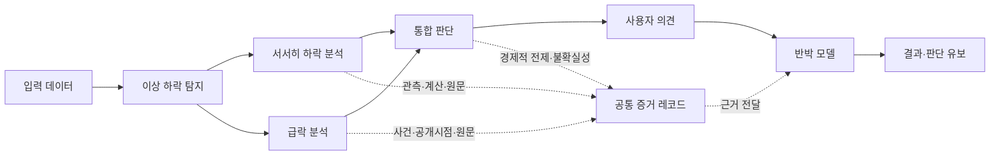

# FDS 전체 UI/UX 재설계안

작성일: 2026-10-22 · 상태: 사용자 검토용 설계 제안 / 구현 승인 전

프로젝트명: **기업가치 훼손위험 탐지 및 검증 시스템**

## 0. 이번 산출물과 경계

이 문서는 A. 전체 사이트 UI/UX 설계안과 B. 프로젝트 개요·DuPont의 구체적인 새 배치를 함께 제시한다. 이번 작업은 문서 작성만 수행한다. 기존 UI·CSS·계산·데이터 처리·출처 추적 코드는 수정하지 않는다. 아래의 신규 화면, 모형 계산, 상호작용, 제안 상태 모델은 구현 완료 기능이 아니다.

기존의 분기 관계, 공시 시점 선택, PIT 제한, 수식·CSV·계정·보고서 연결, 키보드 선택, 동작 줄이기 기능은 재사용 대상으로 보존한다. 기존 레이아웃을 보존해야 한다는 뜻은 아니다. 설계 승인 전 구현·패키지 추가·Drive OAuth·자동 동기화·DB 반영·AWS 배포를 시작하지 않는다.

---

# A. 전체 사이트 UI/UX 설계

## 1. 확인한 근거와 확인하지 않은 범위

### 1.1 읽은 자료

| 근거 | 실제 확인 내용 | 설계에 반영할 사항 |
|---|---|---|
| `G:\내 드라이브\skku_fds_main\기획PT\기획PT_261015.pdf` 전체 15쪽 | 텍스트 전체를 읽음. 2쪽 전체 흐름과 7쪽 Ohlson은 이미지로도 확인 | 분석 결과가 증거 레코드에 직접 연결되어야 함. 관측과 경제적 추론을 분리 |
| PT 2~3쪽 | 포트폴리오→탐지→분석→가치 관련성→증거→논리 구조화→검증·반론. 공통 증거 필드 | 첫 방문 설명과 전체 연구 작업공간을 분리. 문서·공개시점·원문 위치를 결과와 연결 |
| PT 4~8쪽 | 서서히 모델, CUSUM 후보, 재무 추세, F-Score, Ohlson, 첫 실험 범위 | 각 모형에 맞는 서로 다른 시각화. 실험 후보 파라미터를 확정 모수로 표시하지 않음 |
| PT 9~11쪽 | 급락·Event Study, AR/CAR, 공개시각·중첩 사건·회복·대안 설명 | 날짜와 사건의 관계를 주 화면으로 사용. 사건과 장기 가치훼손을 동일시하지 않음 |
| PT 12~15쪽 | Toulmin, Warrant, 반대 근거, 유보, 연구 병목 | 반박 화면을 채팅 결과가 아닌 주장·전제·증거의 관계 탐색으로 설계 |
| `docs/WORK_STATUS.md` | 기존 코드·실행 주소·확인한 데이터 경로·검증 범위·표시 정책 | 이미 조사한 경로와 기능 재사용. 이번에 전체 파일을 다시 분석하지 않음 |
| 앞선 작업에서 읽은 감사 보고서·판정 기준·검증 요약 | 전체 상태 REVIEW, 검사 차원별 PASS, 우전 오류 영향값 제외, 의미 미확정·원문 경로 미확인 | 값·출처·산식·회계 의미의 상태를 분리. 최종 승인 데이터로 포장하지 않음 |
| 현재 01·02·03·08·25·26 및 기업 매핑 구조의 기존 확인 기록 | 실제 헤더, 명시적 fact_id·접수번호, 계산 변수와 공시 이용 가능일 | 표시 항목은 실제 컬럼에 연결. 필요한 새 연구 입력은 기존 데이터와 별도로 명시 |

기획 PT의 제목은 별도 연구 브리핑 명칭이다. 제품명은 사용자가 지정한 이름을 유지한다. PT 2쪽의 8개 설명 상자를 그대로 웹에 옮기지 않는다. 최근 사용자 요구에 따라 금융분석을 서서히/급락으로 분기하고 통합 판단으로 합류시키며, PT의 가치 관련성·증거 생성·판단 수정 요구를 해당 단계 안에 배치한다.

### 1.2 재사용할 실제 자료 위치

기준 루트: `G:\내 드라이브\skku_fds_main`

- 최종 CSV: `데이터\Open Dart\OpenDART_TTM_팀원전달_최종본(지해)\csv버전`.
- XML 사본·기존 검증: 위 폴더의 `검증·보완자료\공시원문` 및 검증 CSV.
- 별도 감사: `데이터\Open Dart\OpenDART_전수재검증_검토용(나현)`.
- API 원천: `데이터\Open Dart\OpenDART_보완통합본\04_전체원본계정_통합.csv`.
- 관련 기획: `기획PT\기획PT_261015.pdf`.

기존 읽기 전용 경로 어댑터를 재사용한다. G:를 운영 환경의 필수 경로로 고정하지 않는다. 파일 존재와 읽기 가능 여부는 내용·회계 의미 인증이 아니다. 이번에는 새로운 금융 데이터를 수집하거나 감사·금융 원본을 다시 생성하지 않는다.

### 1.3 현재 구현과 연구 입력을 구분

| 현재 확인된 재료/기능 | 아직 계산·인증된 결과로 취급할 수 없는 것 |
|---|---|
| 20개 기업 매핑, 공시 이벤트·재무 CSV, 일부 XML, 실제 감사 산출물 | 기업 전체 과거 이력·가격·회계 의미의 전수 인증 |
| 25번의 NOA·평균 NOA·PM·ATO·OpROA, 기존 TTM 연결 | 개별 산식 PASS를 전체 원천 PASS로 확대하는 판단 |
| 기존 series/lineage/evidence/reports/source-fact/xml API 및 PIT 제한 | 실제 기업의 검증 완료 CUSUM·AR/CAR·급락 경보 |
| 지배기업 귀속 자본·순이익 입력 일부 및 검토 상태 | Ohlson 가치 추정·기대 잔여이익·확정 자기자본비용 |
| F-Score의 이론적 조건과 설명 | 모든 기업·기간에 대해 검증된 9조건 점수 |
| 공통 증거·반박 모델의 기획 요구 | 자동 Warrant 검증·자동 반박·가치훼손 최종 분류 |

예시로 활용할 실제 관측 맥락은 기존 브라우저에서 확인한 **켐트로닉스(089010), CFS, 2019 Q3, 접수번호 20191113000024, 공시일 2019-11-13, 이용 가능일 2019-11-14**다. 해당 선택 범위에 실제 공시 이벤트 21개가 조회된 사실은 확인했다. 이는 재무금액의 의미 인증이나 전체 XML 확보율을 뜻하지 않는다. 표시되지 않은 corp_code·보고기간 날짜·장중 공개시각을 이 예시에서 추정하지 않는다.

## 2. 현재 화면이 비슷해진 구조적 원인

1. **읽는 순서가 항상 같다.** 큰 제목→조건 선택→큰 그래픽→반복 설명→출처로 이어져, 시각화의 종류를 바꿔도 같은 페이지처럼 보인다.
2. **주 시각화가 데이터 대신 이름을 담는다.** 흐름도는 단계 이름, DuPont은 변수 이름과 연결선이 대부분이다. 데이터가 바뀌어도 화면 면적·위치·형태가 크게 변하지 않는다.
3. **사실·계산·연구 상태가 같은 모양이다.** 현재 조회 가능한 공시와 미구현 탐지 단계가 비슷한 노드로 나와, 무엇을 실제로 탐색하는지 한눈에 구분하기 어렵다.
4. **상세가 계속 아래로 밀린다.** 스크롤 설명과 출처가 순차로 쌓여, 선택 결과를 원래 그래픽과 함께 비교하기 어렵다.
5. **미검증 값을 숨기자 주 그래픽도 약해졌다.** 실제 공시 날짜만 있는 세 줄은 시점 비교에는 유효하지만, 재무지표의 변화를 보여주는 그래프는 아니다.
6. **CSS로 해결하기 어려운 문제를 CSS로 보완했다.** 작은 글자·연한 선을 개선해도, 동일한 공간 배분과 정보의 도착 순서가 유지되었다.

해결 방향은 문장을 더 크게 만드는 것이 아니라 **사용자의 질문마다 다른 시각적 도구를 주고, 선택한 데이터와 그 근거를 같은 작업면에서 연결하는 것**이다.

## 3. 공통 경험과 정보 구조

### 3.1 상위 탐색

상단에는 6개 목적지만 두고 13개 화면을 모두 가로로 나열하지 않는다.

| 상위 목적지 | 내부 화면 |
|---|---|
| 프로젝트 | 프로젝트 개요 / 전체 분석 흐름 |
| 실제 기업 분석 | 기업별 통합 분석 |
| 금융모형 | DuPont / Ohlson / Piotroski F-Score / 서서히 하락 탐지 / 급락 분석 |
| 반박 모델 | 주장·전제·증거 탐색 |
| 데이터·근거 | 수집·처리 / 계보·공시 / 품질·검증 |
| 개발 현황 | 산출물·검증·연구 과제 |

개요는 처음 이해하는 화면, 전체 분석 흐름은 선택 기업의 작업 상태를 따라가는 화면이다. 두 화면에 같은 흐름도를 복제하지 않는다. DuPont은 서서히 하락 분석에서도 진입할 수 있으나 독립적인 분석 도구로 유지한다.

### 3.2 화면 간 유지하는 맥락

기업, CFS/OFS, 분석 기간, 기준일, 선택 관측 공시, 최초/정정 버전, 참고값 보기 여부를 유지한다. 모델별 설정은 별도 저장 대상으로 제안하며, 현재 저장 기능이 있다고 가정하지 않는다.

- 공시일, 회계기간, 이용 가능일은 각각 다른 필드다. 기준일은 PIT 필터다.
- 그래프의 재무 관측일은 이용 가능일을 기본으로 하고 회계기간을 Hover에 함께 표시한다. 회계기간 축으로 전환하면 별도 축 이름·PIT 제한을 유지한다.
- 다른 화면에서 돌아오면 선택 기업·시점과 키보드 초점을 복원한다.
- 과거 분석에서 미래 정정본을 자동 사용하지 않는다. 최초·정정 비교는 버전을 나란히 선택하는 별도 조작이다.
- 모든 차트가 한 Hover 이벤트에 무조건 반응하지 않는다. 사용자가 ‘같은 시점 비교’를 켠 분석 범위 안에서만 커서를 공유한다.

### 3.3 시각적 원칙

순백색 바탕, 명확한 검정·회색 계층, 블루 선택 상태를 사용한다. 재무성과의 좋고 나쁨과 데이터 검증 색은 같은 의미로 혼합하지 않는다. 색만으로 상태를 전달하지 않고 선 형태·기호·라벨을 함께 쓴다.

- 첫 화면의 핵심 조작 영역이 데스크톱에서 화면 면적의 절반 이상을 차지하도록 시안을 평가한다. 제목과 소개문만으로 첫 화면을 채우지 않는다.
- 설명은 축·분자·분모·사건·근거 옆에 붙인다. 같은 설명을 본문·Hover·패널에 반복하지 않는다.
- 주요 설명 14~16px, 본문 16px 수준을 출발점으로 잡고 실제 모바일 렌더링으로 조정한다. 핵심 사용법을 8~10px 텍스트에 의존하지 않는다.
- 흰 여백은 그룹 구분에만 사용한다. 스크롤 길이는 장면별 데이터 변화로 정당화해야 한다.
- 카드 그리드를 기본 컴포넌트로 삼지 않는다. 행렬·시간축·평면·계산 조립·문서 대조·관계 그래프를 각각 사용한다.
- 값이 없는 자리를 장식용 그래프·0·가상 기업값으로 채우지 않는다. 실제 컬럼·공시·검사 범위와 계산 구조를 보여준다.

### 3.4 데이터 표시 정책

아래는 화면의 상태 표현 제안이며, 실제 감사 결과를 새로 판정하는 알고리즘이 아니다.

| 구분 | 표시 | 금지 사항 |
|---|---|---|
| 출처·산식의 명시적 검사 확인 | ‘산식 확인’ 또는 ‘해당 검사 확인’과 근거 범위를 함께 표시 | ‘전체 검증 완료’로 축약하지 않음 |
| 원천 의미 REVIEW이지만 연결된 기록값 | 사용자가 여는 ‘검토용 관측값’에서 출처·검사 차원·위험을 표시 | 공식 결과·학습 승인본·투자 판단으로 승격하지 않음 |
| 확인된 오류 영향 또는 계산/합산 불일치 | 값 대신 제외 표식과 원인·영향 경로 | 대체금액 추정, 정상값처럼 그래프에 연결 |
| MISSING·미연결 | 빈 위치·단절·해당 없음의 이유를 구분 | 0 또는 직전 값으로 보간 |
| 연구 시나리오 | 실제 관측과 분리된 사용자 선택 모드, 가정·출처·계산 가능 범위 표시 | 미확보 입력에 자동 기본 숫자를 넣어 실제 분석처럼 표시 |

기본 화면의 참고값 보기 정책은 기존 v3의 명시적 선택 방식을 계승한다. **참고값을 면적·궤적·금액 시계열로 확장하는 안은 이번 설계 제안이며 별도 사용자 승인과 차원별 검사 연결이 필요하다.** 승인 전에는 수치 그래프를 확정 구현하지 않는다.

‘확인 완료’는 검사 범위를 붙여서만 사용한다. 원문 셀 재현·산식 일치·PIT 검사·회계 의미는 별도 표시한다. 과거 CSV의 숫자를 API로 읽었다는 사실만으로 독립 감사의 해당 행 PASS를 부여하지 않는다. 감사 행은 기업·기간·CFS/OFS·fact_id 또는 계산 키가 정확히 대응할 때만 연결한다.

## 4. 화면별 설계: 13개 화면

### 4.1 프로젝트 개요 — 연구 시스템을 이해하는 입구

1. **목적:** 가격 탐지, 재무/사건 분석, 증거, 사용자 논리 검증이 어떻게 연결되는지 이해한다.
2. **첫 시각화:** 중앙의 분기형 연구 파이프라인. 단순 노드 열 대신 ‘입력 자료 묶음→분기별 분석 도구→공통 증거 레코드→주장 검토’가 서로 다른 형태로 나타난다. 모형 이름을 나열하는 대신 각 단계가 어떤 데이터를 바꾸는지 보여준다.
3. **데이터 위치:** 노드 안에 긴 설명을 넣지 않는다. 실제 자료 종류는 입력면에, 선택한 기업·공시의 식별 정보는 증거면에, 단계 상태는 연결부에 붙인다. 켐트로닉스의 실제 문서 식별 정보로 한 경로를 따라갈 수 있게 제안한다.
4. **Hover:** 해당 자료가 통과하는 경로·사용 모형·결과의 출처 연결만 강조한다. 구현된 조회와 연구 예정 단계를 다른 선 형태로 구분한다.
5. **Click:** 단계 설명을 바꾸는 것에 더해 중앙 작업면이 그 단계의 데이터 표현으로 바뀐다. 서서히는 재무 변수 묶음, 급락은 사건 시간축, 증거는 레코드와 원문 식별 정보가 열린다.
6. **Scroll:** 4개 장면에서 입력 정렬→분기 분석→증거 생성→논리 검토로 화면의 자료 표현이 바뀐다. 선택 강조만 바뀌고 도형은 그대로인 장면은 만들지 않는다.
7. **구조 차이:** 큰 제목+정적인 지도+반복 설명 8개를 제거한다. 짧은 소개 다음 바로 조작 가능한 연구 작업면으로 진입한다. 분기와 합류는 유지한다.
8. **미검증 표현:** 실제 조회 자료, 참고 관측, 미구현 산출물을 명시적으로 분리한다. 예정 단계에는 출력 숫자를 만들지 않고 필요한 입력과 아직 생성되지 않은 증거 필드를 보여준다.

### 4.2 전체 분석 흐름 — 선택 기업의 작업과 증거를 따라가기

1. **목적:** 전체 프로젝트 설명과 달리, 선택한 기업·기준일의 어느 작업에 실제 입력·산출물이 있는지 추적한다.
2. **첫 시각화:** 좌측 입력·가운데 서서히/급락 병렬 작업·우측 공통 증거와 논증 단계가 있는 작업 그래프. 상단에는 선택 기업과 기준일, 하단에는 선택 경로의 증거 레코드 필드가 붙는다.
3. **데이터 위치:** 작업 노드에는 실제 산출물 유무와 버전만, 연결선에는 자료 종류만 표시한다. 공통 증거에는 PT 3쪽의 관측 사실·공개시점·경제적 전제·반대 근거·불확실성을 구분한다. 이 스키마의 현재 DB 구현을 가정하지 않는다.
4. **Hover:** 결과를 선택했을 때 어떤 입력과 계산을 거쳤는지 역방향 경로를 밝힌다. 선 굵기는 금액이나 위험도로 오인되지 않게 고정한다.
5. **Click:** 특정 작업의 입력/출력 비교와 관련 전문 화면 진입을 제공한다. 빈 연구 노드는 ‘실행’ 대신 선행 조건을 표시한다.
6. **Scroll:** 그래프 전체를 계속 축소하지 않고 선택 경로를 펼친 뒤 증거 레코드→주장 검토로 작업면을 이동한다. 진행 상태는 데이터로만 바뀐다.
7. **구조 차이:** 프로젝트 개요의 소개·스토리 장면을 복제하지 않는다. 한 기업의 실제 연결 상태·막힌 입력·다음 검증 작업을 보여주는 탐색 화면이다.
8. **미검증 표현:** 연결 있음/검토 필요/산출물 없음/제외를 구분한다. 노드 수나 스크롤 진행률을 연구 완료율로 표시하지 않는다.

### 4.3 수정 DuPont — 수익성의 위치와 변화 원인을 함께 탐색

1. **목적:** 같은 OpROA가 이익률과 회전율의 어떤 조합인지, 선택 기간의 변화가 어떤 입력과 공시에 연결되는지 확인한다.
2. **첫 시각화:** ATO를 가로축, PM을 세로축으로 놓은 **수익성 평면**과 선택 시점 궤적. `OpROA = PM × ATO`는 그래픽을 조작하는 수식 헤더로 유지한다. 본문 대부분을 큰 변수 글자로 채우지 않는다.
3. **데이터 위치:** 선택 점에 기업·분기·이용 가능일을 붙이고, 하단의 세 정렬 시계열에서 같은 관측을 연결한다. 분자·분모·TTM 구성항은 해당 축을 선택할 때 같은 작업면에 전개한다. 출처는 아래 수평 근거 띠로 연결한다.
4. **Hover:** 한 점의 PM·ATO·OpROA, 상태, 공시 버전과 분자/분모를 함께 표시한다. 동일 OpROA 관계선을 강조하되 다른 점의 값을 변형하지 않는다.
5. **Click:** 점은 기준 시점을, PM/ATO는 분해 축과 입력 전개를 바꾼다. 두 시점 선택은 기존 대칭 변화 분해를 별도 설명으로 열고 실제 비교 공시를 연결한다.
6. **Scroll:** 위치/궤적→마진 경로→회전율·NOA 경로→공시 근거로 그래픽의 표현 자체가 바뀐다. 점과 출처의 동일 식별자는 유지한다.
7. **구조 차이:** 대형 수식+연결선+설명문을 기본 화면으로 쓰지 않는다. **데이터 위치·궤적을 주 그래픽으로**, 수식을 조작 도구로 바꾼다. 단순 선 그래프 3개와 숫자 카드로 대체하지 않는다.
8. **미검증 표현:** 허용된 참고 관측을 켠 경우에만 ‘검토용 관측’ 궤적을 표시한다. 제외/결측은 단절한다. 기본값 없는 상태에서는 실제 TTM 원천의 기간·접수번호와 기호형 분수 전개를 보여주고, 가짜 좌표·가짜 변화선을 그리지 않는다. 상세 배치는 B.2 참조.

### 4.4 Ohlson — 관측 회계 입력과 미래 가정의 경계

1. **목적:** 장부자본과 잔여이익의 관계를 이해하고, 실제 관측과 미래 가정을 구분한다. 자동 적정주가 화면으로 시작하지 않는다.
2. **첫 시각화:** 기간을 따라 배치한 자본 장부와 잔여이익 계산 다리. 과거 관측 구간은 실선, 미래 기대 구간은 분리된 가정 영역으로 표현한다.
3. **데이터 위치:** `RI_t = NI_t − r_e B_(t−1)`의 NI·기초 B는 원천 기간과 귀속 기준을 붙인다. `V_t = B_t + Σ E_t[RI_(t+τ)]/(1+r_e)^τ`는 관측·가정이 섞이지 않게 다른 영역에 둔다. 현재 ni_owner_ttm을 연간 NI와 무조건 동일시하지 않는다.
4. **Hover:** 순이익·기초 자본·자본비용·기대 잔여이익이 어떤 항인지와 해당 기간·출처·가정 상태를 보여준다.
5. **Click:** 자본/순이익은 원천으로, 미래 항은 가정 편집으로 이동한다. 자기자본비용·지속성은 사용자가 지정한 시나리오에서만 계산하고 출처 없는 기본값을 넣지 않는다.
6. **Scroll:** 기초 자본→순이익과 요구수익 차이→미래 기대와 할인→반대 근거·한계로 전개한다. 관측 구간을 스크롤로 미래 예측으로 바꾸지 않는다.
7. **구조 차이:** 잔여이익 공식 설명과 입력 금액 나열 대신, 기간과 귀속 기준이 연결된 회계 흐름을 보여준다. DuPont의 평면을 복제하지 않는다.
8. **미검증 표현:** CFS 귀속 입력의 의미 REVIEW와 clean surplus 등 가정 미확인을 표시한다. OFS에 지배기업 귀속 값을 대입하지 않는다. 필요한 입력이 없으면 미래 면적·가치·확률을 채우지 않는다. PT 7쪽의 이론적 관계와 실제 가치평가 구현을 구분한다.

### 4.5 Piotroski F-Score — 9조건 판정 매트릭스

1. **목적:** 총점보다 어떤 회계 신호가 개선/악화/미확인인지 확인한다.
2. **첫 시각화:** 세 영역(수익성·재무구조·운영효율)의 9행 × 비교 기간 열을 가진 판정 매트릭스. 색과 함께 충족·미충족·미확인·비적용 기호를 쓴다.
3. **데이터 위치:** PT 6쪽의 9조건을 각각 한 행에 둔다: ROA 양수, CFO 양수, ROA 개선, CFO/자산>ROA, 장기 레버리지 감소, 유동비율 개선, 신주 발행 없음, 매출총이익률 개선, 자산회전율 개선. 선택 셀 아래에 당기/전기 입력과 공시를 붙인다.
4. **Hover:** 조건식·두 기간의 값·판정 범위가 열린다. 0점과 결측을 같은 색으로 처리하지 않는다.
5. **Click:** 한 조건의 계정·분모·전기 비교·보고서 버전을 펼친다. 기간 열 선택으로 9개 조건의 같은 기간을 비교한다.
6. **Scroll:** 매트릭스 행/기간 헤더를 유지하면서 수익성→재무구조→효율의 입력 차이를 단계적으로 본다. 총점 카운트 애니메이션은 사용하지 않는다.
7. **구조 차이:** 9개 카드나 원형 점수계 대신 실제 판정 셀·비교 기간이 중심이다. **F-Score의 자산회전율과 DuPont의 NOA 기반 ATO를 같은 변수로 재사용하지 않는다.**
8. **미검증 표현:** 분모·연간/분기·누적·자산 평균·회계정책의 정의를 확정하기 전 자동 점수를 만들지 않는다. 모든 9조건이 필요한 검증 범위를 충족하지 않으면 0~9 확정 총점을 내지 않고 ‘확인 가능한 조건 수’를 별도로 표시한다.

### 4.6 서서히 하락 탐지 — 가격·잔차·누적 통계량의 동기화

1. **목적:** 지속적 이상 하락 신호가 어떤 잔차의 누적으로 생기는지 확인하고 재무 검토로 연결한다.
2. **첫 시각화:** 같은 날짜축을 쓰는 가격/기대수익 비교, 표준화 잔차, 하방 CUSUM의 3층 그래픽. 점진 하락 후보 구간은 여러 층을 관통하는 얇은 밴드로 표시한다.
3. **데이터 위치:** 종목·시장·업종 입력, 과거 추정 구간, 계수 버전, 잔차 z, C⁻, k/h, 보조 CAR의 위치를 분리한다. 확정된 모델 출력이 있을 때만 경보를 표시한다.
4. **Hover:** 한 날짜에서 실제 입력→기대수익→잔차→누적 통계량의 연결을 보여준다. 표준화와 날짜 정렬의 근거를 확인할 수 있다.
5. **Click:** 구간을 고정하면 같은 기간의 재무·Peer 검토로 이동한다. k/h 조정은 저장된 결과와 구분한 실험 미리보기이며 자동 최적화된 값처럼 표시하지 않는다.
6. **Scroll:** 시장·업종 조정→잔차의 음수 지속→누적→경보 후보와 오탐 검토 순서로 층을 활성화한다. 기존 선을 단순히 등장시키는 것으로 끝내지 않는다.
7. **구조 차이:** 일반적인 가격 선 그래프+설명 또는 가상 CUSUM 단독 실험을 실제 탐지 화면처럼 쓰지 않는다.
8. **미검증 표현:** 현재 실제 검증 출력이 미확보임을 표시한다. PT 5쪽의 252일·180일·k=0.25·h=5는 실험 후보다. 가상 잔차를 실제 기업 경보로 사용하지 않으며 수정주가·시장·업종 정렬이 없으면 관련 층을 계산 완료로 보이지 않는다.

### 4.7 급락 분석 — 최초 공개시점과 가격 반응의 대조

1. **목적:** 사건의 공개와 가격 반응을 날짜·시각 수준에서 비교하고 중첩 사건·대안 설명을 찾는다.
2. **첫 시각화:** 중앙 t=0 사건 축 위에 가격·거래량, 아래에 공시·뉴스·IR의 원문 표식과 AR/CAR 창을 배치한 사건 연구 작업면.
3. **데이터 위치:** 원문 공개시각/날짜, 실제 거래일, 사건창·추정창, 수정주가 여부, 모형 버전을 각 층에 붙인다. 단일 ‘공시일’로 모두 합치지 않는다.
4. **Hover:** 사건 제목·접수번호·공개 정밀도와 같은 시점의 가격·AR·CAR를 연동한다. 데이터가 없으면 그 항목의 부재 이유만 표시한다.
5. **Click:** 사건 후보를 바꾸면 t=0과 관련 문서·창을 변경한다. 창 조절은 기존 분석과 다른 시나리오로 표시하고 중첩 사건을 함께 남긴다.
6. **Scroll:** 반응 구간→최초 공개 근거→후속 공시·회복/지속→현금흐름·할인율·비정보성 설명으로 이동한다.
7. **구조 차이:** 주가 옆에 사건 카드를 나열하지 않는다. 사건의 시간 정밀도와 거래일 정렬이 시각화의 기준선이다.
8. **미검증 표현:** 장중 시각이 없으면 00:00을 만들지 않고 날짜 범위로 표시한다. 현재 AR/CAR·급락 판정이 검증된 것으로 그리지 않는다. 뉴스 존재나 반전 패턴만으로 가치훼손을 확정하지 않는다. PT 9~11쪽 반영.

### 4.8 실제 기업 분석 — 한 기업의 질문을 조립하는 분석 면

1. **목적:** 모형마다 오가며 잃는 맥락 없이 특정 기업의 가격·재무·사건·근거를 비교한다.
2. **첫 시각화:** 공통 시간 브러시와 사용자가 고른 2~3개 데이터 층. 가격·재무·공시가 각자의 단위·주기로 정렬되며 임의 종합 점수를 만들지 않는다.
3. **데이터 위치:** 기업 식별·기준일은 얇은 상단 맥락 줄에, 주요 관측은 해당 시간층에, 선택 시점의 공시 근거는 하단에 표시한다. 가격과 분기 재무를 같은 빈도로 보간하지 않는다.
4. **Hover:** 같은 이용 가능 시점의 관측과 관련 공시를 비교한다. 단위가 다른 값은 각 축을 유지한다.
5. **Click:** 질문(수익성/현금/사건)을 선택해 층을 추가·교체한다. 재무 포인트는 DuPont 등 전문 도구로 이어지고 돌아올 때 같은 시점을 유지한다.
6. **Scroll:** 기간 전체→선택 구간→해당 구간의 공시·대안 설명을 살펴본다. 아래로 갈수록 같은 차트를 반복 추가하지 않는다.
7. **구조 차이:** 8개 숫자 선택 카드와 차트 한 개를 번갈아 보는 방식에서, 질문에 맞는 서로 다른 자료를 정렬해 비교하는 방식으로 바꾼다.
8. **미검증 표현:** 각 층과 점의 상태를 개별 표시한다. 수정주가 미확인은 가격층, 계정 의미 REVIEW는 재무층에 붙인다. 한 기업 전체를 단일 초록색 ‘검증 완료’로 표시하지 않는다.

### 4.9 반박 모델 — 주장·전제·증거 관계 그래프

1. **목적:** 사용자의 결론보다 그 결론이 의존하는 사실·경제적 전제를 검토한다.
2. **첫 시각화:** Claim/Grounds/Warrant/Qualifier와 실제 Evidence를 연결한 논증 그래프. 지지·직접 충돌·전제 약화·근거 부족의 선 의미가 구분된다.
3. **데이터 위치:** 주장 문장은 논증 영역, 관측·인용은 증거 영역, 경제적 연결과 성립 조건은 중간 연결부에 둔다. PT 3쪽 공통 필드와 12~13쪽 논증 구조를 반영한다.
4. **Hover:** 특정 결론을 지탱하는 전제와 원문 범위를 함께 강조한다. 검색 점수와 주장 타당성을 혼합하지 않는다.
5. **Click:** 원문·인용 위치·공개시점 확인, 주장 구조 수정, 반대 근거 추가를 제공한다. 사용자가 입력한 주장과 모델이 제안한 해석의 작성 주체를 구분한다.
6. **Scroll:** 주장→암묵적 전제→증거 대조→반론 수용/판단 유보의 검토 단계를 본다. 기존 판단을 조용히 덮어쓰지 않고 변경 이유를 남긴다.
7. **구조 차이:** 일반 챗봇 답변이나 찬반 카드가 중심이 아니다. ‘어느 전제가 어떤 근거로 약해지는가’를 관계로 탐색한다.
8. **미검증 표현:** 현재 자동 관계 판정이 미구현임을 유지한다. 실제 문서 연결 없이 인용·관계 확률·판단을 생성하지 않는다. 예시 논리는 ‘PT의 설명용 문장’으로 분리하고 특정 기업의 실제 결론으로 붙이지 않는다.

### 4.10 데이터 수집 및 처리 과정 — 원본과 변환의 대조

1. **목적:** 어떤 출처가 어떤 변환을 거쳐 분석 입력이 되는지 재현 가능하게 이해한다.
2. **첫 시각화:** 원본 계정/누적 기간→분기 변환→TTM→이벤트→일별 전파의 변환 작업면. 선택 단계 앞뒤의 실제 행이 연결된다.
3. **데이터 위치:** 왼쪽 원본 행·가운데 변환식·오른쪽 결과 행의 비교는 이 화면에만 사용한다. 실제 헤더·단위·fact_id·버전·PIT가 행에 붙는다.
4. **Hover:** 누적 차감 또는 TTM 부호에 따라 어떤 원천 셀이 사용되는지 강조한다. 같은 값의 대체 근거를 두 번 합산하지 않는다.
5. **Click:** 파일과 변환을 고르면 그 기업·기간에서 가능한 실제 예시만 조회한다. 열은 원천 컬럼 설명과 사용 모형으로 연결한다.
6. **Scroll:** 원본→분기→TTM→이벤트→일별 전파의 차이를 따라가되 각 단계의 전후 행을 고정 비교할 수 있다.
7. **구조 차이:** 전체 흐름도만 반복하거나 CSV 목록을 먼저 제시하지 않는다. 사용자가 고른 실제 한 값의 변환 전후가 중심이다.
8. **미검증 표현:** 출처 형식 수정과 금액·회계 의미 수정을 분리한다. 검토용 수정 사본을 원본으로 대체하지 않는다. Drive 동기화 상태를 실제 구현 전 ‘연결됨’으로 표시하지 않는다.

### 4.11 데이터 계보 및 공시 근거 — 지표에서 문서 위치까지

1. **목적:** 한 관측의 계산 입력과 다대다 보고서 출처를 끝까지 추적한다.
2. **첫 시각화:** 결과→계산→원천 행→보고서의 계층 그래프와 선택 문서의 인용 위치. 원문 미확보 시 마지막으로 확인되는 계층을 표시한다.
3. **데이터 위치:** 노드에 변수·기간·상태, 엣지에 역할·부호·연결 방식, 문서면에 계정·표/행/열·단위·접수번호·공개일·이용 가능일을 둔다.
4. **Hover:** 해당 구성항의 조상·후손과 실제 원문 위치를 함께 강조한다. 원문 검색 일치를 회계 의미 PASS로 표시하지 않는다.
5. **Click:** 계산 항·대체 근거·공시 버전을 펼친다. TTM 원천 보고서 전체를 유지하며, 하나의 대표 보고서로 축약하지 않는다.
6. **Scroll:** 계산 계층을 내려가면서 현재 선택 경로와 문서 위치가 유지된다. 큰 그래프 축소만으로 모든 글자를 작게 만들지 않는다.
7. **구조 차이:** 항상 전체 그래프를 펼치는 모달 대신, 선택한 지표의 필요한 경로와 실제 문서를 대조하는 독립 작업면이다.
8. **미검증 표현:** 확정 fact_id/재현된 선택 규칙/API 후보/미연결을 다른 엣지로 표시한다. 로컬 원문이 없으면 실제 DART 링크와 미확보 사유를 제시한다. 회계기간·계정 ID를 추정하지 않는다.

### 4.12 데이터 품질 및 검증 상태 — 오류의 위치와 영향

1. **목적:** 전체 ‘통과율’보다 어느 검사에서 무엇이 확인되고 어떤 지표가 영향을 받는지 확인한다.
2. **첫 시각화:** 행에 기업·기간 또는 원천 묶음, 열에 식별자/날짜/PIT/셀 재현/산식/회계 의미를 둔 검사 매트릭스. 선택 오류의 영향 그래프를 함께 연다.
3. **데이터 위치:** 실제 감사 상태와 검사 대상 키·시각·범위를 셀에 연결한다. 상세에는 원천→파생 지표→영향 기간을 표시한다.
4. **Hover:** PASS의 정확한 범위와 검증 시각을 보여준다. 같은 개체에 대한 여러 검사 행 수를 데이터 개수로 오인하지 않게 한다.
5. **Click:** REVIEW·FAIL·MISSING·비적용 필터와 해당 검사 원본 행을 연다. 우전 오류는 대체금액 없이 영향 지표와 제외 사유로 보여준다.
6. **Scroll:** 검사 차원→개별 차이→파생 영향→미해결 작업으로 이동한다. 큰 초록 완료율을 반복하지 않는다.
7. **구조 차이:** 검증 건수 배지나 목록만 보던 화면을 검사 범위와 영향 관계 중심으로 바꾼다.
8. **미검증 표현:** 전역 상태 REVIEW를 유지하되 확인된 식별자·날짜 차원까지 숨기지 않는다. 감사 원본이 없거나 키 대응이 불명확하면 ‘미연결’이지 임의 PASS/FAIL이 아니다.

### 4.13 개발 현황 — 산출물과 완료 조건의 지도

1. **목적:** 현재 사용할 수 있는 기능, 필요한 입력, 연구 미확정 사항과 다음 검증을 구분한다.
2. **첫 시각화:** 모형·입력·검증·산출물의 의존 관계와 실제 테스트/문서/화면 증거를 연결한 납품 지도. 단순 프로젝트 진행률 대시보드가 아니다.
3. **데이터 위치:** 작업마다 구현 상태·실행 검증·데이터 검증·연구 승인 상태를 별도로 둔다. 최근 실행 시각과 당시 커밋/데이터 버전은 기록이 있는 경우에만 표시한다.
4. **Hover:** 해당 완료 주장에 대한 실제 테스트·산출물·제한을 보여준다. ‘구현됨’과 ‘데이터 검증 완료’를 혼합하지 않는다.
5. **Click:** 검증 기록·기능 화면·남은 입력·수용 조건으로 이동한다. 저장·수정 기능은 권한 설계 후 별도 승인한다.
6. **Scroll:** 사용 가능한 산출물→의존성이 막힌 작업→다음 수용 조건과 연구 결정으로 전개한다.
7. **구조 차이:** 상태 행과 임의 퍼센트 대신, 무엇이 있어야 다음 작업을 완료할 수 있는지 관계로 보여준다. 근거 없는 담당자·ETA를 채우지 않는다.
8. **미검증 표현:** 테스트를 실행하지 않았으면 ‘미실행’, 실패했으면 실패 원인, 과거 기록이면 당시 범위를 표시한다. 오래된 검증 JSON을 현재 실행 통과로 사용하지 않는다.

---

# B. 프로젝트 개요와 DuPont의 구체적 새 레이아웃

## B.1 프로젝트 개요: ‘단계 지도’에서 ‘연구 과정의 데이터 변환’으로

### B.1.1 첫 화면 구성

데스크톱 1440×1000을 첫 검토 크기로 제안한다. 아래 수치는 설계 출발점이며 실제 반응형 검증 결과가 아니다.

```text
┌───────────────────────────────────────────────────────────┐
│ 공통 탐색                           기업·기준일 맥락         │  약 64
├───────────────────────────────────────────────────────────┤
│ 시스템 목적 1줄          선택 사례 / 실제 자료·연구 상태 안내 │  약 80
├───────────────────────────────────────────────────────────┤
│                    중앙 연구 작업면                         │
│                                                           │
│ [입력 자료 묶음] → [이상 하락 탐지] ─┬─ [재무 분석] ─┐       │
│                                   └─ [사건 분석] ─┴─→     │
│ [통합 판단·가치 관련성] → [사용자 의견] → [반박 모델] → [결과] │
│                                                           │  약 480
│  공통 증거 레코드는 두 분석·통합 판단에서 반박 모델로 연결    │
│  선택 단계에 맞춰 ‘자료 묶음/기간/증거’의 내부 표현이 바뀜     │
├───────────────────────────────────────────────────────────┤
│ 현재 확인한 데이터 / 아직 필요한 입력 / 다음 검토 행동       │  약 160
└───────────────────────────────────────────────────────────┘
```

- 제목은 짧은 목적 문장으로 제한한다. 큰 제목 아래에 비슷한 소개문과 시작 버튼을 다시 쌓지 않는다.
- 도형은 의미에 따라 달라진다: 입력은 출처별 자료 표식, 분석은 사용 변수·기간, 증거는 구조화 필드, 논증은 주장과 전제 관계다. 모두 원형 버튼이나 동일한 사각형으로 만들지 않는다.
- 흐름 전체는 길을 잃지 않게 보이되, 선택한 부분이 작업면 면적을 더 차지하도록 확대한다. 글자를 계속 줄여 전체 구조를 맞추지 않는다.
- 연결선은 자료의 사용·전달을 뜻한다. 선 두께를 금액·중요도·위험 확률처럼 인코딩하지 않는다.
- 결과 단계는 단일 판정색 대신 관측/해석/미확인의 세 결과 종류를 구분한다. 자동 분류가 미구현이면 그 결과는 만들지 않는다.


주 경로와 증거 전달 경로는 다음처럼 구분한다. 점선은 추가 순차 단계가 아니라 근거 전달이다.



### B.1.2 네 장면의 실제 화면 변화

| 장면 | 작업면에서 바뀌는 것 | 실제 자료로 채울 수 있는 것 | 현재 만들지 않을 것 |
|---|---|---|---|
| 1. 같은 시점의 입력 | 출처 묶음이 공시 공개일·이용 가능일의 두 축으로 정렬 | 기업 식별, 01번 공시 제목·접수번호·날짜, CSV 역할 | 미확보 장중 공개시각, 수정주가 검증 완료 표시 |
| 2. 다른 분석 경로 | 두 분기가 각각 재무 변수와 사건 시간축으로 전개 | 25번 계산 구조, 02번 계정명, 실제 공시 날짜 | 검증된 CUSUM 경보·AR/CAR가 있는 것처럼 만든 궤적 |
| 3. 같은 증거 형식 | 선택 변수/공시가 공통 증거 레코드 필드에 연결 | 원천 fact_id·문서 식별·관측 시점·검사 범위 | 검증되지 않은 경제적 결론·가치훼손 확률 |
| 4. 논리 검토 | 증거와 사용자 주장·Warrant 사이의 관계를 탐색 | PT가 정의한 필드·검토 순서, 실제 연결 문서 | 자동 반박·최종 판단·매도 유도 결과 |

스크롤은 장면의 데이터 표현을 바꾸고, 클릭은 그 장면 안에서 자료/분기/근거를 바꾼다. Hover는 경로의 미리보기다. 스크롤 때문에 사용자가 고정한 기업·공시가 다른 사례로 바뀌어서는 안 된다.

### B.1.3 첫 방문과 재방문

- 처음에는 입력 장면에서 시작한다. 페이지 내 ‘실제 사례 따라가기’는 확인한 켐트로닉스 공시 맥락을 사용한다.
- 재방문에는 마지막 장면을 복원할 수 있지만 연구 모형을 자동 실행하지 않는다.
- 전체 분석 흐름 화면으로 이동하면 소개 장면이 아니라 해당 기업의 입력·산출물 존재 여부를 보게 한다.

### B.1.4 모바일

단순 축소하지 않는다. 상단에는 현재 위치와 분기 요약, 중앙에는 선택 장면의 데이터 표현, 하단에는 다음 검토 행동을 둔다. 분기 선택은 ‘서서히 / 급락’ 두 버튼과 같은 합류 지점을 함께 표시한다. 전체 지도는 보조 보기로 열고, 기본 화면에서 8개 작은 노드를 모두 읽게 하지 않는다. 스크롤 때 고정 영역은 화면 절반을 넘지 않도록 실제 시안에서 확인한다. 키보드/보조기술은 같은 순서의 단계 목록과 선택 상태를 이용한다.

### B.1.5 현재 구현 대비 제거/보존/신규

| 제거 또는 교체 | 보존 | 새로 구성 |
|---|---|---|
| 큰 두 줄 제목과 별도 설명의 넓은 면적 | 실제 사용자 지정 분석 순서 | 바로 조작하는 중앙 연구 작업면 |
| 동일 모양 노드와 아래 8개 반복 설명 | 서서히/급락 분기·합류 | 단계별로 다른 자료 표현과 4개 장면 |
| 선택 시 텍스트만 바뀌는 상세 스트립 | 클릭·Hover/focus·스크롤 상태 모델 | 자료 묶음→기간→증거 레코드의 변환 |
| 실제 데이터와 예정 연구를 같은 수준으로 표시 | 기존 조회·출처·PIT 제한 | 관측/연구/미확정의 명확한 시각적 구분 |

## B.2 DuPont: 수익성 평면 + 동일 시점 비교 + 계산 조립

### B.2.1 유지할 정의

```text
NOA_t   = assets_t − current_liabilities_t
avg_noa = (NOA_t + NOA_t_4q) / 2
PM      = operating_profit_ttm / sales_ttm
ATO     = sales_ttm / avg_noa
OpROA   = PM × ATO
```

평균 NOA는 당기와 전년 동분기의 NOA 평균이다. 총자산 평균으로 바꾸지 않는다. F-Score의 효율성 정의를 이 화면에 역으로 적용하지 않는다. 기존 CSV 결과를 UI에서 덮어쓰지 않는다.

### B.2.2 첫 화면 구성

```text
┌──────────────────────────────────────────────────────────────┐
│ 금융모형 / 수정 DuPont       기업 · CFS/OFS · 기간 · 기준일    │  약 100
├──────────────────────────────────────────────────────────────┤
│ OpROA = [PM] × [ATO]     선택 시점 · 버전 · 표시 정책          │  약 64
├──────────────────────────────────────────────────────────────┤
│ PM                                                         │
│ ↑       수익성 평면: 같은 시점의 PM과 ATO                    │
│ │       실제 관측/참고 상태의 선택 가능한 점과 기간 궤적      │
│ │       선택 OpROA 관계선 / 두 시점 비교                     │  약 440
│ └──────────────────────────────────────────────→ ATO        │
│ 축 선택 → 해당 분자·분모의 계산 전개가 같은 작업면에 나타남   │
├──────────────────────────────────────────────────────────────┤
│ PM ───────────── 같은 날짜축 · 선택 커서 ───────────────────  │
│ ATO ──────────────────────────────────────────────────────  │  약 140
│ OpROA ─────────────────────────────────────────────────────  │
├──────────────────────────────────────────────────────────────┤
│ 선택 입력 → CSV 컬럼 → fact_id → 보고서 → 원문 위치           │  약 140
└──────────────────────────────────────────────────────────────┘
```

첫 화면에서 숫자 카드·설명 사이드바는 두지 않는다. 설명은 선택한 축·구성항에 붙은 짧은 주석과 하단 근거 띠로 제공한다. 상세가 필요하면 **하단 계산 시트**를 열며 그래픽의 선택 맥락을 유지한다. 모든 항목을 처음부터 펼쳐 세로로 쌓지 않는다.

### B.2.3 데이터 인코딩과 계산 전개

- 가로 위치는 ATO(배), 세로 위치는 PM(%), 선택 점의 계산 결과는 OpROA(%)다. 점 크기는 금액이나 위험도로 쓰지 않는다. 동일 OpROA 관계선은 산술 관계를 설명할 뿐 적정·부실 경계선이 아니다.
- 궤적은 실제 관측 순서를 따른다. 공시 이용 가능일 간격과 최초·정정 버전을 Hover에 제공한다. 같은 회계기간의 정정 이벤트를 다른 독립 분기 실적으로 집계하지 않는다.
- PM<0, ATO<0 또는 비정상 분모를 한 사분면으로 숨기지 않는다. 부호는 유지하고, 분모 0·누락은 계산 불가로 분리한다. 축 범위가 달라지면 변경 사실을 알린다.
- PM 선택: 세로축과 이익률 경로가 주도권을 갖는다. 영업이익 TTM/매출 TTM이 분수로 펼쳐지고, 선택 TTM의 연간+누적−전년 동기 구성항과 실제 보고서가 이어진다.
- ATO 선택: 가로축과 회전율 경로가 주도권을 갖는다. 매출 TTM/평균 NOA가 펼쳐지고, 평균 NOA 아래 당기/전년 동분기 NOA와 총자산·유동부채를 연결한다.
- OpROA 선택: 평면의 위치와 두 축의 관계를 다시 본다. 큰 글자 세 개가 선택 상태만 바뀌는 화면으로 돌아가지 않는다.
- 두 시점 비교: 기존 대칭 분해 `ΔPM×평균 ATO + ΔATO×평균 PM`를 재사용하여 %p 기여를 구분한다. 불완전 입력이면 분해하지 않는다. 기여를 경제적 인과로 해석하지 않는다.

### B.2.4 상호작용 명세

| 조작 | 데이터/표현의 변화 | 유지해야 하는 것 |
|---|---|---|
| 점 Hover/focus | PM·ATO·OpROA·기간·이용 가능일·상태·같은 시점의 커서 | 다른 관측값과 기준일 |
| 점 Click/Enter | 기준 관측과 계산 입력·근거 보고서 변경 | 기업·재무제표·전체 분석 기간 |
| PM/ATO Click | 선택 축의 분수와 계정 전개, 해당 시계열·출처 강조 | 동일한 기준 관측 |
| 기간 브러시 | 표시 기간과 비교 가능한 실제 관측 범위 변경 | PIT 필터와 제외 상태 |
| 두 시점 선택 | 이동 경로와 기여 분해·두 버전의 출처 비교 | 원래 CSV 값 |
| 구성항 Click | 실제 컬럼·fact_id·계정·기간·보고서 목록 열기 | 계산의 부호·다대다 출처 |
| 공시 Click | 원문 위치 또는 공식 DART 열기 | 원래 선택과 돌아올 초점 |
| Scroll | 위치/변화→PM 경로→ATO/NOA 경로→원문 검토로 작업면 전환 | 선택 기업·시점·참고 정책 |

드래그가 어려운 사용자를 위해 기간 선택·앞/뒤 관측 버튼·동등한 관측 목록을 제공한다. Hover만으로 정보를 얻어야 하는 기능은 만들지 않는다.

### B.2.5 검토 상태에 따른 두 보기

**관계·출처 보기(기본):** 금융값의 의미가 미확정일 때도 비우지 않는다. 실제 분자/분모 정의, 선택 보고서의 기간 구성, 명시적 fact_id·부호·접수번호·이용 가능일을 조립형 계산 시트로 보여준다. 원천이 여러 개이면 실제 구성항 수와 역할이 드러난다. 좌표에 값이 없는 지점을 가짜 점이나 0으로 그리지 않는다.

**검토용 관측 보기(승인 후 구현 제안):** 기존 명시적 참고값 보기의 정책을 확장한다. 연결된 CSV 기록과 검사 차원을 함께 보여주고, 그래픽 전체에 REVIEW 상태를 유지한다. 오류 영향·산식/합산 불일치·결측은 각기 다른 제외 표식으로 남긴다. 원인 미확정 REVIEW를 정상 데이터로 채택하지 않는다. 원천 의미 전수 검증 완료 그래프와 시각적으로 구분한다.

이 두 보기를 ‘실데이터/데모’로 부르지 않는다. 둘 다 실제 자료에 근거하지만, 하나는 관계·출처이고 다른 하나는 검토 중 관측이다. 실험 수치가 필요하다면 별도의 명시적 수학 실험으로 분리하며 실제 기업 그래프와 겹치지 않는다.

### B.2.6 실제 사례의 화면 연결

기존 확인 사례인 켐트로닉스 CFS 2019 Q3를 고르면:

1. 현재 선택 공시는 `20191113000024`, 이용 가능일은 `2019-11-14`로 표시한다.
2. PM/ATO/OpROA의 같은 관측을 선택한다. 해당 값의 의미 인증 여부와 검사 범위는 별개다.
3. 매출 원천 중 기존에 확인한 `F030155`는 계정명·기간 구분·원천 컬럼·접수번호로 추적한다. 한 fact만으로 TTM 전체를 설명하지 않고 관련 구성항 전체를 이어 보여준다.
4. DART 보고서 제목·공시일·이용 가능일을 제공한다. 원문 회계기간 또는 계정 ID가 미확인이면 그대로 남긴다.
5. 특정 원천이 로컬 사본에 없으면 공식 링크로 이어진다. 원문 검색 결과를 보여주려면 실제 사본과 해시 대조가 먼저 필요하다.

금융값을 이 설계 문서에서 새로 계산하거나 샘플 숫자로 채우지 않는다.

### B.2.7 모바일 배치

한 화면에 평면·시계열·계보를 동시에 축소하지 않는다. 기본은 선택 시점과 평면 또는 관계 보기다. 아래의 ‘계산’, ‘시간’, ‘근거’ 동작으로 같은 관측의 작업면을 전환한다. 이는 모든 모형에 복제하는 카드 탭이 아니라 DuPont의 공간 제약을 해결하는 세부 탐색이다.

- 선택 관측은 항상 보인다. 앞/뒤 관측 이동은 터치·키보드로 가능하다.
- 긴 컬럼명은 계산 시트에서 줄바꿈하고 원천 근거에서 복사 가능하게 제안한다. 핵심 계정 설명을 9px로 줄이지 않는다.
- 분수/NOA 전개는 선택 깊이만 펼친다. 가로로 긴 전체 트리는 보조 보기로 둔다.
- 문서 근거는 하단 전체 화면 보기로 열고 닫으면 동일 관측으로 돌아간다.

### B.2.8 현재 구현 대비 제거/보존/신규

| 제거 또는 교체 | 보존 | 새로 구성 |
|---|---|---|
| 대형 변수 글자·선이 차지하는 주 화면 | `OpROA = PM × ATO`와 확정 NOA 정의 | 수익성 평면·기간 궤적과 선택 관계선 |
| 스크롤로 설명만 이어지는 장면 | 실제 스크롤 상태 변경·선택 이벤트 | 축과 계산 조립이 바뀌는 장면 |
| 공시 날짜 3줄을 재무값 그래프처럼 기대하게 하는 배치 | 실제 공시 시점·선택 상태 | 수치 보기와 공시 이벤트 보기의 구분 |
| 모든 원천을 긴 목록으로 아래 누적 | 명시적 fact_id·PIT·다대다 출처 | 하단 계산 시트·같은 시점 비교·선택 근거 띠 |
| 숫자 카드 또는 오른쪽 설명 패널 중심 배치 | 참고값 정책·오류 차단·결측 구분 | 선택한 데이터 위치에서 근거까지 이어지는 탐색 |

---

## 5. 구현 가능성·재사용 경계

### 5.1 기존 기능을 재사용할 부분

- 기업·기간 조회: 기존 catalog/series 조회와 기준일 제한.
- DuPont·TTM: 기존 lineage/evidence 계산과 명시적 fact_id, 기존 대칭 분해.
- 보고서·계정·문서: 기존 reports/source-fact/xml 및 보고서 메타데이터·해시 확인.
- 스키마·품질: 기존 schema/column/pipeline-quality/quarter-compare와 실제 감사 산출물.
- 키보드·동작 줄이기·원래 화면으로 복귀: 기존 동작을 기능 계약으로 보존.

새 그림을 만들기 위해 금융 계산을 프런트엔드에 복제하지 않는다. API에서 연결한 실제 값과 상태를 시각화용으로 변환하는 계층만 설계 대상으로 삼는다. 새 API·상태 필드가 필요하면 명세를 먼저 제시한다.

### 5.2 신규 연구/데이터가 필요한 부분

CUSUM·AR/CAR·사건 최초 시각·F-Score 완전한 입력·Ohlson 기간 정렬 및 미래 가정·Peer·Warrant 검증은 화면 설계와 별개다. 각 모형의 입력과 산출물 버전이 확인되기 전에는 동작하는 연구 결과처럼 발표하지 않는다. PT 3쪽의 공통 Evidence Record는 제안 계약이며 현재 DB에 모두 저장되어 있다고 가정하지 않는다.

기존 감사의 이전 절대경로, 미확보 원문 기간, 후보 계정 ID는 새 UI가 해결한 것처럼 표시하지 않는다. 의미 판단·데이터 교체·인증·대규모 구조 변경이 필요하면 해당 작업을 분리하고 PAUSE한다.

### 5.3 구현 승인 이후의 순서 제안

1. 이 문서의 전체 정보 구조와 두 기준 화면 배치를 사용자 검토로 확정.
2. 레이아웃 시안에서 첫 화면의 시각화 비중, 실제 조작, 미검증 보기를 확인. 구현 코드 수정은 이 승인 후에만 시작.
3. 개요의 중앙 작업면과 DuPont의 관계/출처 보기를 먼저 구현. 참고값 평면·시계열 확장은 표시 정책을 별도 확인.
4. 두 기준 화면에서 실제 기업·기간·공시·키보드·모바일·동작 줄이기를 검증하고 승인 대기.
5. 승인된 공통 탐색·상태 표현만 재사용하여 다른 모형을 각자의 시각화로 구현. 동일한 화면 틀을 복제하지 않음.

## 6. 승인 판단용 수용 기준

- 제목·본문을 가려도 개요/평면/행렬/사건/논증/문서 대조가 서로 다른 도구로 보이는가?
- 개요의 두 분석 분기와 합류가 이해되며, 실제 자료와 예정 산출물이 구분되는가?
- 개요 스크롤은 도형·자료 표현을 바꾸고, 클릭은 실제 탐색 내용을 바꾸는가?
- DuPont은 큰 글자 자체가 아니라 같은 시점의 데이터 관계와 계산 전개가 중심인가?
- 선택한 관측에서 원천 계정·보고서까지 맥락을 잃지 않고 도달하는가?
- 결측·오류 제외·검토용 관측·확인된 검사 범위가 각각 구분되는가?
- 모바일에서 전체 그래픽을 작은 글자로 축소하지 않고 같은 작업을 완료할 수 있는가?
- 키보드와 동작 감소에서도 원문 추적까지 동등하게 이용할 수 있는가?
- 실제 미구현 모형을 설명용 수치로 채워 구현된 것처럼 보이지 않는가?

## 7. 사용자 검토가 필요한 설계 결정

1. **개요:** 기존 단계 지도 대신 자료의 표현이 변하는 4장면 작업면을 기준으로 삼을지.
2. **DuPont:** 수익성 평면+같은 시점 비교+하단 계산 시트를 기본 구조로 삼을지.
3. **표시 정책:** 기본 관계/출처 보기와 명시적 선택에 의한 검토용 관측 그래프를 분리할지. 금융값의 회계 의미 승인과는 다른 화면 설계 결정이다.
4. **확장:** 13개 화면의 독립적인 시각화와 6개 상위 탐색 구조를 채택할지.

**현재 단계는 문서 검토 대기다. 승인 전 UI 구현을 시작하지 않는다.**
